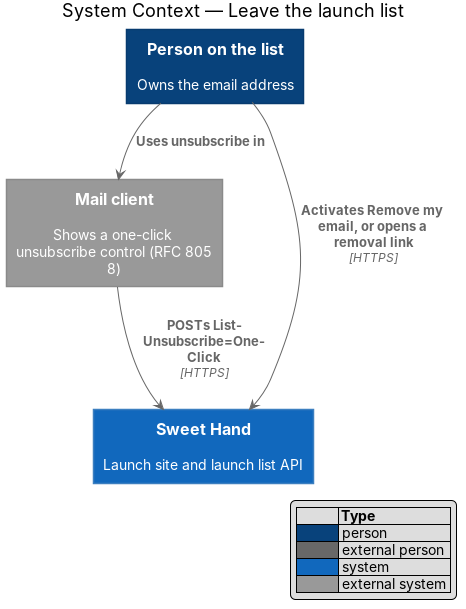
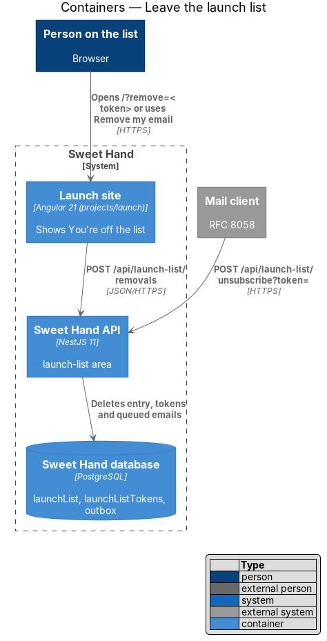
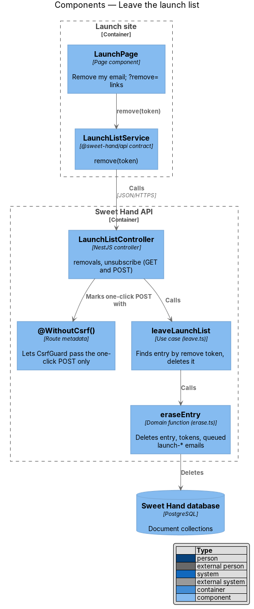
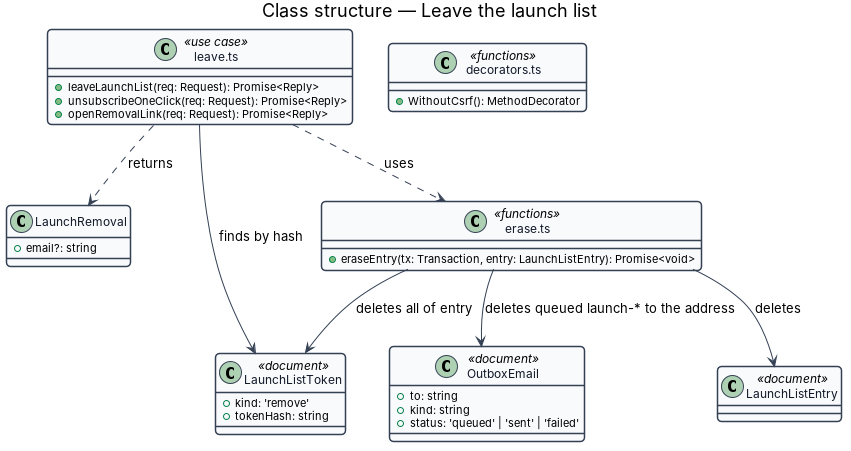
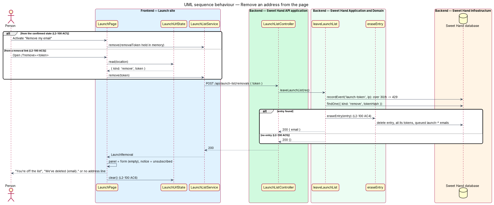
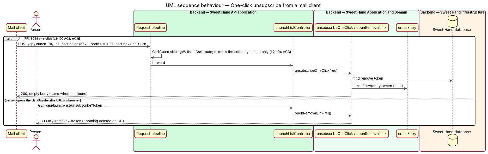

# Leave the launch list

## Overview

A person on the launch list can leave it in one click, without signing in and without a confirmation step (`L2-100`). Leaving deletes the entry rather than flagging it. Canada's Anti-Spam Legislation (CASL) requires a working unsubscribe mechanism in every commercial email, and the mail clients that support RFC 8058 offer their own one-click control. The mock state is `unsubscribed` in `docs/mocks/pages/launch/`.

> **removal token** — token of kind `remove` that lets its holder delete one launch list entry; it stays valid until the entry is deleted

> **removal link** — URL carrying a removal token, in every launch list email and behind "Remove my email" on the confirmed page

> **one-click unsubscribe** — `POST` that a mail client sends to the `List-Unsubscribe` URL with the body `List-Unsubscribe=One-Click` (RFC 8058)

Three routes lead here. "Remove my email" on the confirmed page uses the removal token returned by the confirmation (feature `launch/confirm-launch-list-email`). A removal link opened in a browser lands on the launch site, which posts the token. A mail client's one-click control posts straight to the API. Each ends with the entry, its tokens and any queued launch email deleted at once.

## Description

**Removal links in emails**

- Each launch list email gets its own removal token, issued when the email is queued, because the stored hash of an earlier token cannot be turned back into a link. All of an entry's removal tokens stay valid until the entry is deleted.
- The email body links to `/api/launch-list/unsubscribe?token=<token>`. The email headers carry `List-Unsubscribe: <https://{site}/api/launch-list/unsubscribe?token=<token>>` and `List-Unsubscribe-Post: List-Unsubscribe=One-Click` (`L2-100 AC2`). The outbox email holds the URL in a `headers` field until it is sent. The email provider adapter behind `EmailGateway` passes the headers on; that adapter is `<TO SUPPLY>`.

**Frontend — Launch site**

- **`LaunchPage`** — "Remove my email" calls `LaunchListService.remove(removalToken)`. When `LaunchUrlState.read` returns a `remove` link, the page calls `remove(token)` after hydration (`L2-100 AC3`). The CSRF cookie is ensured first, as for sign-up.
  - On `LaunchRemoval`, it sets `panel` to `form` (empty, consent unticked) and `notice` to `unsubscribed`. An `sh-alert` (info, `role="status"`) reads "You’re off the list" and "We’ve deleted {email}." (`L2-100 AC1`, `L2-107 AC5`). With no `email` in the reply, the alert shows the title only (`L2-100 AC5`); that variant needs a mock.
  - It calls `LaunchUrlState.clear()` after a link-based removal (`L2-100 AC6`).
  - A later sign-up with the same address starts a new entry (`L2-100 AC7`).

**Backend — `backend/src/launch-list/`**

- **`LaunchListController`**:
  - `POST api/launch-list/removals` with `@UsePolicy(anonymous)` and `@MaxBody(4096)`, under the CSRF guard, calls `leaveLaunchList`.
  - `GET api/launch-list/unsubscribe` with `@UsePolicy(anonymous)` calls `openRemovalLink`. It deletes nothing, because link scanners fetch URLs, and replies HTTP 303 to `/?remove=<token>`. Before launch the launch site handles that address; after launch the product forwards it to its removal page (feature `launch/retire-launch-site`).
  - `POST api/launch-list/unsubscribe` with `@UsePolicy(anonymous)`, `@MaxBody(1024)` and `@WithoutCsrf()` calls `unsubscribeOneClick`. A mail client has no CSRF cookie, so this one route is exempt; it can only delete, and only the entry its token names (`L2-104 AC3`).
- **`@WithoutCsrf()`** — new decorator in `backend/src/http/nest/decorators.ts` that sets route metadata read by `CsrfGuard`. Only this route carries it.
- **`leave.ts`**:
  - `leaveLaunchList(req)` counts `launch-token` events for the hashed IP (above 30 in an hour: HTTP 429 with `Retry-After`, `L2-104 AC5`), finds the `remove` token by hash, and calls `eraseEntry`. It returns `ok({ email })` when an entry was deleted and `ok({})` when the token names no entry (`L2-100 AC5`).
  - `unsubscribeOneClick(req)` does the same with the token from the query string and returns HTTP 200 with no body in both cases.
- **`erase.ts`** — `eraseEntry(tx, entry)` deletes the `LaunchListEntry`, every `LaunchListToken` with its `entryId`, and every `queued` outbox email whose `to` is the entry's address and whose `kind` starts with `launch-`. It runs in the request's transaction, so no later email reaches the address (`L2-100 AC4`). Deleted data leaves backups within 35 days under `L2-072` and `privacy/delete-account`.

**Tests**

- `backend/test/launch-list/leave.test.ts`: removal by page token and by link token, unknown and repeated tokens, the one-click `POST` without a CSRF cookie, `GET` deleting nothing, and queued emails removed.
- `frontend/e2e/specs/launch/leave-launch-list.spec.ts`: the `unsubscribed` state from "Remove my email" and from `/?remove=`.

## Requirements

The feature realizes the following level-2 (L2) requirement from `docs/specs/L2.md`. It refines the level-1 (L1) requirement cited beside it. Requirement text is quoted from the specification, with *must* rendered as *shall*.

| L2 ID | Refines (L1) | Requirement |
|-------|--------------|-------------|
| `L2-100` | `L1-025` | A person shall be able to remove their address in one click, without signing in and without a confirmation step, from the confirmed page or from any email the launch list sends. Removal deletes the record. |

## Diagrams

### System context

The person leaves through the launch site or through their mail client's unsubscribe control. Both reach Sweet Hand directly.

### Containers

The launch site posts removals to the API. The mail client posts the one-click request to the API without the launch site.

### Components

`LaunchListController` maps the three routes to `leave.ts`, which calls `eraseEntry`. `@WithoutCsrf()` marks only the one-click route.

### Class structure

`eraseEntry` deletes the entry, all of its tokens and queued launch emails to the address. `LaunchRemoval` carries the deleted address when there was one.

### Behaviour — remove from the page

"Remove my email" and a removal link both post a removal token. The reply is HTTP 200 whether or not the token named an entry.

### Behaviour — one-click unsubscribe

A mail client's `POST` deletes the entry without a page. A browser `GET` on the same URL deletes nothing and redirects to `/?remove=<token>`.

