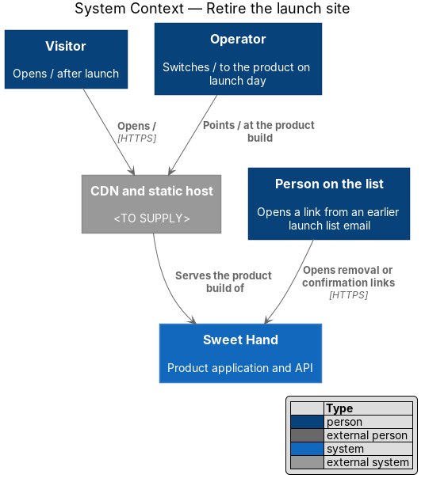
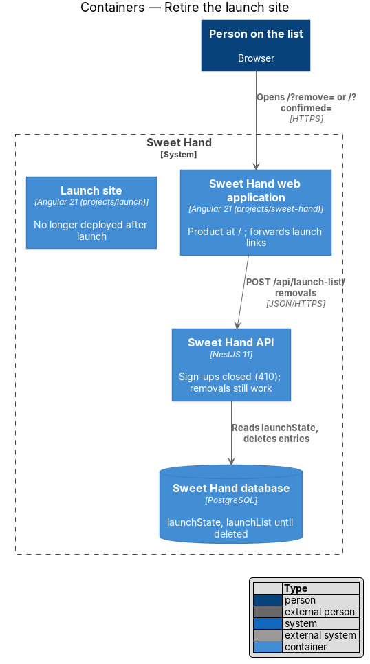
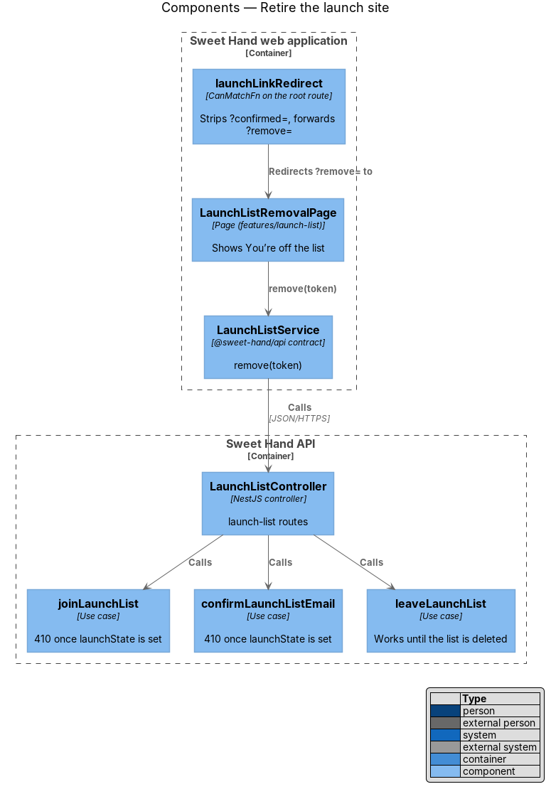
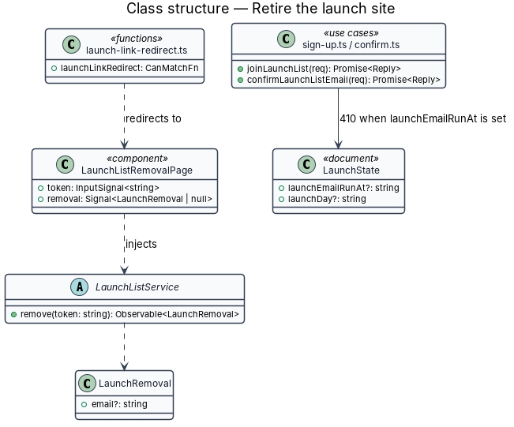
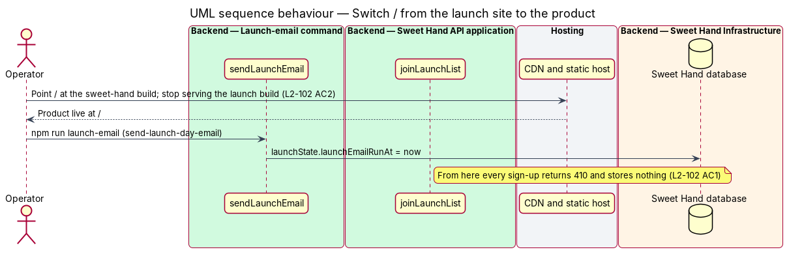
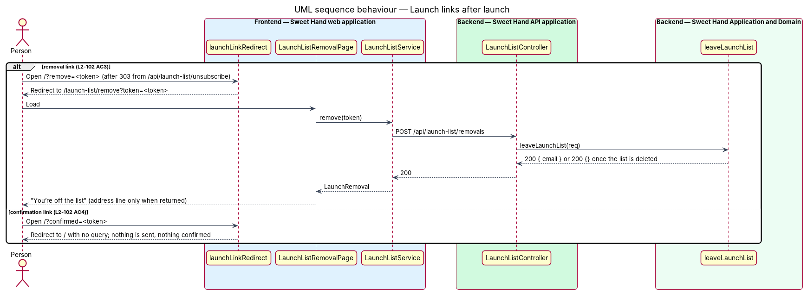

# Retire the launch site

## Overview

On launch day the product application replaces the launch site at `/` (`L2-102`). Sign-ups close, because the launch-day email has gone. Links already sent in launch list emails keep working: a removal link still deletes the entry until the list itself is deleted 30 days later, and a confirmation link lands on the product's home page without doing anything.

> **switch-over** — launch-day step in which the host stops serving the launch build at `/` and serves the product build instead

> **launch link** — URL from a launch list email: `/?confirmed=<token>`, `/?remove=<token>` or `/api/launch-list/unsubscribe?token=<token>`

The order on launch day is fixed. The operator first switches `/` to the product, so the launch-day email's links lead to a live product. The operator then runs the launch-email command (feature `launch/send-launch-day-email`), which records the launch and closes sign-ups.

## Description

**Hosting**

- The switch-over is a configuration change on the CDN and static host, `<TO SUPPLY>`: `/` and every product route serve the `sweet-hand` build, and the `launch` build is no longer published (`L2-102 AC2`). Requests under `/api/` keep reaching the Sweet Hand API.
- The `launch` project then has no consumer. It can be deleted from `frontend/angular.json`, `frontend/projects/launch/`, the CI jobs and `frontend/e2e/specs/launch/` without touching `projects/sweet-hand/`, because the product never imports it (`L2-102 AC5`, `L2-092 AC3`). The launch list API, `LaunchListService` and the product's removal page stay until the list is deleted.

**Backend — `backend/src/launch-list/`**

- `joinLaunchList` returns HTTP 410 and stores nothing once `LaunchState.launchEmailRunAt` is set (`L2-102 AC1`). `GET api/public/launch-list` reports `open: false`.
- `confirmLaunchListEmail` returns HTTP 410 once `launchEmailRunAt` is set, so no link confirms anything after launch (`L2-102 AC4`).
- `leaveLaunchList`, `unsubscribeOneClick` and `openRemovalLink` work unchanged until the sweep deletes the list (feature `launch/leave-launch-list`). After the deletion, every removal token is unknown and the reply is HTTP 200 with no address, so the page still says "You’re off the list" (`L2-102 AC3`).

**Frontend — Sweet Hand web application (`frontend/projects/sweet-hand/`)**

- **`launchLinkRedirect`** (`features/launch-list/launch-link-redirect.ts`) — `CanMatchFn` on the root route. With `?remove=<token>`, it returns a `UrlTree` to `/launch-list/remove?token=<token>`. With `?confirmed=<token>`, it returns a `UrlTree` to `/` without the query, so nothing is sent and no error shows (`L2-102 AC4`). With neither, it matches and the home page loads as usual.
- **`LaunchListRemovalPage`** (`features/launch-list/launch-list-removal-page.ts`, `.html`, `.css`) — route `/launch-list/remove`, `data.chrome: 'minimal'`, anonymous. It calls `LaunchListService.remove(token)` once on load, shows the `sh-alert` "You’re off the list" with "We’ve deleted {email}." when an address comes back, or the title alone when it does not, and clears the token with `Router.navigate` and `replaceUrl` (`L2-102 AC3`). The page needs a mock in `docs/mocks/pages/` before it is built.
- **`features/launch-list/providers.ts`** — registers `{ provide: LaunchListService, useClass: HttpLaunchListService }` for the area.
- Both pieces are removed in the same change that deletes the launch list API, after the sweep has deleted the list.

**Tests**

- `backend/test/launch-list/after-launch.test.ts`: 410 for sign-ups and confirmations after the launch-day run; removal still deleting; 200 with no address after the list is gone.
- `frontend/e2e/specs/launch-list/after-launch.spec.ts`: `/?remove=` and `/?confirmed=` on the product after the test-control API records a launch.

## Requirements

The feature realizes the following level-2 (L2) requirement from `docs/specs/L2.md`. It refines the level-1 (L1) requirement cited beside it. Requirement text is quoted from the specification, with *must* rendered as *shall*.

| L2 ID | Refines (L1) | Requirement |
|-------|--------------|-------------|
| `L2-102` | `L1-024` | On launch day the product replaces the launch site at `/`. Sign-ups close, and links already sent in launch list emails keep working until the list is deleted. |

## Diagrams

### System context

The operator points `/` at the product. Visitors then reach the product, and people with earlier launch links reach Sweet Hand through the same address.

### Containers

After launch the product application handles launch links and calls the API. The launch site is no longer deployed.

### Components

`launchLinkRedirect` sends removal links to `LaunchListRemovalPage` and drops confirmation links. The use cases close sign-ups and confirmations once the launch is recorded.

### Class structure

`LaunchState` decides whether sign-ups and confirmations are open. The product's removal page uses the same `LaunchListService` as the launch site.

### Behaviour — switch-over

The operator switches `/` to the product first, then runs the launch-email command, which closes sign-ups.

### Behaviour — launch links after launch

A removal link still deletes the entry through the product's removal page. A confirmation link lands on `/` and confirms nothing.

