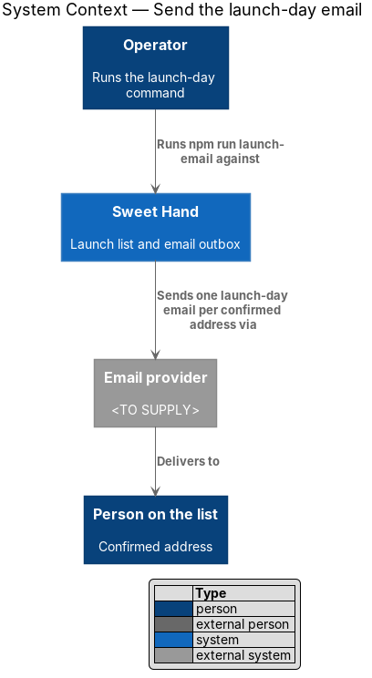
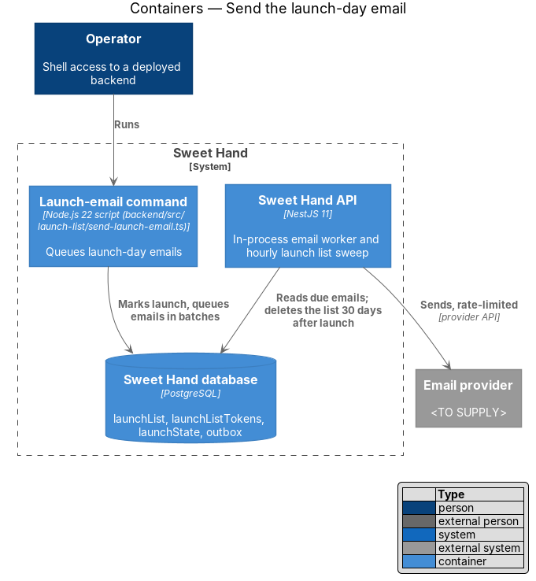
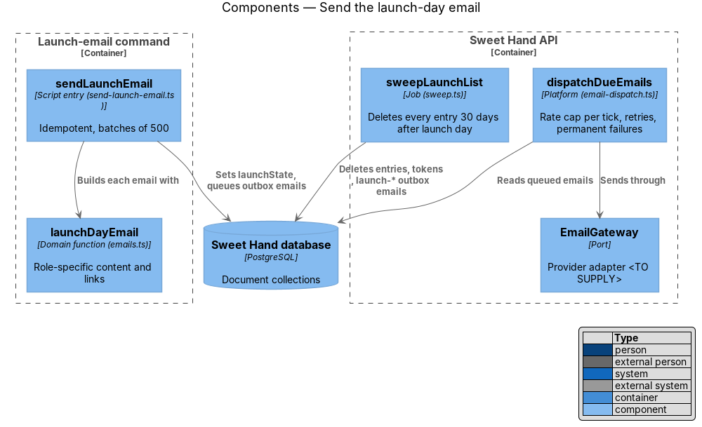
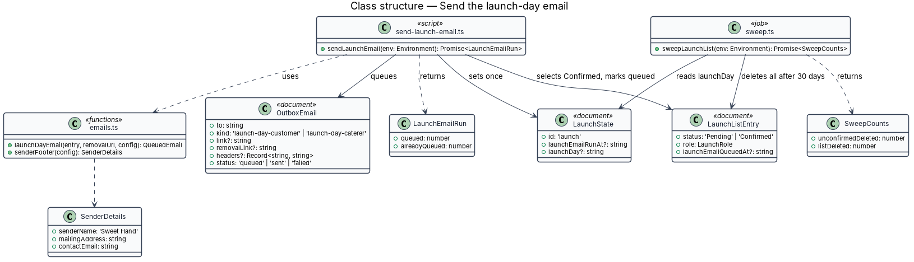
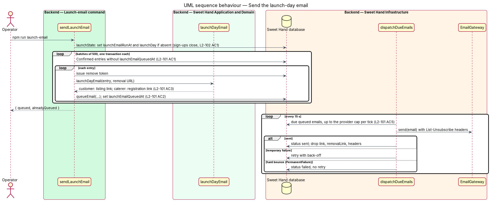
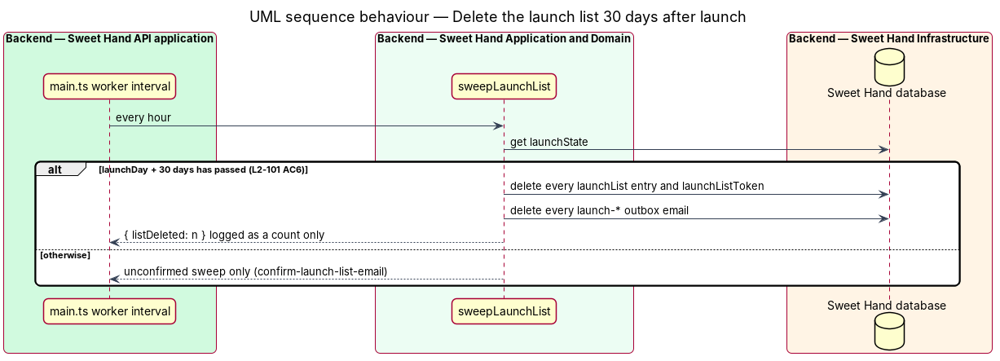

# Send the launch-day email

## Overview

The launch list exists for one email: the one that says Sweet Hand is open (`L2-101`, assumption A-8). On launch day an operator runs a command that queues exactly one email to each `Confirmed` entry. Thirty days later the whole list is deleted. The list is never used for anything else.

> **launch day** — date, in `America/Toronto`, on which the operator first runs the launch-email command

> **launch-email command** — explicit command-line run, `npm run launch-email` in `backend/`, with no web UI

> **launch-day email** — the email of kind `launch-day-customer` or `launch-day-caterer` that announces the opening

The command marks the launch, which closes sign-ups (feature `launch/retire-launch-site`), and queues the emails through the existing outbox. The in-process email worker sends them at the provider's pace, retrying temporary failures. The hourly sweep deletes every remaining entry 30 days after launch day.

## Description

**Backend — `backend/src/launch-list/`**

- **`send-launch-email.ts`** — script entry `sendLaunchEmail(env)`, wired as `"launch-email": "node --import @swc-node/register/esm-register src/launch-list/send-launch-email.ts"` in `backend/package.json`, beside `migrate` and `seed`. It connects to the database named by `DATABASE_URL`.
  1. In one transaction it reads `LaunchState` and, when `launchEmailRunAt` is empty, sets it to now and `launchDay` to today in `America/Toronto`. From this point sign-ups receive HTTP 410 (`L2-102 AC1`).
  2. It repeats, in one transaction per batch of 500, until no entry is left: select `Confirmed` entries with no `launchEmailQueuedAt`; for each, issue a `remove` token, build the email with `launchDayEmail`, `queueEmail` it, and set `launchEmailQueuedAt` (`L2-101 AC1`). `Pending` and removed addresses are never selected.
  3. It prints `{ queued, alreadyQueued }` and exits.
  Because each entry is marked in the same transaction that queues its email, a second run, or a run resumed after a crash, queues nothing twice (`L2-101 AC2`).
- **`emails.ts`** — `launchDayEmail(entry, removalUrl, config)` returns the outbox fields. Role `customer` gets kind `launch-day-customer` with a link to the caterer listing. Role `caterer` gets kind `launch-day-caterer` with a link to caterer registration and a line on the food handler certificate (`L2-101 AC3`). Every launch list email (confirmation, already on the list, launch day) ends with the footer from `senderFooter(config)`: sender name "Sweet Hand", the operator's mailing address, the contact address, a line saying the person asked for this on `{signedUpAt}` (shown in `America/Toronto`), and the removal link (`L2-101 AC4`). The mailing address and contact address come from configuration and are `<TO SUPPLY>`. The wording of each email needs a mock.
- **Never another use** — no other code path reads `launchList` for sending, joins it with `users`, or exports it. Caterers and third parties never receive it; only the email provider sees each address to deliver it (`L2-101 AC7`).

**Backend — `backend/src/platform/`**

- **`email-dispatch.ts`** — `dispatchDueEmails` gains three changes, which apply to every email kind:
  - a cap on emails sent per tick, from configuration, set to the provider's rate limit (`<TO SUPPLY>`) (`L2-101 AC5`);
  - on success it removes `removalLink` and `headers` as well as `link`, since each may hold a token;
  - when the gateway throws `PermanentFailure` (a hard bounce or rejected address), the email becomes `failed` at once with no retry. Temporary failures keep the existing back-off.
- **`AzureCommunicationEmailGateway`** — the provider adapter composes the launch templates, includes the CASL sender footer, passes `List-Unsubscribe` and `List-Unsubscribe-Post`, authenticates through managed identity and maps permanent provider refusals to `PermanentFailure`.

**Retention — `sweep.ts`**

- `sweepLaunchList(env)` runs every hour from the worker interval in `backend/src/main.ts`. Once the current date in `America/Toronto` is 30 days or more after `launchDay`, it deletes every `LaunchListEntry`, every `LaunchListToken` and every outbox email whose `kind` starts with `launch-`, and logs the count deleted (`L2-101 AC6`, `L2-073`). `LaunchState` stays, since it holds no personal data and keeps sign-ups closed. The unconfirmed-entry part of the sweep belongs to `launch/confirm-launch-list-email`.

**Tests**

- `backend/test/launch-list/send-launch-email.test.ts` calls `sendLaunchEmail` against the in-memory database: one email per `Confirmed` entry, none for `Pending`, role-specific links, no duplicates on a second run, the sign-up 410 afterwards, and deletion at 30 days with the fixed clock.

## Requirements

The feature realizes the following level-2 (L2) requirement from `docs/specs/L2.md`. It refines the level-1 (L1) requirement cited beside it. Requirement text is quoted from the specification, with *must* rendered as *shall*.

| L2 ID | Refines (L1) | Requirement |
|-------|--------------|-------------|
| `L2-101` | `L1-025` | On launch day an operator sends one email to each confirmed address. Thirty days later the whole list is deleted. The list is never used for anything else. |

## Diagrams

### System context

The operator runs the command. Sweet Hand sends one launch-day email to each confirmed person through the email provider.

### Containers

The launch-email command writes to the database only. The API's worker sends the queued emails and its sweep later deletes the list.

### Components

`sendLaunchEmail` builds each email with `launchDayEmail` and queues it. `dispatchDueEmails` sends through `EmailGateway`. `sweepLaunchList` deletes the list.

### Class structure

`LaunchState` records the launch. Each `LaunchListEntry` gains `launchEmailQueuedAt`, which makes the command idempotent.

### Behaviour — send

The command marks the launch, then queues emails in batches, marking each entry as it goes. The worker sends them at the provider's pace.

### Behaviour — delete the list

Thirty days after launch day, the hourly sweep deletes every entry, token and launch email.

