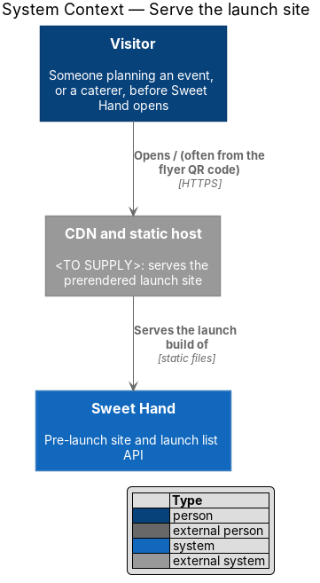
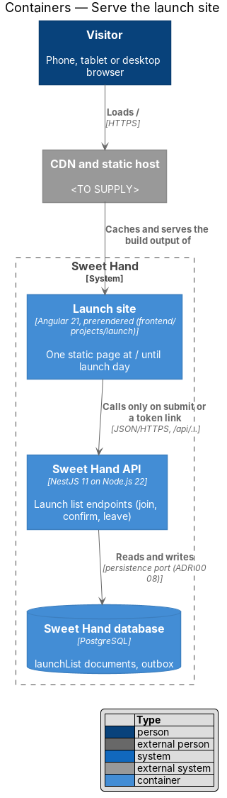
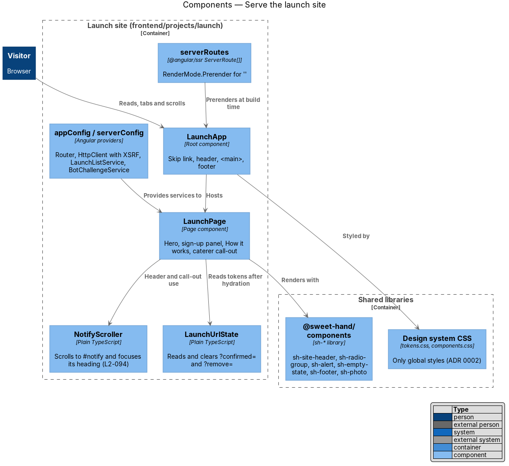
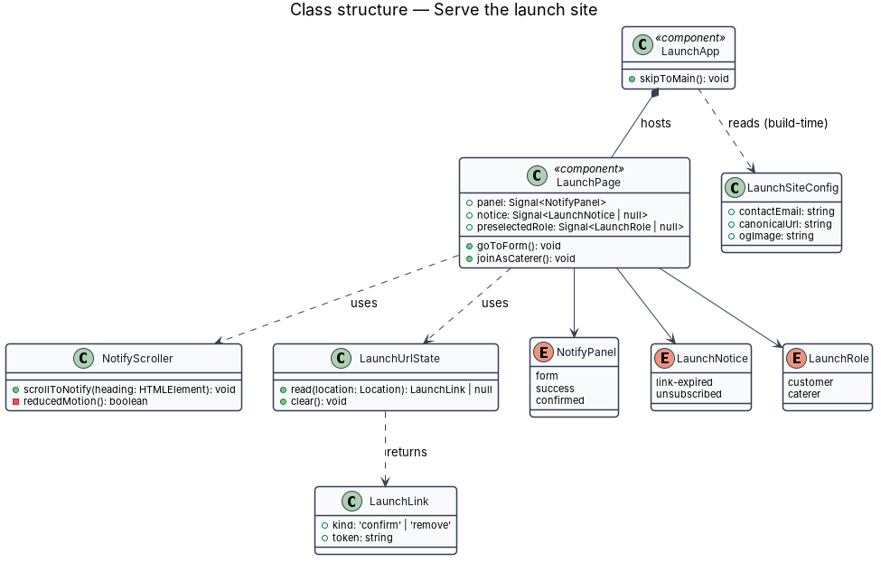
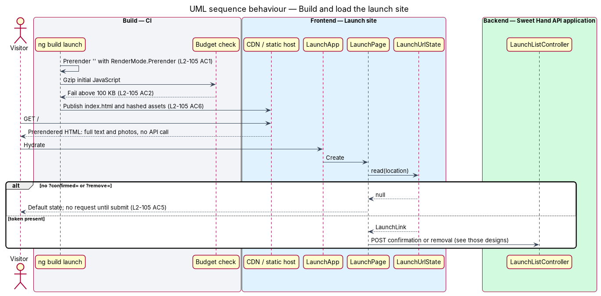
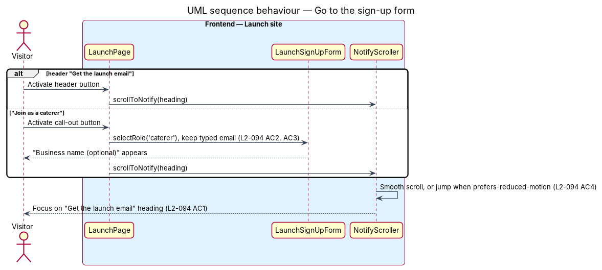

# Serve the launch site

## Overview

Sweet Hand opens to the public on a launch day that is still ahead. Until then, the home address of the platform shows a single page that says what Sweet Hand is and invites visitors to join a launch list (`L1-024`). The page is the design reference `docs/mocks/pages/launch/` in nine states.

> **launch site** — single-page Angular application served at `/` until launch day, separate from the product application

> **launch list** — set of email addresses whose owners asked for one email when Sweet Hand opens (assumption A-8)

> **sign-up panel** — section of the launch page with the heading "Get the launch email" that holds the sign-up form or a result in its place

> **prerendering** — rendering a route to static HTML at build time, so that the first paint needs no JavaScript and no API call

This feature covers the application itself: the workspace project, the page outside the form, prerendering, budgets, layout, translation readiness and accessibility. The form and its results belong to the sibling features `launch/join-launch-list`, `launch/confirm-launch-list-email` and `launch/leave-launch-list`. The launch-day email belongs to `launch/send-launch-day-email`, and the hand-over to the product on launch day belongs to `launch/retire-launch-site`.

## Description

The launch site is a new application project, `launch`, in the Angular workspace in `frontend/` (ADR 0001), beside `sweet-hand`, `components` and `api`. It imports `@sweet-hand/components` and `@sweet-hand/api` from source, the same way the product does. It imports nothing from `projects/sweet-hand/` (`L2-092 AC3`), so it carries its own small form helpers rather than the product's `core/forms`.

**Workspace — `frontend/angular.json`**

- **`launch` project** — `projectType: application`, `root: projects/launch`, with `build`, `serve`, `test`, `extract-i18n` and `lint` targets (`L2-092 AC1`). The `build` target uses the `@angular/build:application` builder with `outputMode: "static"` and `server: projects/launch/src/main.server.ts`, so the output is static files only. It adds `@angular/ssr` to `frontend/package.json` for build-time prerendering. Its `styles` are exactly `../docs/design-system/tokens/tokens.css` and `../docs/design-system/assets/components.css` (ADR 0002), and its `polyfills` hold `@angular/localize/init` (ADR 0005).
- **Budgets** — the `production` configuration sets an `initial` budget whose error threshold is the raw size equivalent of 100 KB gzip, `<TO SUPPLY>` once measured. Because Angular budgets measure raw bytes, CI also runs a short script that gzips the initial chunks of `dist/launch/browser` and fails above 100 KB (`L2-105 AC2`). A second CI step sums every file the first load of `/` transfers and fails above 350 KB (`L2-105 AC3`).
- **Lighthouse** — CI runs Lighthouse in mobile mode against the static build and fails below a performance score of 95, a Largest Contentful Paint above 2.0 s or a Cumulative Layout Shift above 0.05 (`L2-105 AC4`). The Lighthouse runner is the one chosen for `platform/deliver-fast-pages`, `<TO SUPPLY>`.

**Frontend — Launch site (`frontend/projects/launch/src/`)**

- **`main.ts` / `main.server.ts`** — browser and build-time bootstraps. `main.server.ts` exists only so the builder can prerender. No Node server is deployed.
- **`app/app.config.ts`** — `appConfig` with `provideRouter`, `provideClientHydration()`, `provideHttpClient(withFetch(), withXsrfConfiguration({ cookieName: 'XSRF-TOKEN', headerName: 'X-XSRF-TOKEN' }))`, `{ provide: LaunchListService, useClass: HttpLaunchListService }` and `{ provide: BotChallengeService, useClass: LocalBotChallengeService }` until a provider is chosen (`L2-092 AC4`).
- **`app/app.routes.server.ts`** — `serverRoutes: ServerRoute[] = [{ path: '', renderMode: RenderMode.Prerender }]`. It prerenders `/` only (`L2-105 AC1`).
- **`LaunchApp`** (`app/app.ts`, `.html`, `.css`) — root component. It renders the "Skip to main content" link, `sh-site-header` with the "Sweet Hand" wordmark and the "Get the launch email" button, `<main id="main">` holding `LaunchPage`, and `sh-footer` with the "Privacy" and "Contact" links (`L2-093`). The contact `mailto:` address and the privacy notice URL come from `LaunchSiteConfig` at build time (`L2-093 AC4`).
- **`LaunchPage`** (`app/launch-page/launch-page.ts`, `.html`, `.css`) — the page. It renders the hero (three decorative `sh-photo` images, the overline, the `h1` "Find someone with a sweet hand" and the subtitle), the sign-up panel, "How it works" with its three steps, and the caterer call-out (`L2-093 AC1`). It owns two signals: `panel` (`form`, `success` or `confirmed`) and `notice` (`link-expired`, `unsubscribed` or none). The panel content belongs to the sibling features. After hydration it asks `LaunchUrlState` for a token link, so that prerendered HTML never depends on a query string.
- **`NotifyScroller`** (`app/launch-page/notify-scroller.ts`) — plain TypeScript. `scrollToNotify(heading)` scrolls the sign-up panel into view with `behavior: 'smooth'`, or `'auto'` when `prefers-reduced-motion: reduce` matches (`L2-094 AC4`), then focuses the heading, which carries `tabindex="-1"` (`L2-094 AC1`). "Join as a caterer" first selects the caterer role on the form and keeps any typed email (`L2-094 AC2`, `L2-094 AC3`). A load at `/#notify` uses the browser's own fragment scrolling (`L2-094 AC5`).
- **`LaunchUrlState`** (`app/launch-page/launch-url-state.ts`) — plain TypeScript. `read(location)` returns `{ kind: 'confirm', token }` for `?confirmed=` and `{ kind: 'remove', token }` for `?remove=`, or `null`. `clear()` calls `history.replaceState` to drop the query string.
- **Head metadata** — the prerendered `index.html` carries `lang="en-CA"`, the `<title>` "Sweet Hand · Opening soon in Toronto and the GTA", a meta description, Open Graph title, description and image, and a canonical link to the site root (`L2-093 AC3`). The Open Graph image is `<TO SUPPLY>`.
- **Photos** — the four food photos come from the design reference (`docs/mocks/assets/img/`), are resized at build time to their displayed size at 2× density, served as AVIF or WebP no larger than 25 KB each, and carry `width`, `height` and `alt=""` (`L2-105 AC3`, `L2-107 AC4`). The call-out photo uses `loading="lazy"`. The resizing step is `<TO SUPPLY>`.

**Layout, theme and text**

- The page uses the mock's classes (`container--narrow`, `page-intro`, `well`, `grid--auto`, `section-gap`) from `components.css`, so it holds from 320 px to 2560 px with no horizontal scrolling (`L2-106 AC1`). `viewport-fit=cover` and padding from `env(safe-area-inset-*)` keep content clear of notches (`L2-106 AC2`).
- `tokens.css` switches between light and dark themes on `prefers-color-scheme` (`L2-106 AC5`).
- Every user-facing string carries an `i18n="@@launch.<key>"` ID, and the workspace ESLint i18n rule covers the project (`L2-106 AC6`). `ng extract-i18n launch` writes `projects/launch/src/locale/messages.xlf`.

**Accessibility**

- Focus order follows the reading order and the focus ring comes from the design system (`L2-107 AC2`). The hero photo row has `aria-hidden="true"` (`L2-107 AC4`).
- State announcements and focus moves of the sign-up panel are specified in the sibling features (`L2-107 AC5`, `L2-107 AC6`).

**Tests**

- Playwright specs live in `frontend/e2e/specs/launch/` with one page object, `frontend/e2e/pages/launch.page.ts` (`LaunchPage`), in Chromium only (`L2-092 AC6`, `L2-106 AC7`). `playwright.config.ts` gains a third `webServer` entry that serves the `launch` project on its own port (`E2E_LAUNCH_PORT`, default `<TO SUPPLY>`) with the same `/api` proxy. Each spec runs axe-core with WCAG 2.2 A and AA rules at XS and XL in both themes (`L2-107 AC1`).
- CI builds, lints and tests `launch` on every pull request. A change confined to `projects/launch/` leaves `ng build sweet-hand` output unchanged (`L2-092 AC7`).

**Hosting**

- The CDN and static host for the build output are `<TO SUPPLY>`. Hashed assets are served with `Cache-Control: public, max-age=31536000, immutable` and `index.html` with a CDN lifetime of 300 s or less (`L2-105 AC6`). Responses carry the headers of `L2-081`. Requests under `/api/` are routed to the Sweet Hand API on the same origin, so the XSRF cookie and same-origin policy hold.

## Requirements

The feature realizes the following level-2 (L2) requirements from `docs/specs/L2.md`. Each refines the level-1 (L1) requirement cited beside it. Requirement text is quoted from the specification, with *must* rendered as *shall*.

| L2 ID | Refines (L1) | Requirement |
|-------|--------------|-------------|
| `L2-092` | `L1-024` | The launch site shall be a separate, slim Angular application project in the existing workspace in `frontend/`. It shares the design system and libraries with the product but none of the product's pages, routes or services, and it builds, tests and deploys on its own. |
| `L2-093` | `L1-024` | The launch page shall show, in this order, a header, a hero, the "Get the launch email" section, "How it works", the caterer call-out and a footer, with the mock's copy and nothing else. |
| `L2-094` | `L1-024` | The header button and the caterer call-out shall bring the visitor to the sign-up form, and "Join as a caterer" shall start the form as a caterer. |
| `L2-105` | `L1-022` | The launch site shall be prerendered and small, so that it loads quickly on a phone on a slow mobile network, including from the QR code on the printed flyer. |
| `L2-106` | `L1-018` | The launch site shall work at every supported width, in both colour themes, and all its text shall be ready for translation (A-6). |
| `L2-107` | `L1-019` | The launch site shall meet WCAG 2.2 AA in every state, with the focus and announcement behaviour the mocks note. |

## Diagrams

### System context

A visitor reaches the launch site at `/`, often from the QR code on the printed flyer. A CDN and static host serve the prerendered build.

### Containers

The launch site is static files built from `frontend/projects/launch`. It calls the Sweet Hand API only when a visitor submits the form or opens a token link from an email.

### Components

`LaunchApp` hosts `LaunchPage`, which renders with `@sweet-hand/components` and uses `NotifyScroller` and `LaunchUrlState`. `serverRoutes` prerenders the single route at build time.

### Class structure

`LaunchPage` holds the panel and notice signals that the sibling features drive. `LaunchUrlState` turns the query string into a `LaunchLink`.

### Behaviour — build and load

CI prerenders `/`, enforces the JavaScript budget and publishes the build. A visitor's first load needs no API call. After hydration, the page checks for a token link.

### Behaviour — go to the sign-up form

The header button and "Join as a caterer" both scroll to the sign-up panel and focus its heading. "Join as a caterer" first selects the caterer role.

