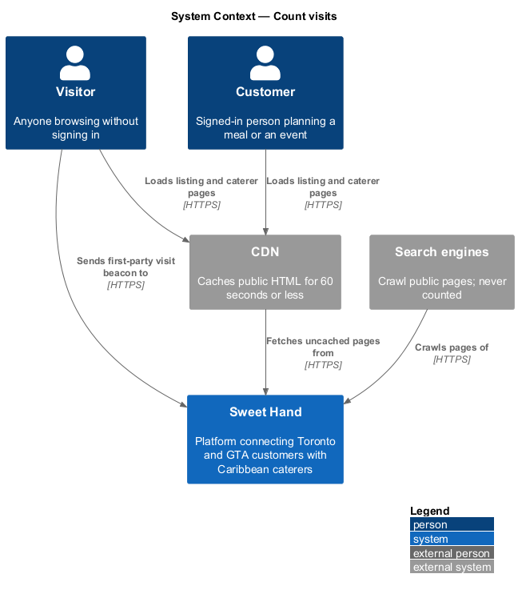
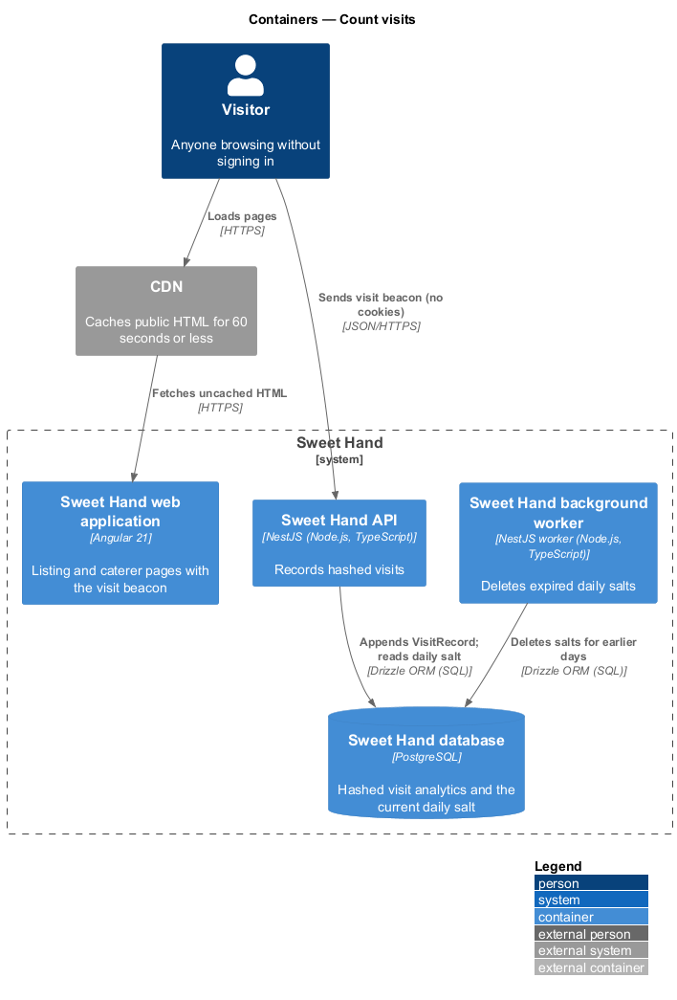
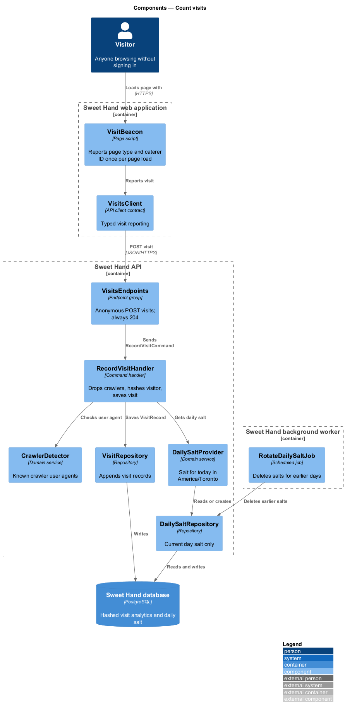
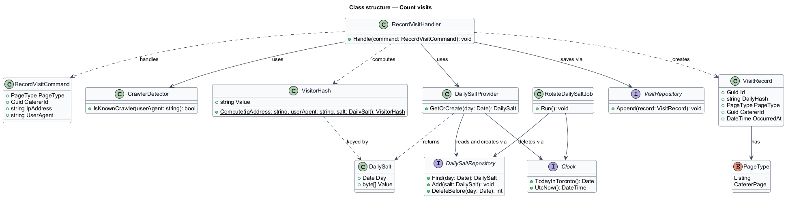
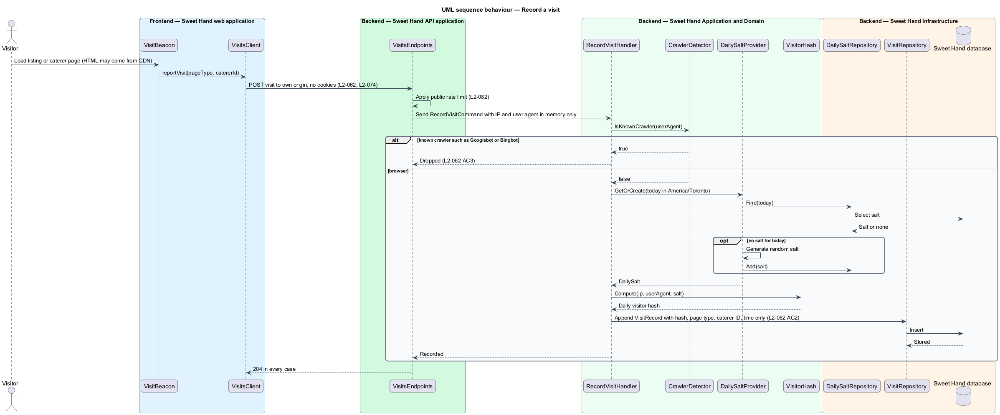
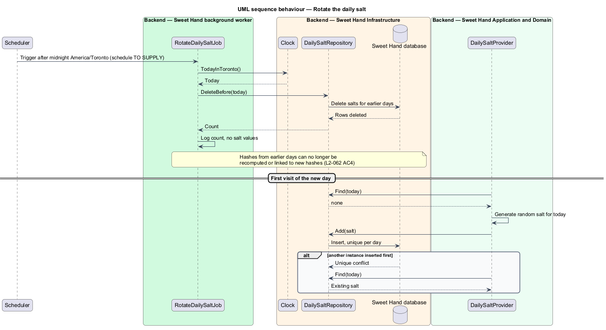

# Count visits

## Overview

Sweet Hand is a platform that connects people in Toronto and the Greater Toronto
Area (GTA) with caterers who sell Caribbean food. Operators need to see how the
platform is used over time (`L1-017`), and two of the figures they watch are
page visits and unique visitors. This feature records those visits.

Visits are counted inside the platform. No third-party analytics script runs,
and no cookie that needs consent is set (`L2-074`). Unique visitors are
estimated from a one-way hash of the IP address and user agent mixed with a
random value that changes every day. Because that value is discarded after its
day, a visitor counted on one day cannot be linked to the same visitor on the
next. Known crawlers are left out.

The feature sits in the metrics subsystem. It writes visit records. The
operator dashboard (`metrics/view-metrics-dashboard`) and the CSV export
(`metrics/export-metrics`) read them in aggregated form. Retention of visit
records (25 months) is enforced by the privacy subsystem (`L2-073`).

Terms used in this document:

- **visit** — one load of a listing page or caterer page by a browser that is not a known crawler
- **page type** — kind of page visited: `Listing` or `CatererPage`
- **daily salt** — random secret generated for one `America/Toronto` calendar day and deleted after it
- **visitor hash** — one-way keyed hash of IP address, user agent and daily salt, used only to count unique visitors within one day
- **visit beacon** — small first-party request the page sends once it has loaded, reporting the page type and caterer ID

## Description

Technology choices follow ADR 0001 (Angular 21) and ADR 0006 (NestJS on
Node.js, PostgreSQL through Drizzle ORM, S3-compatible object storage);
providers not named there remain `<TO SUPPLY>`. The components are named by
role.

Public pages are served through the CDN, which caches HTML for 60 seconds or
less (`L2-087 AC4`). A cached page never reaches the application servers, so
counting visits from HTML requests would miss cached views. The design
therefore counts visits from a first-party visit beacon that each page sends to
the Sweet Hand API. The beacon goes to the platform's own origin, carries no
cookie and no user ID, and is never cached.

Frontend — Sweet Hand web application:

- **`VisitBeacon`** — script included on the listing page and caterer page. After
  the page loads it sends one `POST` with `pageType` and, on a caterer page,
  `catererId`. It does not set or read cookies or browser storage. It uses a
  delivery mechanism that survives page unload; the mechanism is `<TO SUPPLY>`.
  The beacon is part of the first-load JavaScript budget (`L2-087 AC1`).
- **`VisitsClient`** — API client contract that `VisitBeacon` depends on.

Backend — Sweet Hand API application:

- **`VisitsEndpoints`** — anonymous endpoint `POST /visits`. Anonymous access is
  a deliberate choice: visitors who are not signed in shall be counted. The
  route shape is `<TO SUPPLY>`. The endpoint always answers HTTP 204, so it does
  not reveal whether a visit was counted. Public read rate limits
  (`L2-082 AC1`) apply.

Backend — Sweet Hand Application and Domain:

- **`RecordVisitCommand`** / **`RecordVisitHandler`** — carries the page type,
  optional caterer ID, IP address and user agent. The IP address and user agent
  exist only in memory for the length of the request. The handler asks
  `CrawlerDetector` whether the user agent is a known crawler and drops the
  visit if so (`L2-062 AC3`). Otherwise it gets the daily salt, builds a
  `VisitorHash`, and saves a `VisitRecord`. A caterer ID that does not belong to
  a `Published` caterer is dropped.
- **`CrawlerDetector`** — domain service that matches the user agent against a
  maintained list of known crawlers, including Googlebot and Bingbot. The list
  source and update process are `<TO SUPPLY>`.
- **`DailySaltProvider`** — returns the salt for today in `America/Toronto`.
  If none exists it generates a cryptographically random salt and stores it, so
  every API instance uses the same salt for the day. Salt length is
  `<TO SUPPLY>`.
- **`VisitorHash`** — value object. It is computed as a keyed one-way hash of
  the IP address and the full user agent, keyed by the daily salt. The hash
  algorithm is `<TO SUPPLY>`. Only the resulting hash is kept, never the inputs
  (`L2-062 AC2`).
- **`VisitRecord`** — entity holding exactly: `dailyHash`, `pageType`,
  `catererId` (or none) and `occurredAt` (UTC). It holds no raw IP address, no
  user agent string and no user ID (`L2-062 AC2`).

Backend — Sweet Hand Infrastructure:

- **`VisitRepository`** — appends visit records to the hashed visit analytics
  tables in the Sweet Hand database.
- **`DailySaltRepository`** — stores the salt for the current day only.
- **`Clock`** — current date in `America/Toronto` and current UTC time.

Backend — Sweet Hand background worker:

- **`RotateDailySaltJob`** — scheduled job that runs after midnight in
  `America/Toronto`. It deletes every salt for a day before today, so no stored
  salt can link hashes across days (`L2-062 AC4`). The exact schedule is
  `<TO SUPPLY>`.

Logging follows `L2-084`. Neither the request log nor the security log for the
visits endpoint records the raw IP address or the user agent. Visits from
signed-in users are counted the same way as anonymous visits, with no user ID.

## Requirements

The feature realizes the following level-2 (L2) requirements from
`docs/specs/L2.md`. Each refines the level-1 (L1) requirement cited beside it.
Requirement text is quoted from the specification, with *must* rendered as
*shall*.

| L2 ID | Refines (L1) | Requirement |
|-------|--------------|-------------|
| `L2-062` | `L1-017` | Visits shall be counted inside the platform without third-party analytics scripts and without cookies that need consent. Unique visitors are worked out from a hash of IP address and user agent with a salt that changes every day, and the raw IP address is never stored. Known bots and crawlers are left out. |

## Diagrams

### System context

Visitors and customers load pages through the CDN, and crawlers request pages
too. Only visits from browsers that are not known crawlers are recorded. No
third-party analytics system takes part.

### Containers

The page's visit beacon calls the Sweet Hand API, which writes hashed visit
records to the Sweet Hand database. The background worker deletes old daily
salts.

### Components

`VisitBeacon` calls `VisitsClient`. `VisitsEndpoints` dispatches
`RecordVisitCommand`, whose handler uses `CrawlerDetector` and
`DailySaltProvider` before saving a `VisitRecord`.

### Class structure

`RecordVisitHandler` builds a `VisitorHash` from the request and the daily salt
and saves a `VisitRecord` holding only the four permitted fields.

### Behaviour — record a visit

The beacon reports the page. The handler drops crawlers, hashes the visitor with
today's salt, and stores the visit without the raw inputs.

### Behaviour — rotate the daily salt

After midnight in `America/Toronto`, the worker deletes earlier salts. The
first visit of the new day causes a new salt to be generated.

