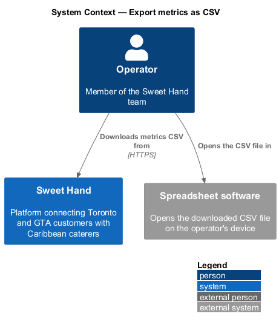
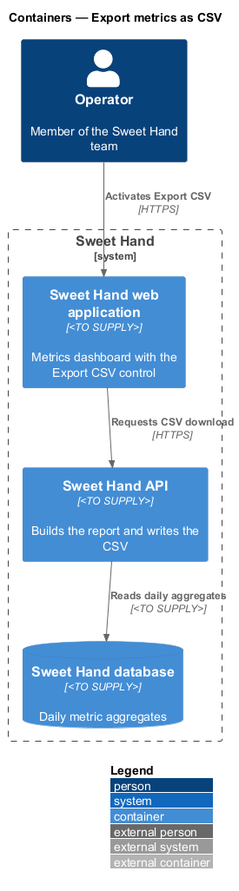
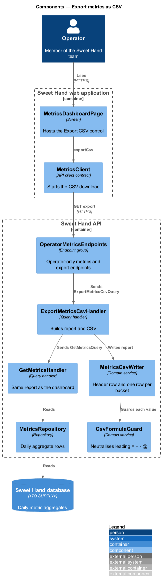
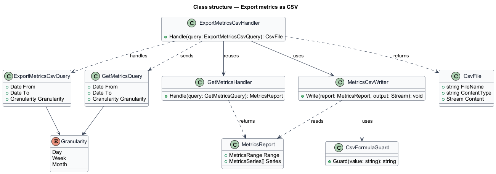
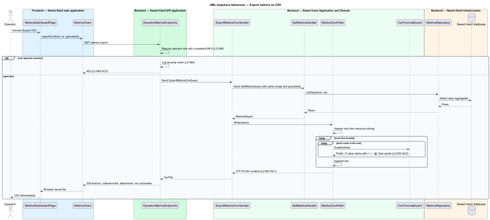

# Export metrics as CSV

## Overview

Sweet Hand is a platform that connects people in Toronto and the Greater Toronto
Area (GTA) with caterers who sell Caribbean food. Operators watch platform usage
on the metrics dashboard (`metrics/view-metrics-dashboard`). This feature lets an
operator take those same figures away as a comma-separated values (CSV) file,
for example to share with the rest of the team or to analyse in a spreadsheet.

The export uses the date range and granularity the operator has already chosen
on the dashboard. It produces one row per time bucket and one column per
metric. Because spreadsheet software can run a cell that starts with certain
characters as a formula, every value is written so that it cannot be run that
way.

The feature sits in the metrics subsystem and reuses the dashboard's query, so
the file and the screen always agree.

Terms used in this document:

- **CSV export** — UTF-8 text file with a header row and one row per time bucket holding every dashboard metric
- **formula injection** — attack in which a cell value starting with `=`, `+`, `-` or `@` is run as a formula when the file is opened in spreadsheet software
- **formula guard** — rule that rewrites a value starting with one of those characters so that it is read as text

## Description

Technology choices for every component below are `<TO SUPPLY>`, pending
architecture decision records in `docs/adr/`. The components are named by role.

Frontend — Sweet Hand web application:

- **`MetricsDashboardPage`** — hosts the "Export CSV" control. The control
  passes the current range and granularity from the URL to `MetricsClient`. A
  range over 24 months is already rejected on the page (`L2-061 AC2`), so the
  control is disabled while the range is invalid.
- **`MetricsClient`** — API client contract. `exportCsv(from, to, granularity)`
  starts a file download from the export endpoint.

Backend — Sweet Hand API application:

- **`OperatorMetricsEndpoints`** — adds
  `GET /operator/metrics/export.csv?from=&to=&granularity=`. The route shape is
  `<TO SUPPLY>`. The `RequestPipeline` requires an operator session that has
  completed multi-factor authentication (`L2-056`). A non-operator session
  receives HTTP 403 (`L2-063 AC3`) and the attempt is logged as a security event
  (`L2-056 AC3`, `L2-084`). The response sets
  `Content-Type: text/csv; charset=utf-8` and
  `Content-Disposition: attachment`. The file name pattern is `<TO SUPPLY>`.
  The response is marked not cacheable.

Backend — Sweet Hand Application and Domain:

- **`ExportMetricsCsvQuery`** / **`ExportMetricsCsvHandler`** — carries the range
  and granularity. The handler sends a `GetMetricsQuery` (defined in
  `metrics/view-metrics-dashboard`) to get the `MetricsReport`, then passes it
  to `MetricsCsvWriter`. Range validation is the same `MetricsRange` rule.
- **`MetricsCsvWriter`** — writes the header row and one row per `TimeBucket`
  (`L2-063 AC1`). The first column is the bucket start date in ISO 8601
  (`yyyy-MM-dd`). One column follows for each metric in `L2-061`, with caterer
  counts by status as one column per status. Header labels come from
  externalised resource strings (`L2-064`). Whether the file starts with a
  byte order mark is `<TO SUPPLY>`. The number format of the
  reply-within-48-hours share (fraction or percentage, decimal places) is
  `<TO SUPPLY>`.
- **`CsvFormulaGuard`** — applied to every value before writing. A value that
  starts with `=`, `+`, `-` or `@` is prefixed with a single quote (`'`)
  (`L2-063 AC2`). Every field is then quoted with double quotes, and embedded
  double quotes are doubled, as RFC 4180 describes. Whether tab and carriage
  return as leading characters are also guarded is `<TO SUPPLY>`; the design
  guards them as well, since spreadsheet software treats them the same way.

The export performs no write and changes no state. Exports are not listed among
the operator actions that `L2-060` requires in the audit log.

## Requirements

The feature realizes the following level-2 (L2) requirements from
`docs/specs/L2.md`. Each refines the level-1 (L1) requirement cited beside it.
Requirement text is quoted from the specification, with *must* rendered as
*shall*.

| L2 ID | Refines (L1) | Requirement |
|-------|--------------|-------------|
| `L2-063` | `L1-017` | An operator shall be able to download the metrics for the selected range and granularity as a CSV file. |

## Diagrams

### System context

An operator downloads the metrics file from Sweet Hand and opens it in
spreadsheet software outside the platform.

### Containers

The web application starts the download from the Sweet Hand API, which reads
the daily aggregates from the Sweet Hand database.

### Components

`OperatorMetricsEndpoints` dispatches `ExportMetricsCsvQuery`. Its handler reuses
`GetMetricsHandler` and writes the result through `MetricsCsvWriter` and
`CsvFormulaGuard`.

### Class structure

`ExportMetricsCsvHandler` depends on the dashboard query handler and on
`MetricsCsvWriter`, which uses `CsvFormulaGuard` for every value.

### Behaviour — export metrics as CSV

The API checks the operator role, builds the same report as the dashboard, and
streams a guarded UTF-8 CSV file.

