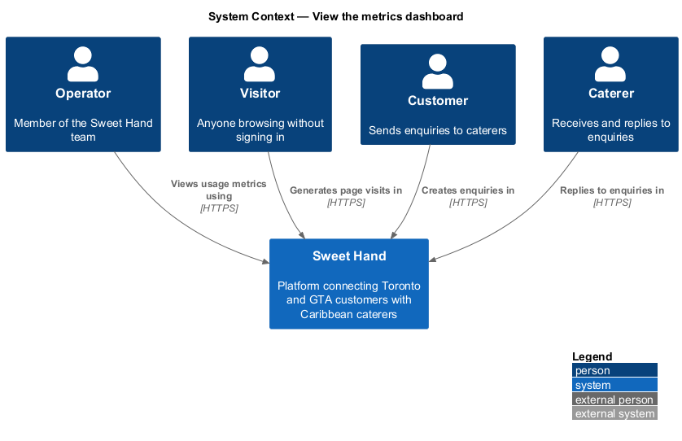
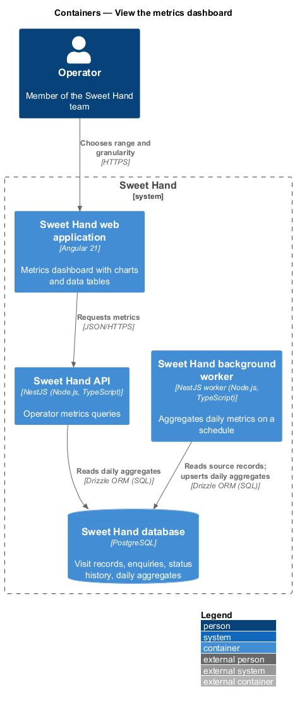
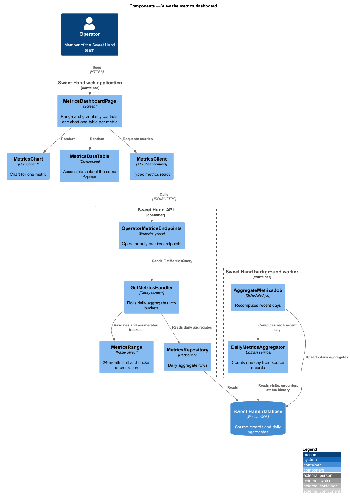
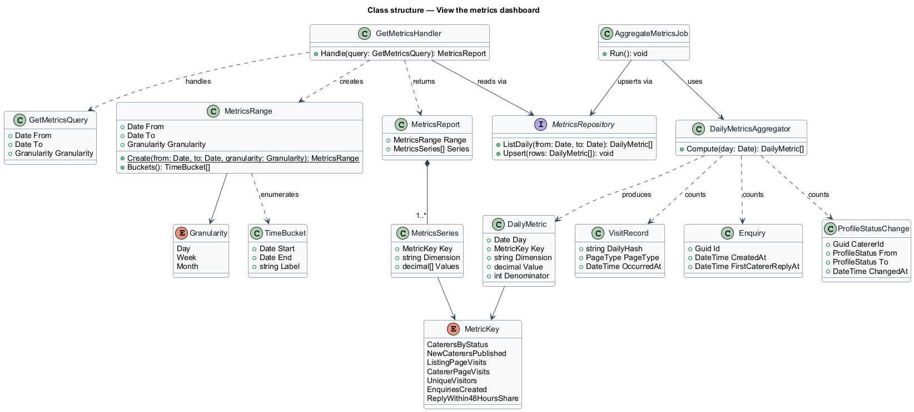
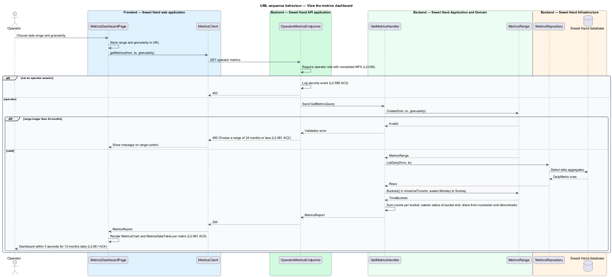
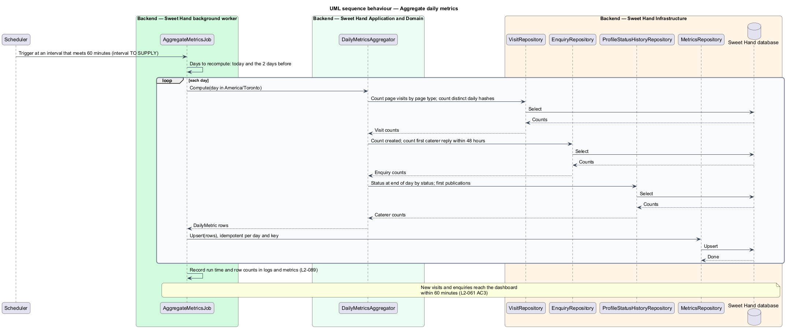

# View the metrics dashboard

## Overview

Sweet Hand is a platform that connects people in Toronto and the Greater Toronto
Area (GTA) with caterers who sell Caribbean food. The Sweet Hand team, called
operators, approve caterers and keep listings accurate. To run the platform they
need to see how it is used over time: how many caterers there are, how many
people visit, how many enquiries are sent, and whether caterers answer them.
This feature gives operators that view.

An operator picks a date range of up to 24 months and a granularity of day,
week or month. The dashboard shows one chart per metric, each with a matching
data table that assistive technology can read. Figures come from aggregates
that a background job keeps up to date, so the dashboard reflects new events
within 60 minutes and loads a 12-month daily view within 3 seconds.

The feature sits in the metrics subsystem. Visit records come from
`metrics/count-visits`. Caterer status history comes from the moderation and
caterer-profiles subsystems (`L2-046`). Enquiries and replies come from the
enquiries subsystem. The CSV download is a separate feature
(`metrics/export-metrics`).

Terms used in this document:

- **date range** — first and last calendar day, in `America/Toronto`, that the dashboard covers; at most 24 months long
- **granularity** — size of each time bucket: day, week or month
- **time bucket** — one day, one week (Monday to Sunday) or one calendar month in `America/Toronto`
- **daily aggregate** — stored count for one metric on one day, built by the aggregation job
- **reply-within-48-hours share** — share of enquiries created in a bucket that received a first caterer reply within 48 hours of creation

## Description

Technology choices follow ADR 0001 (Angular 21) and ADR 0006 (NestJS on
Node.js, PostgreSQL through Drizzle ORM, S3-compatible object storage);
providers not named there remain `<TO SUPPLY>`. The components are named by
role.

The dashboard shows these metrics, as `L2-061` lists them:

1. Caterer counts by status (`Draft`, `Pending review`, `Changes requested`,
   `Published`, `Suspended`, `Removed`) at the end of each bucket, plus new
   caterers published in the bucket (first transition to `Published`).
2. Listing page visits.
3. Caterer page visits.
4. Unique visitors. For a day bucket this is the count of distinct daily
   visitor hashes. Hashes from different days cannot be linked
   (`L2-062 AC4`), so for week and month buckets the figure is the sum of
   daily unique visitors. The label for that sum is `<TO SUPPLY>`.
5. Enquiries created.
6. Reply-within-48-hours share. How enquiries younger than 48 hours that have
   no reply yet are treated is `<TO SUPPLY>`; the design leaves them out of the
   share until 48 hours have passed.

Weeks run Monday to Sunday, matching the week of 2026-09-28 (a Monday) in
`L2-061 AC1`. All buckets use `America/Toronto` calendar boundaries over UTC
timestamps.

Frontend — Sweet Hand web application:

- **`MetricsDashboardPage`** — operator screen. It holds the date range and
  granularity controls in the URL query string, shows a validation message for
  a range over 24 months (`L2-061 AC2`), and renders one `MetricsChart` and one
  `MetricsDataTable` per metric. It also hosts the "Export CSV" control from
  `metrics/export-metrics`.
- **`MetricsChart`** — chart for one metric over the buckets. The chart library
  is `<TO SUPPLY>`. Colour is never the only carrier of meaning
  (`L2-069 AC5`).
- **`MetricsDataTable`** — table with the same figures as its chart, with
  column and row headers, available to assistive technology (`L2-061 AC5`).
- **`MetricsClient`** — API client contract. The page depends on this contract,
  not on the concrete HTTP client.

Backend — Sweet Hand API application:

- **`OperatorMetricsEndpoints`** — operator-only endpoint group with
  `GET /operator/metrics?from=&to=&granularity=`. The route shape is
  `<TO SUPPLY>`. The `RequestPipeline` requires an operator session that has
  completed multi-factor authentication (`L2-056`). Any other session receives
  HTTP 403, and the attempt is logged as a security event (`L2-056 AC3`).

Backend — Sweet Hand Application and Domain:

- **`GetMetricsQuery`** / **`GetMetricsHandler`** — carries the date range and
  granularity. The handler builds a `MetricsRange`, reads daily aggregates for
  the range, rolls them up into time buckets, and returns a `MetricsReport`.
- **`MetricsRange`** — value object. It rejects a range longer than 24 months
  with the message "Choose a range of 24 months or less" (`L2-061 AC2`), and a
  start date after the end date. It enumerates the `TimeBucket` values for the
  chosen `Granularity`.
- **`MetricsReport`** — one `MetricsSeries` per metric, each with one value per
  bucket.
- **`DailyMetricsAggregator`** — domain service used by the aggregation job.
  For one day it counts listing and caterer page visits and distinct visitor
  hashes from `VisitRecord`, enquiries created and replies within 48 hours from
  `Enquiry` and `EnquiryMessage`, and caterer statuses and new publications
  from `ProfileStatusChange` history.

Backend — Sweet Hand Infrastructure:

- **`MetricsRepository`** — reads and upserts `DailyMetric` rows (one row per day
  and metric key). Upserts make each aggregation run idempotent.
- **`VisitRepository`**, **`EnquiryRepository`**,
  **`ProfileStatusHistoryRepository`** — read-only sources for aggregation.

Backend — Sweet Hand background worker:

- **`AggregateMetricsJob`** — scheduled job that recomputes the daily aggregates
  for today and the 2 days before. It runs often enough that any visit or
  enquiry appears on the dashboard within 60 minutes (`L2-061 AC3`); the exact
  interval is `<TO SUPPLY>`. Recomputing the 2 earlier days covers first
  replies that arrive within 48 hours of an enquiry created on those days.
  Building aggregates for days before the job first ran is an explicit
  backfill command, not a startup step; its scope is `<TO SUPPLY>`.

Reading pre-aggregated daily rows keeps the 12-month daily view to about 365
rows per metric, which supports the 3-second load target (`L2-061 AC4`). The
target is checked by a performance test; the test data volume is
`<TO SUPPLY>`.

## Requirements

The feature realizes the following level-2 (L2) requirements from
`docs/specs/L2.md`. Each refines the level-1 (L1) requirement cited beside it.
Requirement text is quoted from the specification, with *must* rendered as
*shall*.

| L2 ID | Refines (L1) | Requirement |
|-------|--------------|-------------|
| `L2-061` | `L1-017` | Operators shall have a dashboard showing, for a chosen date range and time granularity (day, week or month): caterer counts by status, plus new caterers published; listing page visits; caterer page visits; unique visitors; enquiries created; the share of enquiries that received a caterer reply within 48 hours. |

## Diagrams

### System context

Operators view usage metrics in Sweet Hand. The figures come from activity
inside the platform only, with no third-party analytics system.

### Containers

The background worker writes daily aggregates to the Sweet Hand database. The
API reads them for the dashboard that the web application renders.

### Components

`MetricsDashboardPage` calls `MetricsClient`. `OperatorMetricsEndpoints`
dispatches `GetMetricsQuery`. In the worker, `AggregateMetricsJob` uses
`DailyMetricsAggregator` to fill the daily aggregates the query reads.

### Class structure

`GetMetricsHandler` turns a validated `MetricsRange` and stored `DailyMetric`
rows into a `MetricsReport` of one `MetricsSeries` per metric.

### Behaviour — view the dashboard

The operator chooses a range and granularity. The API validates the range,
rolls daily aggregates into buckets, and the page renders a chart and a data
table for each metric.

### Behaviour — aggregate daily metrics

On each run the worker recomputes the daily aggregates for the recent days and
upserts them.

