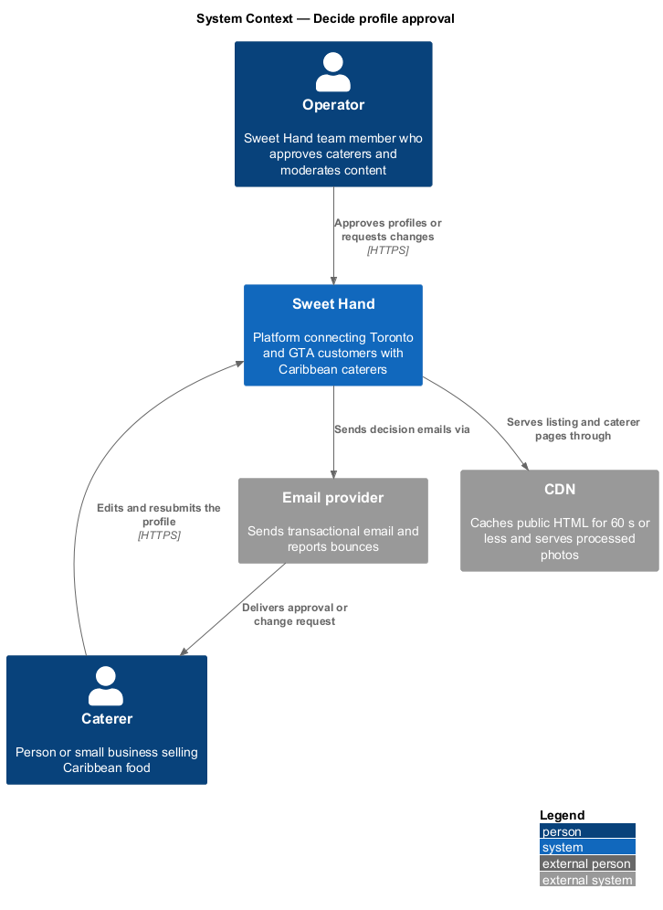
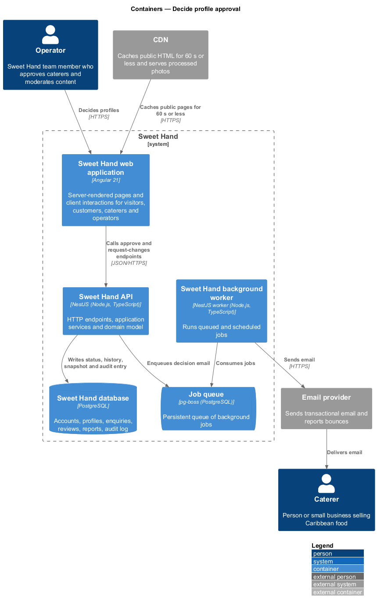
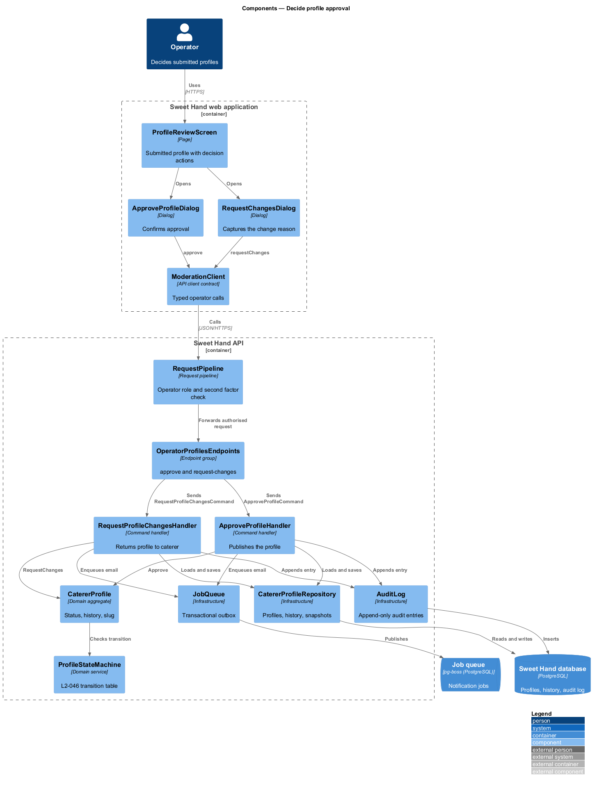
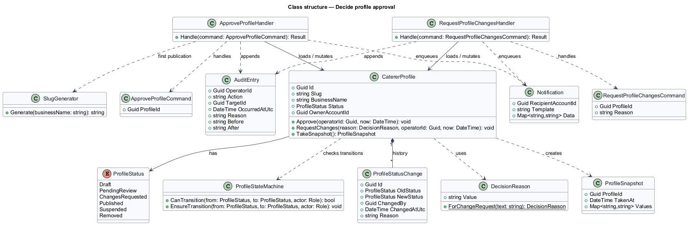
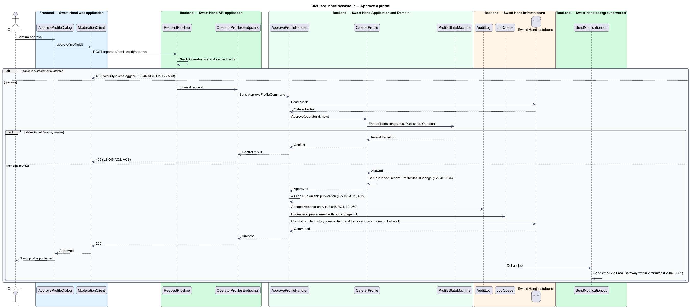
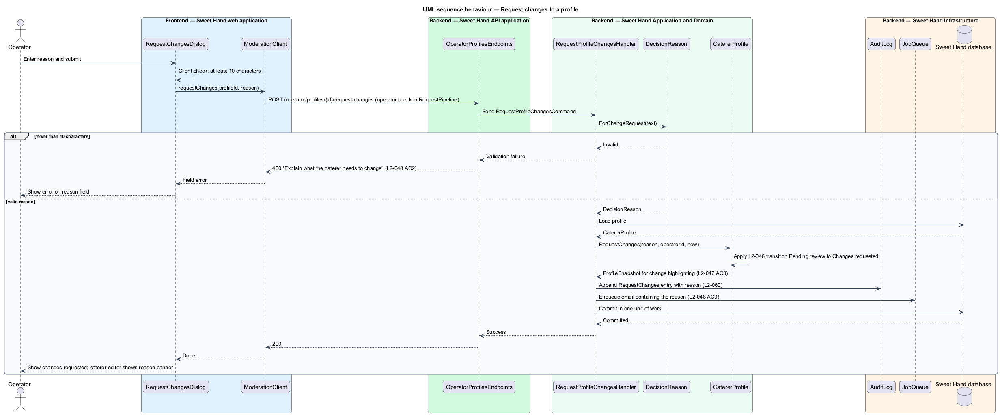

# Decide profile approval

## Overview

A caterer profile appears to visitors only after an operator approves it
(`L1-013`). This feature covers the operator's decision on a submitted profile
and the profile status lifecycle that the decision moves along.

- **profile status** — one of `Draft`, `Pending review`, `Changes requested`, `Published`, `Suspended` or `Removed`, held by every caterer profile at all times
- **approval decision** — operator outcome on a profile in `Pending review`: approve, or request changes with a written reason
- **status history entry** — immutable record of one status change: old status, new status, actor, time and reason

The operator reaches a submitted profile from the review queue
(work-review-queue). Approving publishes the profile, which puts it in the
listing and gives it a public page. Requesting changes sends the profile back
to the caterer with a reason. Either way the caterer receives an email and the
decision enters the audit log. Caterer-side transitions (submit, withdraw,
resubmit) belong to the caterer-profiles subsystem. Suspend, reinstate and
remove belong to suspend-reinstate-remove-profile. All of them run through the
one state machine described here.

## Description

The slice runs from the operator review screen to the database, the job queue
and the email provider. Technology choices follow ADR 0001 (Angular 21) and ADR 0006 (NestJS on
Node.js, PostgreSQL through Drizzle ORM, S3-compatible object storage);
providers not named there remain `<TO SUPPLY>`.

**Status lifecycle (`L2-046`).** `ProfileStateMachine` allows only these
transitions and rejects every other one with HTTP 409:

| From | To | Actor |
|------|----|-------|
| `Draft` | `Pending review` | Caterer (submit) |
| `Pending review` | `Draft` | Caterer (withdraw) |
| `Pending review` | `Published` | Operator (approve) |
| `Pending review` | `Changes requested` | Operator, with a reason |
| `Changes requested` | `Pending review` | Caterer (resubmit) |
| `Published` | `Suspended` | Operator, with a reason |
| `Suspended` | `Published` | Operator (reinstate) |
| Any except `Removed` | `Removed` | Operator, with a reason |

A caterer that calls an operator transition receives HTTP 403 from the request
pipeline before the state machine runs (`L2-046` AC1). An operator approving a
profile in any status other than `Pending review` receives HTTP 409
(`L2-046` AC2). A `Removed` profile accepts no transition (`L2-046` AC3). Every
accepted transition writes a `ProfileStatusChange`; the application's database
account holds no UPDATE or DELETE permission on that table (`L2-046` AC4).

**Frontend — Sweet Hand web application**

- **`ProfileReviewScreen`** — operator screen for a submitted profile (see work-review-queue). It offers "Approve" and "Request changes".
- **`ApproveProfileDialog`** — confirmation dialog for approval.
- **`RequestChangesDialog`** — dialog with a reason field. It shows "Explain what the caterer needs to change" when the reason is shorter than 10 characters (`L2-048` AC2).
- **`ModerationClient`** — API client contract the screen and dialogs depend on.

**Backend — Sweet Hand API application**

- **`RequestPipeline`** — checks on the server that the session holds the `Operator` role with a completed second factor (`L2-056`). A customer or caterer session receives HTTP 403, logged as a security event.
- **`OperatorProfilesEndpoints`** — `POST /operator/profiles/{profileId}/approve` and `POST /operator/profiles/{profileId}/request-changes`.

**Backend — Sweet Hand Application and Domain**

- **`ApproveProfileCommand` / `ApproveProfileHandler`** — loads the profile, calls `CatererProfile.Approve`, assigns the slug on first publication through `SlugGenerator` (`L2-018` AC1 and AC2), resolves the review queue item, appends the audit entry and enqueues the approval email, all in one unit of work.
- **`RequestProfileChangesCommand` / `RequestProfileChangesHandler`** — validates the `DecisionReason`, calls `CatererProfile.RequestChanges`, stores a `ProfileSnapshot` for later change highlighting (`L2-047` AC3), appends the audit entry and enqueues the email.
- **`CatererProfile`** — aggregate that owns the status. `Approve` and `RequestChanges` delegate the transition check to `ProfileStateMachine` and record a `ProfileStatusChange`.
- **`ProfileStateMachine`** — holds the transition table above.
- **`DecisionReason`** — value object; a change request reason holds at least 10 characters after trimming.
- **`ProfileStatusChange`** — immutable history entry (`L2-046` AC4).
- **`SlugGenerator`** — derives `/caterers/{slug}` from the business name and adds a numeric suffix on collision.

**Backend — Sweet Hand Infrastructure and worker**

- **`CatererProfileRepository`**, **`ReviewQueueRepository`** — persist the profile, history, snapshot and queue item.
- **`AuditLog`** — appends an `AuditEntry` for the decision (`L2-048` AC4, `L2-060`).
- **`JobQueue`** — receives the notification job inside the same unit of work (transactional outbox), so a failed email never loses the decision.
- **`SendNotificationJob`** (worker) and **`EmailGateway`** — send the approval email with a link to the public page, or the change-request email with the reason, within 2 minutes (`L2-048` AC1 and AC3).

**Visibility.** The listing and caterer page read only `Published` profiles. The
CDN caches public HTML for 60 s or less (`L2-087` AC4), so an approved profile
appears in the listing within 60 seconds (`L2-048` AC1). The change-request
reason appears as a banner in the caterer's profile editor (`L2-048` AC3),
rendered by the caterer-profiles subsystem.

Open points:

- Business-name change decisions (`L2-044`) appear in the same queue. Approval follows `L2-044` AC3 and `L2-018` AC3, through `ApproveNameChangeHandler` on `OperatorProfilesEndpoints` as described in feature `caterer-profiles/edit-published-profile`. The outcome of rejecting a name change: `<TO SUPPLY>`.
- Whether approval re-checks the submission rules of `L2-039` at decision time: `<TO SUPPLY>`.

## Requirements

The feature realizes the following level-2 (L2) requirements from `docs/specs/L2.md`. Each refines the level-1 (L1) requirement cited beside it. Requirement text is quoted from the specification, with *must* rendered as *shall*.

| L2 ID | Refines (L1) | Requirement |
|-------|--------------|-------------|
| `L2-046` | `L1-013` | A caterer profile shall always have one of these statuses: `Draft`, `Pending review`, `Changes requested`, `Published`, `Suspended` or `Removed`. Only the transitions below are allowed, and only `Published` profiles are publicly visible. (Transition table reproduced in the Description.) |
| `L2-048` | `L1-013` | An operator shall approve a submitted profile or request changes with a written reason. The caterer shall be told the outcome. |

## Diagrams

### System context

The operator decides a caterer's submitted profile in Sweet Hand. Sweet Hand emails the caterer the outcome through the email provider.

### Containers

The decision travels from the web application to the API, which writes state, history, audit entry and notification job in one unit of work. The background worker sends the email.

### Components

`OperatorProfilesEndpoints` dispatches one command per decision. Both handlers mutate `CatererProfile`, whose `ProfileStateMachine` enforces `L2-046`.

### Class structure

`CatererProfile` owns its `ProfileStatus` and a list of `ProfileStatusChange` entries. `ProfileStateMachine` decides whether a transition is allowed, and `DecisionReason` guards the change-request reason.

### Behaviour — approve a profile

The pipeline rejects non-operators with HTTP 403. The state machine rejects any status other than `Pending review` with HTTP 409. An accepted approval commits profile, history, audit entry and email job together.

### Behaviour — request changes to a profile

The reason is checked on the client and again on the server. A valid request moves the profile to `Changes requested`, stores a snapshot, and emails the reason to the caterer.

