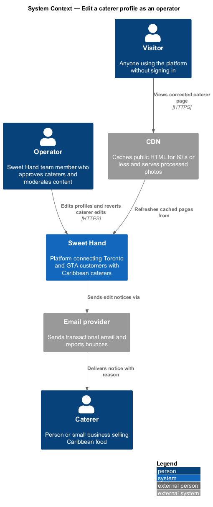
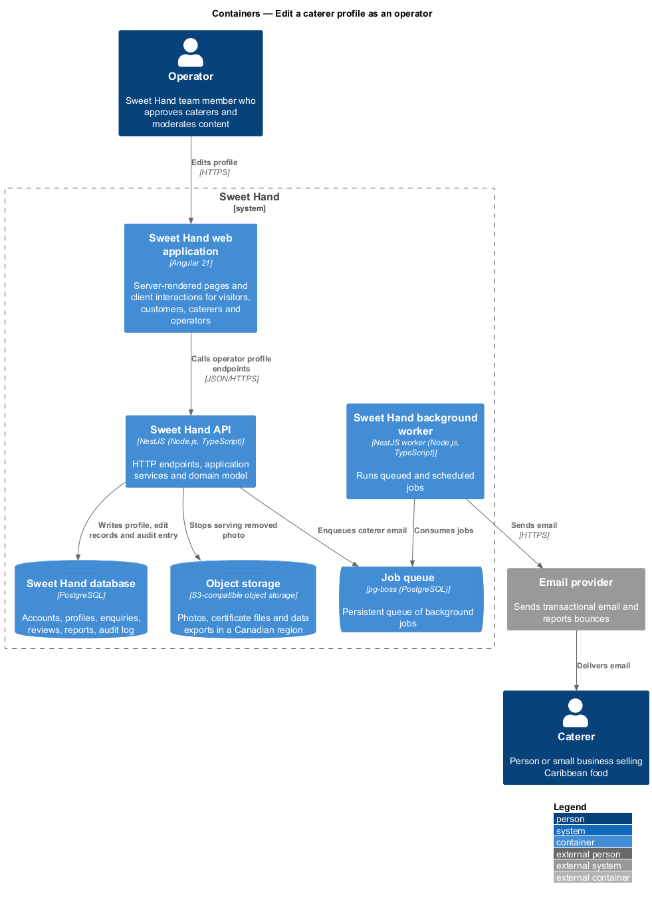
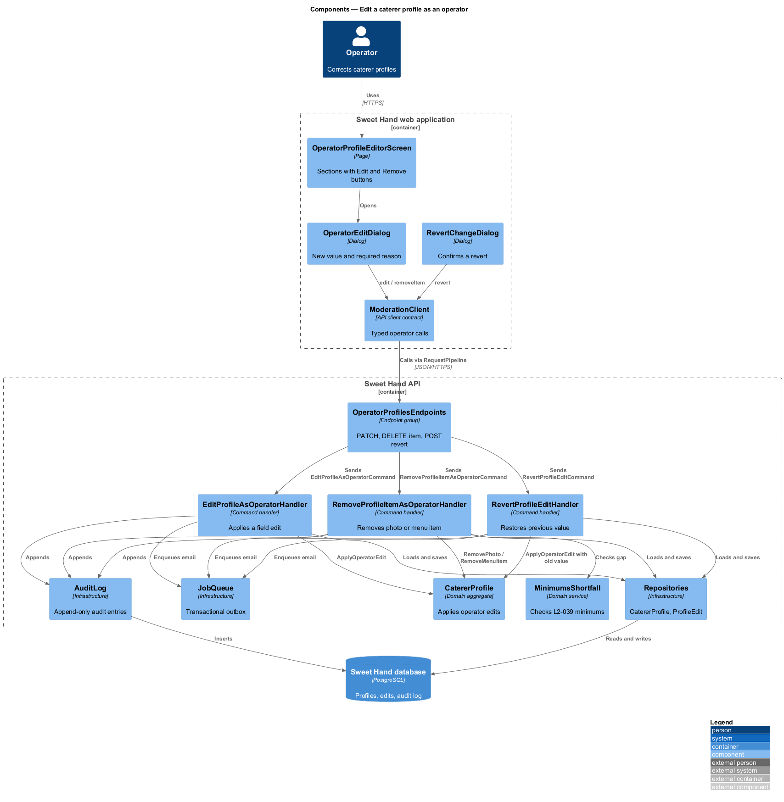
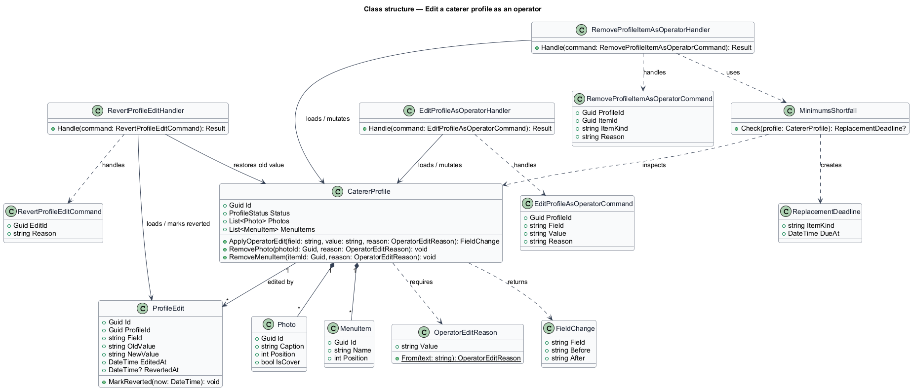
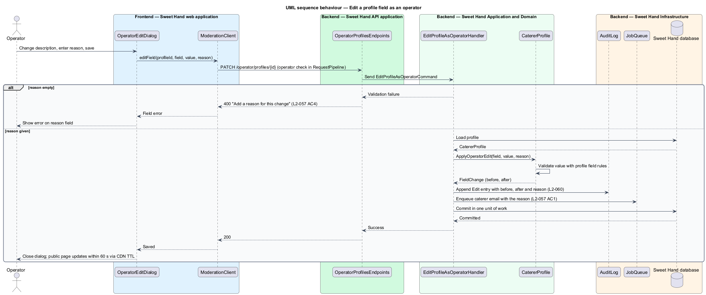
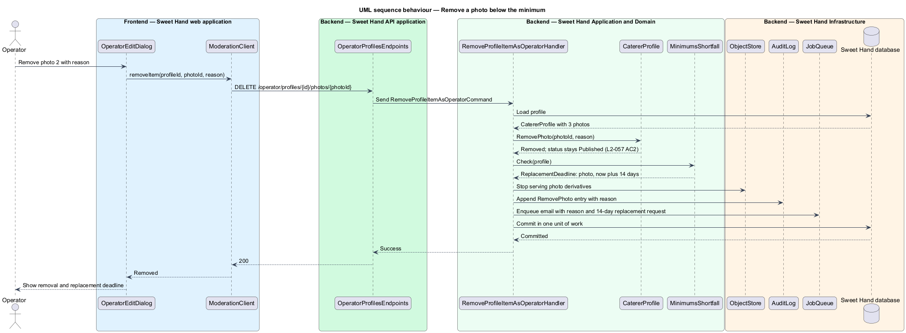
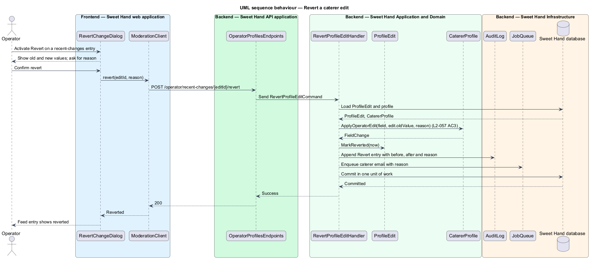

# Edit a caterer profile as an operator

## Overview

Operators keep caterer listings accurate (`L1-016`). This feature lets an
operator change any field of a caterer profile, remove a photo or menu item,
and revert an edit a caterer made to a published profile.

- **operator edit** — change an operator makes to a caterer profile, always with a written reason that the caterer receives
- **revert** — operator action that returns one field to the value it held before a caterer's edit, started from the recent-changes feed
- **replacement deadline** — date 14 days after an operator removal that leaves a published profile below the submission minimums, by which the caterer is asked to add a replacement

Typical reasons are a phone number typed into a description, a stock photo, or
a dish that misstates an allergen. An operator edit goes live on the public
page within 60 seconds and enters the audit log. An operator edit can take a
profile below the minimums of `L2-039` (3 photos, 3 dishes). The profile stays
published and the caterer is asked to replace the item. The recent-changes feed
itself is described in work-review-queue.

## Description

The slice runs from an operator editing screen to the database, the job queue
and the email provider. Technology choices follow ADR 0001 (Angular 21) and ADR 0006 (NestJS on
Node.js, PostgreSQL through Drizzle ORM, S3-compatible object storage);
providers not named there remain `<TO SUPPLY>`.

**Frontend — Sweet Hand web application**

- **`OperatorProfileEditorScreen`** — operator screen that shows every section of a caterer profile. Each "Edit" or "Remove" button opens a dialog; the screen holds no inline form.
- **`OperatorEditDialog`** — dialog for one field or one photo or menu item. It holds the new value and a required reason field. An empty reason shows "Add a reason for this change" (`L2-057` AC4).
- **`RevertChangeDialog`** — confirmation dialog opened from the "Revert" action on `RecentChangesPage` (`L2-057` AC3). It shows the old and new values and asks for a reason.
- **`ModerationClient`** — API client contract the screens and dialogs depend on.

**Backend — Sweet Hand API application**

- **`RequestPipeline`** — operator role and second-factor check (`L2-056`).
- **`OperatorProfilesEndpoints`** — `PATCH /operator/profiles/{profileId}`, `DELETE /operator/profiles/{profileId}/photos/{photoId}`, `DELETE /operator/profiles/{profileId}/menu-items/{itemId}` and `POST /operator/recent-changes/{editId}/revert`. Each body carries a `reason`.

**Backend — Sweet Hand Application and Domain**

- **`EditProfileAsOperatorCommand` / `EditProfileAsOperatorHandler`** — validates the field value with the same rules the caterer editor uses (for example `L2-007`, `L2-010`, `L2-020`), applies it with `CatererProfile.ApplyOperatorEdit`, appends the audit entry and enqueues the caterer email.
- **`RemoveProfileItemAsOperatorCommand` / `RemoveProfileItemAsOperatorHandler`** — removes one photo or menu item. It bypasses the publish minimums (`L2-057` AC2). When `MinimumsShortfall` reports a gap, it sets a `ReplacementDeadline` 14 days ahead and includes the request in the caterer email.
- **`RevertProfileEditCommand` / `RevertProfileEditHandler`** — loads the `ProfileEdit`, writes `oldValue` back to the field, sets `revertedAt`, appends the audit entry and enqueues the email.
- **`CatererProfile`** — aggregate. `ApplyOperatorEdit`, `RemovePhoto` and `RemoveMenuItem` take an `OperatorEditReason`. Its status does not change.
- **`OperatorEditReason`** — value object; it rejects an empty or whitespace-only reason.
- **`MinimumsShortfall`** — domain service that compares photo and menu counts with the `L2-039` minimums.
- **`ReplacementDeadline`** — value object holding the item kind and the due date.
- **`ProfileEdit`** — recent-changes record written by caterer edits (`L2-044`); the revert marks it reverted.

**Backend — Sweet Hand Infrastructure and worker**

- **`CatererProfileRepository`**, **`ProfileEditRepository`** — persist the profile and edit records.
- **`AuditLog`** — appends an entry with the field's values before and after and the reason (`L2-060`).
- **`ObjectStore`** — stops serving the removed photo's derivatives.
- **`JobQueue`**, **`SendNotificationJob`** and **`EmailGateway`** — send the caterer an email containing the reason (`L2-057` AC1).

**Visibility.** Public pages read the live profile values, and the CDN caches
public HTML for 60 s or less (`L2-087` AC4). The change therefore shows on the
public page within 60 seconds (`L2-057` AC1).

Open points:

- What happens when the caterer misses the 14-day replacement deadline: `<TO SUPPLY>`.
- Behaviour of a revert when the field changed again after the reverted edit: `<TO SUPPLY>`.
- Whether an operator change to the business name updates the slug with a redirect as in `L2-018` AC3: `<TO SUPPLY>`.
- Whether a removed photo is also purged from the CDN cache: `<TO SUPPLY>`.

## Requirements

The feature realizes the following level-2 (L2) requirements from `docs/specs/L2.md`. Each refines the level-1 (L1) requirement cited beside it. Requirement text is quoted from the specification, with *must* rendered as *shall*.

| L2 ID | Refines (L1) | Requirement |
|-------|--------------|-------------|
| `L2-057` | `L1-016` | An operator shall be able to edit any field of a caterer profile, including removing a photo or menu item, and to revert a caterer's edit from the recent-changes feed. Each operator edit needs a reason, and the caterer is told about it. |

## Diagrams

### System context

The operator corrects a caterer's profile in Sweet Hand. Sweet Hand emails the caterer the reason, and visitors see the corrected page through the CDN.

### Containers

The edit travels from the web application to the API, which writes the profile, audit entry and email job together. The background worker sends the email.

### Components

`OperatorProfilesEndpoints` dispatches an edit, removal or revert command. Each handler mutates `CatererProfile` with an `OperatorEditReason` and appends an audit entry.

### Class structure

Every operator command carries a reason. `CatererProfile` applies the change, `MinimumsShortfall` detects a gap below the `L2-039` minimums, and `ReplacementDeadline` records the 14-day request.

### Behaviour — edit a profile field

A missing reason fails before the profile loads. A valid edit commits the profile change, the audit entry and the caterer email job together.

### Behaviour — remove a photo below the minimum

The removal goes ahead even when the profile drops below 3 photos. The profile stays published and the caterer receives a 14-day replacement request.

### Behaviour — revert a caterer edit

The operator confirms in a dialog. The handler writes the edit's old value back, marks the edit reverted and notifies the caterer.

