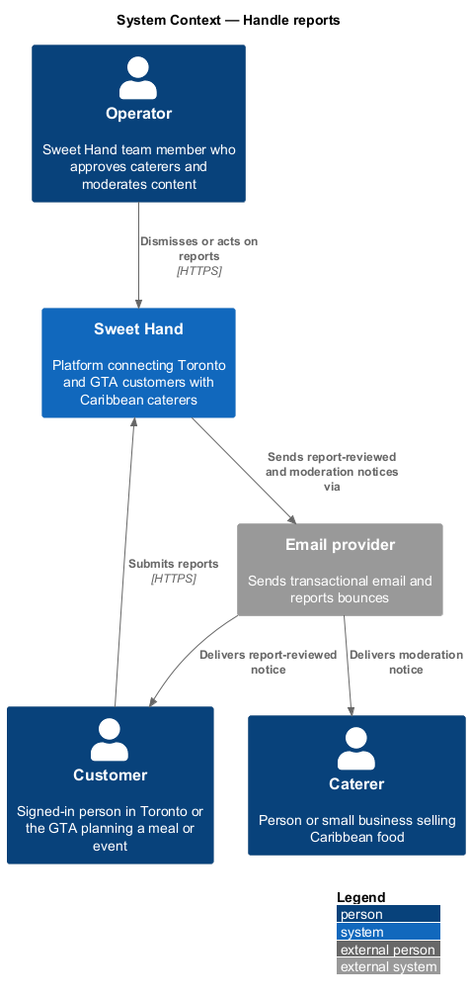
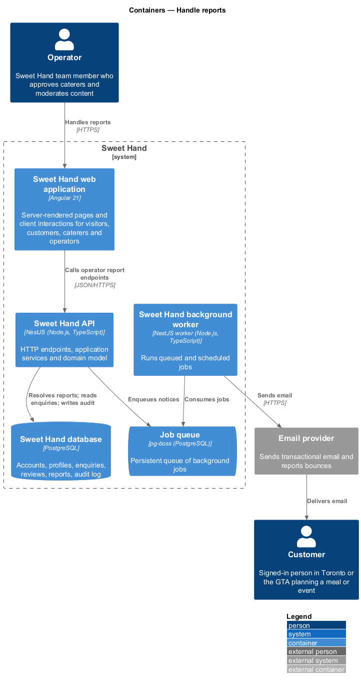
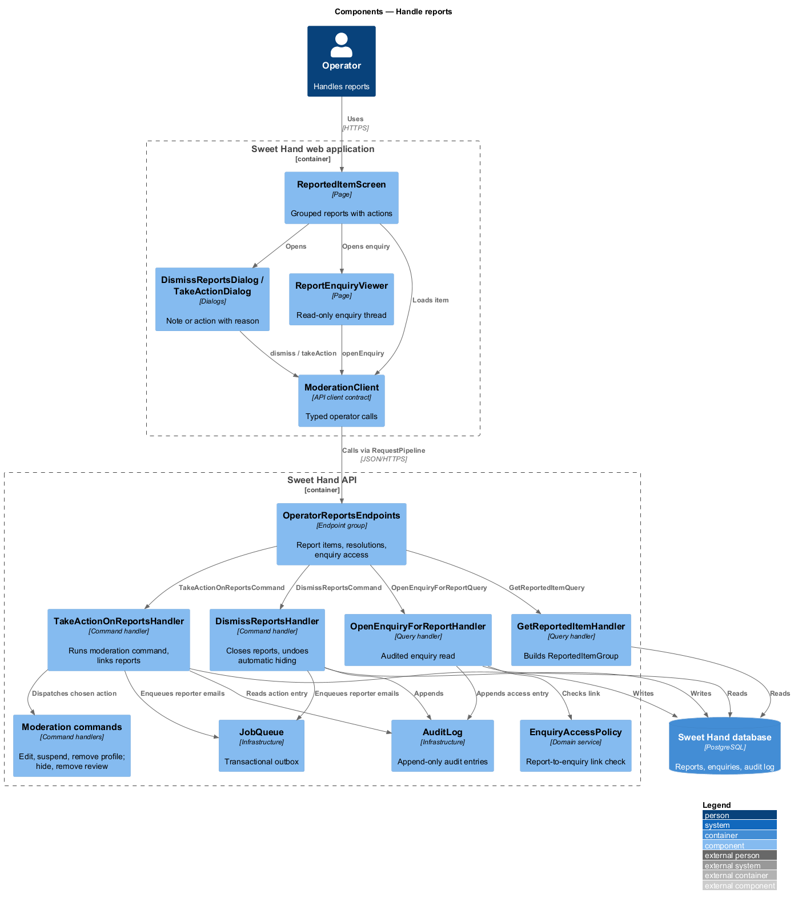
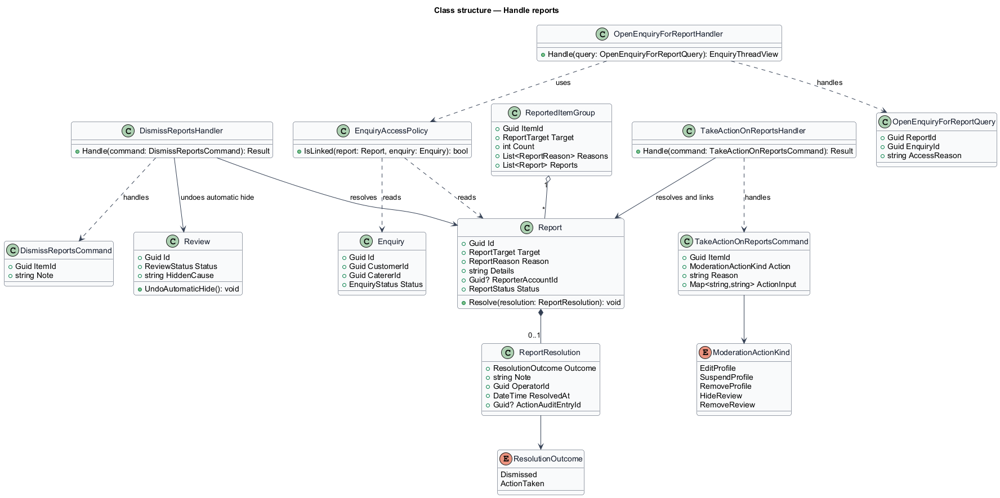
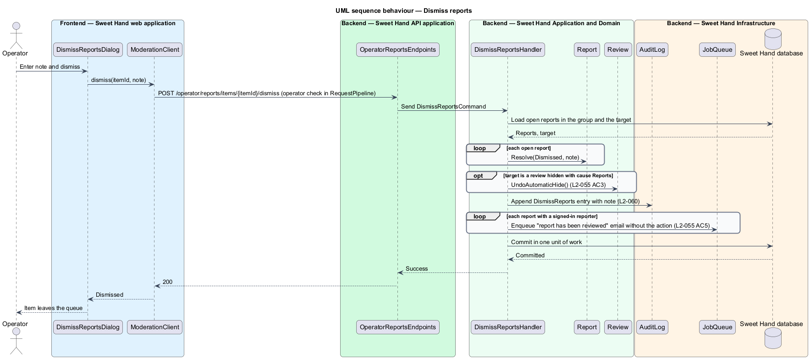
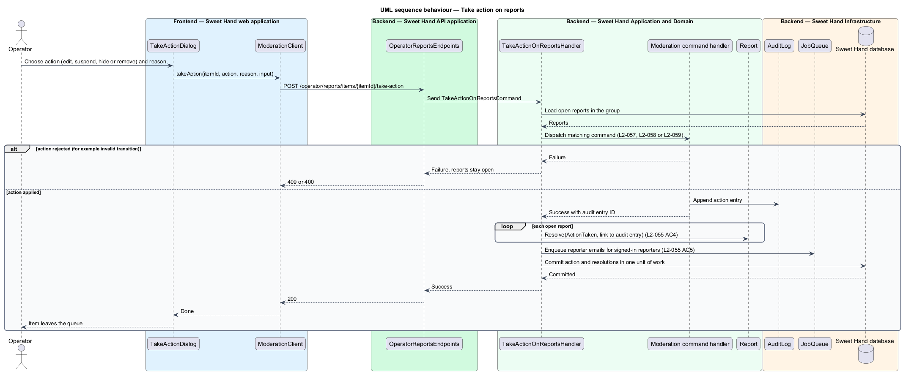
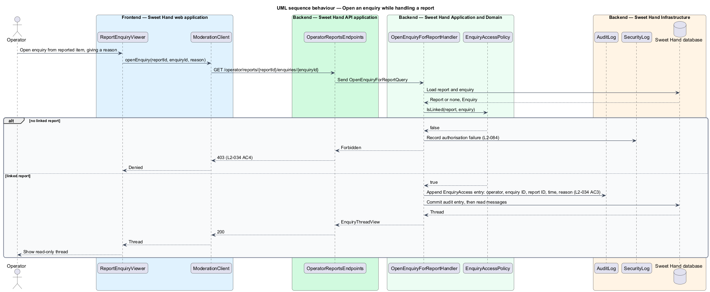

# Handle reports

## Overview

Reports from users reach operators through the review queue (`L1-015`). This
feature covers what an operator does with them: read the grouped reports about
one item, then dismiss them or act on the content. It also covers the one
situation in which an operator may read a private enquiry thread.

- **reported item group** — all open reports about one caterer profile or one review, shown as a single queue item with a report count and every reason
- **dismissal** — resolution that closes the reports without changing the content, with an operator note
- **take action** — resolution that applies an operator moderation action (edit, suspend, hide or remove) and closes the reports linked to that action
- **report-linked enquiry access** — operator read access to an enquiry, granted only while handling a report and always audited

Enquiries are private between a customer and a caterer (`L2-034`). An operator
can open one only through a report, and the audit log records each such access.
Resolution actions reuse the commands of edit-profile-as-operator,
suspend-reinstate-remove-profile and moderate-reviews.

## Description

The slice runs from operator screens to the database and the email provider.
Technology choices follow ADR 0001 (Angular 21) and ADR 0006 (NestJS on
Node.js, PostgreSQL through Drizzle ORM, S3-compatible object storage);
providers not named there remain `<TO SUPPLY>`.

**Frontend — Sweet Hand web application**

- **`ReportedItemScreen`** — operator screen for a reported item group. It shows the item, the report count, each reason and its details (`L2-055` AC1), and offers "Dismiss" and "Take action".
- **`DismissReportsDialog`** — dialog with a required note.
- **`TakeActionDialog`** — dialog to choose edit, suspend, hide or remove, with a reason. The choices match the target kind: profile reports offer edit, suspend and remove; review reports offer hide and remove.
- **`ReportEnquiryViewer`** — read-only view of an enquiry thread, opened from `ReportedItemScreen` with an access reason.
- **`ModerationClient`** — API client contract the screen and dialogs depend on.

**Backend — Sweet Hand API application**

- **`OperatorReportsEndpoints`** — `GET /operator/reports/items/{itemId}`, `POST /operator/reports/items/{itemId}/dismiss`, `POST /operator/reports/items/{itemId}/take-action` and `GET /operator/reports/{reportId}/enquiries/{enquiryId}`, behind the operator check in `RequestPipeline` (`L2-056`).

**Backend — Sweet Hand Application and Domain**

- **`GetReportedItemQuery` / `GetReportedItemHandler`** — returns a `ReportedItemGroup` with the target summary, count, reasons and details.
- **`DismissReportsCommand` / `DismissReportsHandler`** — resolves every open report in the group as `Dismissed` with the note, restores a review hidden with cause `Reports` (`L2-055` AC3), appends the audit entry and enqueues reporter emails.
- **`TakeActionOnReportsCommand` / `TakeActionOnReportsHandler`** — dispatches the chosen moderation command (`EditProfileAsOperatorCommand`, `SuspendProfileCommand`, `RemoveProfileCommand`, `HideReviewCommand` or `RemoveReviewCommand`), then resolves the reports as `ActionTaken` with a link to the action's audit entry (`L2-055` AC4).
- **`ReportResolution`** — value object: outcome (`Dismissed` or `ActionTaken`), note, operator, time and `actionAuditEntryId`.
- **`OpenEnquiryForReportQuery` / `OpenEnquiryForReportHandler`** — asks `EnquiryAccessPolicy` whether the report authorises the enquiry. When it does, it appends an enquiry-access audit entry with operator, enquiry ID, report ID, time and reason (`L2-034` AC3) and returns the thread. When no report links the enquiry, it returns HTTP 403 (`L2-034` AC4).
- **`EnquiryAccessPolicy`** — domain service deciding whether a report links to an enquiry.

**Backend — Sweet Hand Infrastructure and worker**

- **`ReportRepository`**, **`ReviewQueueRepository`**, **`EnquiryRepository`** — persist reports, queue items and read enquiries. Enquiry IDs are UUIDv4 (`L2-034` AC2).
- **`AuditLog`** — appends report resolutions and enquiry access (`L2-060`).
- **`JobQueue`**, **`SendNotificationJob`**, **`EmailGateway`** — email each signed-in reporter that the report has been reviewed, without naming the action (`L2-055` AC5). Anonymous reporters receive no email.

Open points:

- The rule by which a report about a profile or review links to a specific enquiry: `<TO SUPPLY>` (`L2-054` reports target only profiles and reviews).
- Minimum length of a dismissal note: `<TO SUPPLY>`.
- Whether enquiry access is allowed after the report is resolved: `<TO SUPPLY>`.

## Requirements

The feature realizes the following level-2 (L2) requirements from `docs/specs/L2.md`. Each refines the level-1 (L1) requirement cited beside it. Requirement text is quoted from the specification, with *must* rendered as *shall*.

| L2 ID | Refines (L1) | Requirement |
|-------|--------------|-------------|
| `L2-055` | `L1-015` | Operators shall see open reports in the review queue (L2-047), grouped by reported item, with the reasons and details. They shall resolve each one by dismissing it or by acting on the content. |
| `L2-034` | `L1-010` | An enquiry and its messages can be read only by the customer who sent it and the caterer it was sent to. Operators can read one only when handling a report (L2-055), and each such access shall be written to the audit log (L2-060). (This feature realizes the operator access part.) |

## Diagrams

### System context

The operator resolves reports that visitors and customers submitted. Sweet Hand emails signed-in reporters when their report has been reviewed.

### Containers

Operator screens call the API, which resolves reports, applies moderation actions, records audit entries and queues reporter emails for the worker.

### Components

`OperatorReportsEndpoints` dispatches to three handlers and one query. `TakeActionOnReportsHandler` reuses the moderation commands of sibling features, and `EnquiryAccessPolicy` guards enquiry access.

### Class structure

A `ReportedItemGroup` gathers open `Report` records. Each report closes with a `ReportResolution`, which links to the audit entry of any action taken.

### Behaviour — dismiss reports

Dismissal closes every open report in the group, restores an automatically hidden review, records the decision and notifies signed-in reporters.

### Behaviour — take action on reports

The handler runs the chosen moderation command. Only when it succeeds are the reports closed and linked to the action's audit entry.

### Behaviour — open an enquiry while handling a report

The access policy checks for a linked report before any message is read. Granted access writes an audit entry first; refused access returns HTTP 403 and a security log entry.

