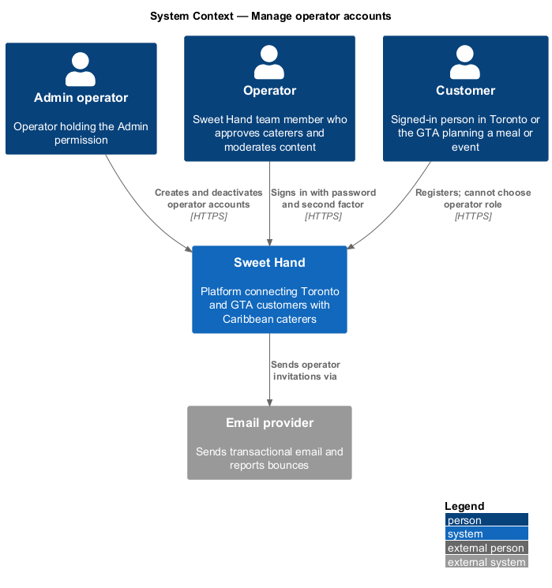
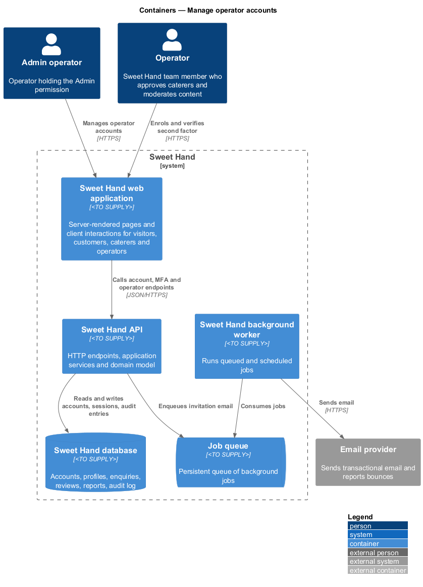
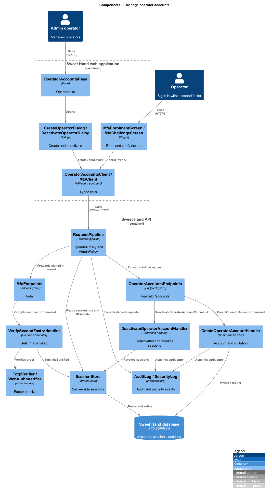
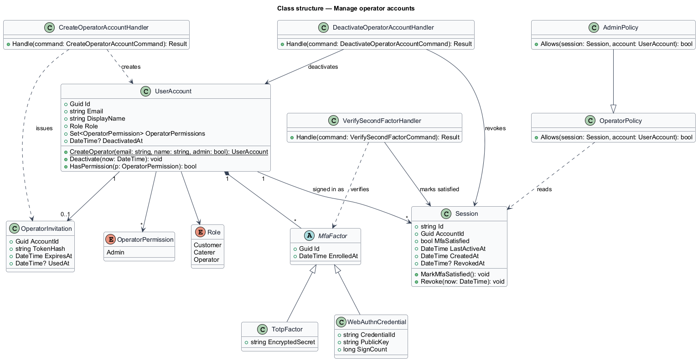
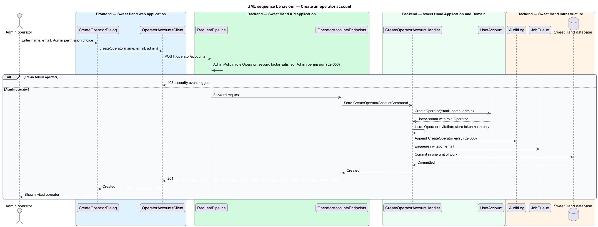
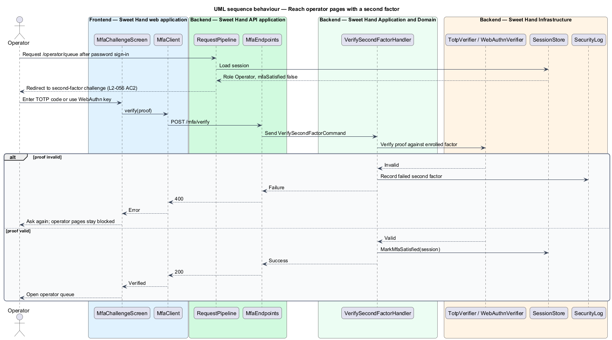
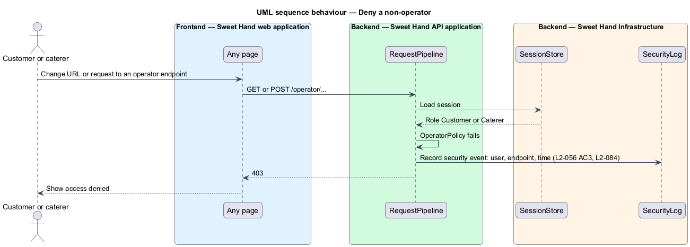
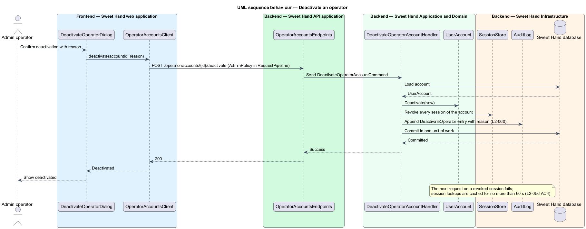

# Manage operator accounts

## Overview

Operators hold the most powerful role on Sweet Hand: they approve caterers,
change profiles, moderate reviews and can read enquiries linked to reports
(`L1-016`). This feature controls who becomes an operator and how operators
reach operator pages.

- **operator account** — user account with role `Operator`, created only by an Admin operator
- **Admin permission** — operator permission that allows creating and deactivating operator accounts and querying the audit log
- **second factor** — time-based one-time password (TOTP) or WebAuthn credential that an operator presents after the password
- **operator gate** — server-side check on every operator page and endpoint that the session holds role `Operator` with a completed second factor

The public registration flows create customers and caterers only, whatever the
request says. An operator signs in with email and password like any user
(identity-and-security subsystem), then completes a second factor before any
operator page opens. Deactivating an operator ends that operator's sessions
within 60 seconds.

## Description

The slice runs from operator account screens and the sign-in flow to the
database and session store. Technology choices for every container are
`<TO SUPPLY>` pending architecture decision records (ADRs) in `docs/adr/`.

**Frontend — Sweet Hand web application**

- **`OperatorAccountsPage`** — Admin-only screen listing operator accounts with status and permissions.
- **`OperatorNavigation`** — the operator console's side navigation. The app shell builds its items from the signed-in operator's permissions and passes only what that operator can use: an operator without the `Admin` permission does not see the Admin-only items "Audit log" and "Operators" (`L2-056` AC5). Hiding them is a convenience only; `AdminPolicy` still checks the `Admin` permission on those routes and returns HTTP 403 without it.
- **`CreateOperatorDialog`** — dialog for display name, email and the optional `Admin` permission.
- **`DeactivateOperatorDialog`** — confirmation dialog with a reason.
- **`MfaEnrolmentScreen`** — screen where a new operator registers a TOTP secret or a WebAuthn credential.
- **`MfaChallengeScreen`** — screen shown after password sign-in for an operator; it blocks every operator page until a factor succeeds (`L2-056` AC2).
- **`OperatorAccountsClient`** and **`MfaClient`** — API client contracts the screens depend on.

**Backend — Sweet Hand API application**

- **`RequestPipeline`** — applies `OperatorPolicy` to every `/operator/*` route: role `Operator` and `session.mfaSatisfied`. A customer or caterer session receives HTTP 403 and a security event (`L2-056` AC3). `AdminPolicy` additionally requires the `Admin` permission.
- **`OperatorAccountsEndpoints`** — `GET /operator/accounts`, `POST /operator/accounts`, `POST /operator/accounts/{accountId}/deactivate`.
- **`MfaEndpoints`** — `POST /mfa/totp/enrol`, `POST /mfa/webauthn/register`, `POST /mfa/verify`.
- **`RegistrationEndpoints`** — public customer and caterer registration (identity-and-security and caterer-profiles). Their request models carry no role field, so any submitted role is ignored (`L2-056` AC1, `L2-079` AC2).

**Backend — Sweet Hand Application and Domain**

- **`CreateOperatorAccountCommand` / `CreateOperatorAccountHandler`** — creates a `UserAccount` with role `Operator`, issues an `OperatorInvitation` for setting a password and enrolling a factor, appends the audit entry and enqueues the invitation email.
- **`DeactivateOperatorAccountCommand` / `DeactivateOperatorAccountHandler`** — marks the account deactivated, revokes all its sessions in `SessionStore` and appends the audit entry (`L2-056` AC4).
- **`VerifySecondFactorCommand` / `VerifySecondFactorHandler`** — checks a TOTP code or WebAuthn assertion and sets `mfaSatisfied` on the session.
- **`UserAccount`** — `role`, `operatorPermissions`, `deactivatedAt` and its `MfaFactor` list.
- **`MfaFactor`** — abstract factor with `TotpFactor` and `WebAuthnCredential` subtypes.
- **`Session`** — server-side session: opaque ID, `accountId`, `mfaSatisfied`, `revokedAt`. Operator sessions use a 30-minute idle and 12-hour absolute timeout (`L2-078`).
- **`OperatorInvitation`** — single-use token whose hash alone is stored (`L2-077` AC5).

**Backend — Sweet Hand Infrastructure**

- **`UserAccountRepository`**, **`SessionStore`** — persist accounts and sessions. Session lookups are not cached for longer than 60 seconds, so a revocation takes effect within 60 seconds.
- **`TotpVerifier`**, **`WebAuthnVerifier`** — verify second-factor proofs.
- **`AuditLog`** — appends operator account changes (`L2-060`).
- **`SecurityLog`** — records denied operator requests and MFA changes (`L2-084`).
- **`JobQueue`**, **`SendNotificationJob`**, **`EmailGateway`** — send the invitation email.

Open points:

- Creation of the first Admin operator: `<TO SUPPLY>` (an explicit command, consistent with the rule against implicit start-up changes).
- Invitation link lifetime: `<TO SUPPLY>`.
- Second-factor recovery when an operator loses the device: `<TO SUPPLY>`.
- Protection against deactivating the last Admin operator: `<TO SUPPLY>`.

## Requirements

The feature realizes the following level-2 (L2) requirements from `docs/specs/L2.md`. Each refines the level-1 (L1) requirement cited beside it. Requirement text is quoted from the specification, with *must* rendered as *shall*.

| L2 ID | Refines (L1) | Requirement |
|-------|--------------|-------------|
| `L2-056` | `L1-016` | Operator accounts cannot be self-registered. Only an operator with the `Admin` permission can create one. Operators shall use multi-factor authentication. Every operator page and endpoint shall check for the operator role on the server. |

## Diagrams

### System context

An Admin operator creates and deactivates operator accounts in Sweet Hand. Sweet Hand sends invitations through the email provider, and customers and caterers cannot reach operator functions.

### Containers

The web application calls account, MFA and operator endpoints on the API. The API keeps accounts and server-side sessions in the database and queues invitation emails.

### Components

`RequestPipeline` applies `OperatorPolicy` and `AdminPolicy` before any operator endpoint runs. Three handlers create, deactivate and verify; the session store holds the second-factor state. `OperatorNavigation` shows the Admin-only items only to Admin operators.

### Class structure

`UserAccount` carries the role, operator permissions and second factors. `Session` records whether the second factor is satisfied and whether the session was revoked.

### Behaviour — create an operator account

Only an Admin operator passes `AdminPolicy`. The handler creates the account with role `Operator`, stores only the invitation token hash and queues the invitation email.

### Behaviour — reach operator pages with a second factor

A password-only operator session is redirected to the challenge. Operator pages open only after a TOTP code or WebAuthn assertion succeeds.

### Behaviour — deny a non-operator

The request pipeline rejects customer and caterer sessions on every operator route with HTTP 403 and records a security event.

### Behaviour — deactivate an operator

Deactivation revokes every session of the account in the session store. With session lookups cached for 60 seconds or less, the operator loses access within 60 seconds.

