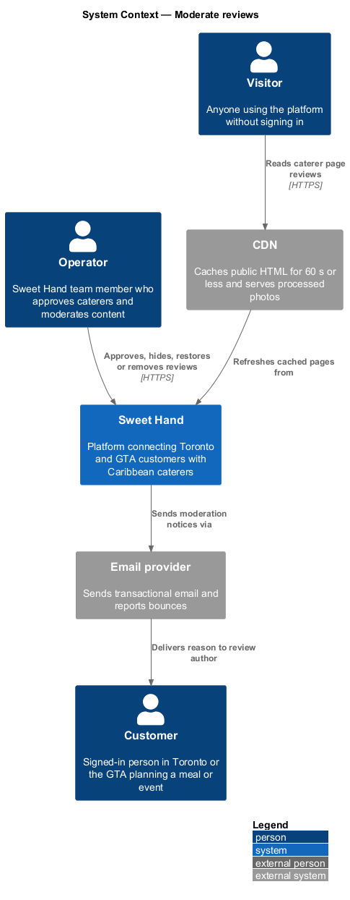
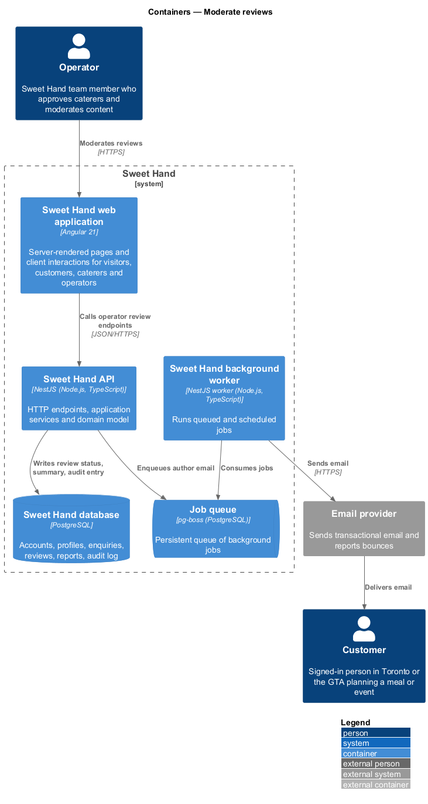
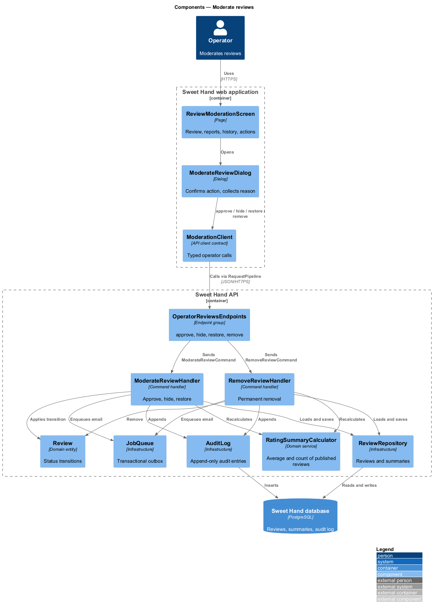
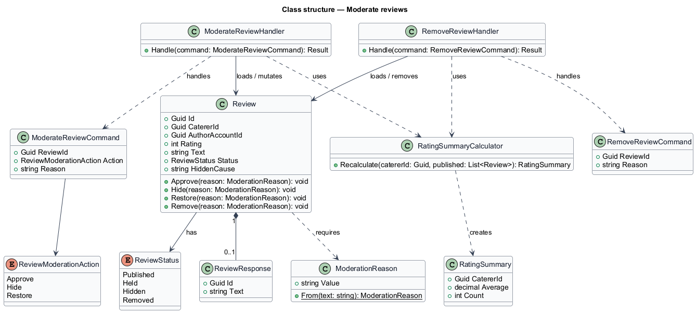
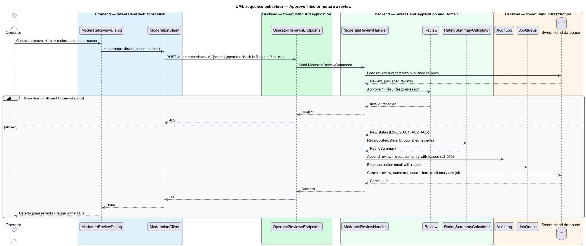
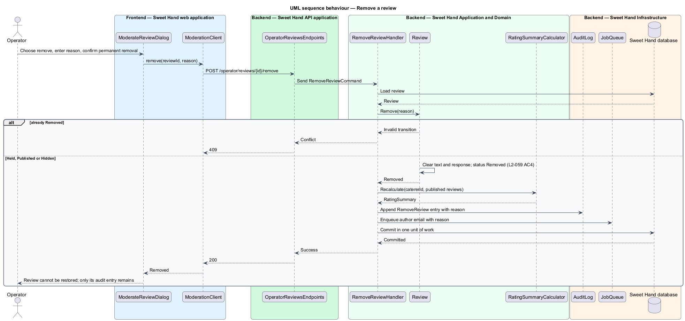

# Moderate reviews

## Overview

Customer reviews appear on caterer pages as soon as they are submitted, unless
they contain a URL, an email address or a phone number, in which case they are
held for a check (`L2-050`). Operators also respond to reports about reviews.
This feature gives operators four actions on a review (`L1-016`).

- **held review** — review not yet public because it contains a URL, email address or phone number
- **hidden review** — review taken off the public page in a reversible way, by an operator or by automatic hiding after reports
- **removed review** — review deleted permanently; only its audit entry remains
- **rating summary** — average rating to one decimal place and review count shown on the caterer page, computed from published reviews only

Each action needs a reason and the review's author receives it by email. The
rating summary is recalculated whenever a review enters or leaves the published
set. Writing and showing reviews belong to the reviews subsystem.

## Description

The slice runs from an operator screen to the database and the email provider.
Technology choices follow ADR 0001 (Angular 21) and ADR 0006 (NestJS on
Node.js, PostgreSQL through Drizzle ORM, S3-compatible object storage);
providers not named there remain `<TO SUPPLY>`.

**Review status transitions.** `Review` allows these operator transitions and
returns HTTP 409 for any other:

- `Held` → `Published` (approve)
- `Published` → `Hidden` (hide)
- `Hidden` → `Published` (restore)
- `Held`, `Published` or `Hidden` → `Removed` (remove; terminal)

**Frontend — Sweet Hand web application**

- **`ReviewModerationScreen`** — operator screen for one review. It shows text, rating, status, reports and history, and offers the actions valid for the status.
- **`ModerateReviewDialog`** — dialog that confirms the chosen action and collects the reason. The removal variant states that removal is permanent.
- **`ModerationClient`** — API client contract the screen and dialog depend on.

**Backend — Sweet Hand API application**

- **`OperatorReviewsEndpoints`** — `POST /operator/reviews/{reviewId}/approve`, `.../hide`, `.../restore` and `.../remove`, behind the operator check in `RequestPipeline` (`L2-056`).

**Backend — Sweet Hand Application and Domain**

- **`ModerateReviewCommand` / `ModerateReviewHandler`** — handles approve, hide and restore. It applies the transition on `Review`, recalculates the `RatingSummary`, resolves the held-review queue item for an approval, appends the audit entry and enqueues the author email.
- **`RemoveReviewCommand` / `RemoveReviewHandler`** — appends the audit entry, deletes the review text and any `ReviewResponse`, marks the review `Removed`, recalculates the `RatingSummary` and enqueues the author email (`L2-059` AC4).
- **`Review`** — entity with `Approve`, `Hide`, `Restore` and `Remove`, each taking a `ModerationReason`.
- **`ModerationReason`** — value object; it rejects an empty reason.
- **`RatingSummary`** — value object per caterer: average to one decimal place and count over `Published` reviews only (`L2-051` AC5). `RatingSummaryCalculator` rebuilds it.

**Backend — Sweet Hand Infrastructure and worker**

- **`ReviewRepository`**, **`ReviewQueueRepository`** — persist reviews, summaries and queue items.
- **`AuditLog`** — appends review moderation entries (`L2-060`).
- **`JobQueue`**, **`SendNotificationJob`**, **`EmailGateway`** — email the author with the reason (`L2-059` AC2).

**Visibility.** The caterer page reads published reviews and the stored
summary. The CDN caches public HTML for 60 s or less (`L2-087` AC4), so an
approved review appears and a hidden review disappears within 60 seconds
(`L2-059` AC1 and AC2).

Open points:

- Whether the audit entry for a removed review keeps the review text as its "before" value: `<TO SUPPLY>`.
- Whether a hidden review's caterer response is hidden with it: `<TO SUPPLY>`. The design hides it with the review.
- Minimum length of a moderation reason: `<TO SUPPLY>`.

## Requirements

The feature realizes the following level-2 (L2) requirements from `docs/specs/L2.md`. Each refines the level-1 (L1) requirement cited beside it. Requirement text is quoted from the specification, with *must* rendered as *shall*.

| L2 ID | Refines (L1) | Requirement |
|-------|--------------|-------------|
| `L2-059` | `L1-016` | An operator shall be able to approve a held review, hide a review (reversible), restore a hidden review, or remove a review permanently. Each action needs a reason, and the review's author is told. |

## Diagrams

### System context

The operator moderates reviews customers wrote about caterers. Sweet Hand emails each author the reason, and visitors see the result on the caterer page.

### Containers

The operator screen calls the API, which changes review status, recalculates the rating summary and queues the author email for the worker.

### Components

`OperatorReviewsEndpoints` sends reversible actions to `ModerateReviewHandler` and removal to `RemoveReviewHandler`. Both recalculate the `RatingSummary`.

### Class structure

`Review` owns its `ReviewStatus` and an optional `ReviewResponse`. Each action takes a `ModerationReason`, and `RatingSummaryCalculator` rebuilds the caterer's `RatingSummary`.

### Behaviour — approve, hide or restore a review

The three reversible actions share one handler. Each checks the transition on `Review`, recalculates the rating summary and emails the author.

### Behaviour — remove a review

Removal clears the review's content, recalculates the summary and leaves only the audit entry. A second removal returns HTTP 409.

