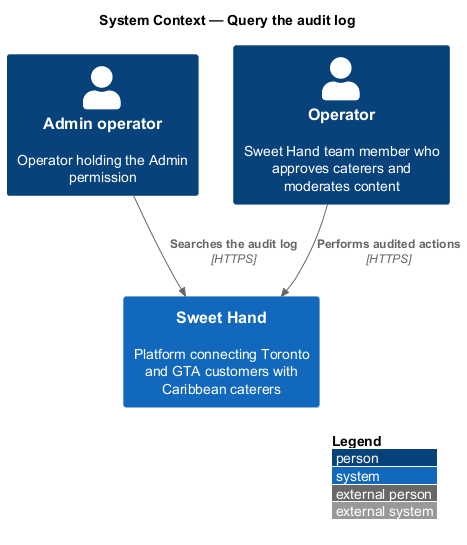
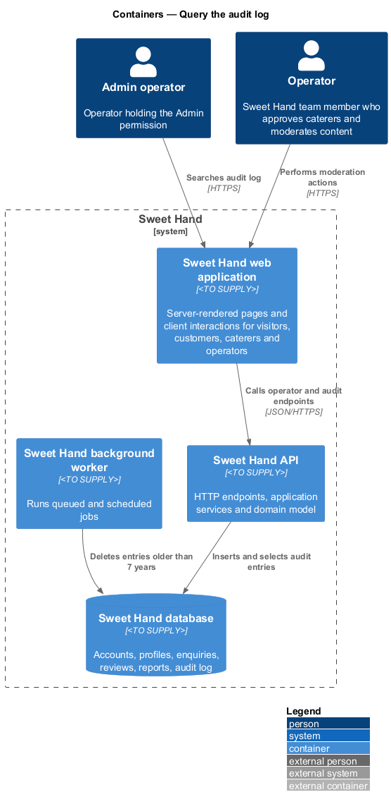
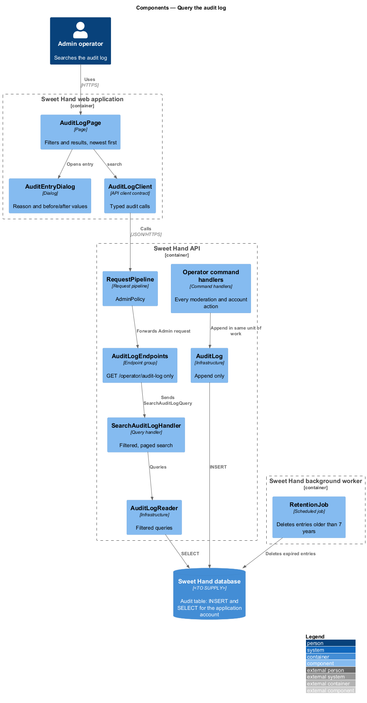
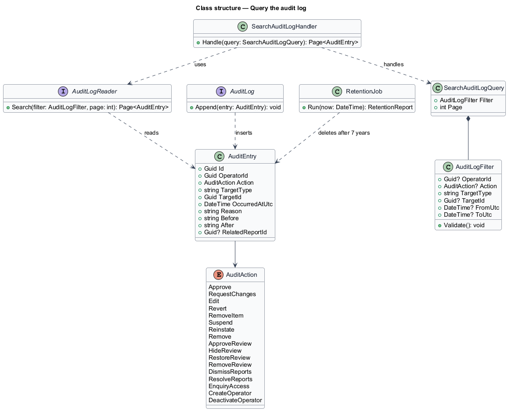
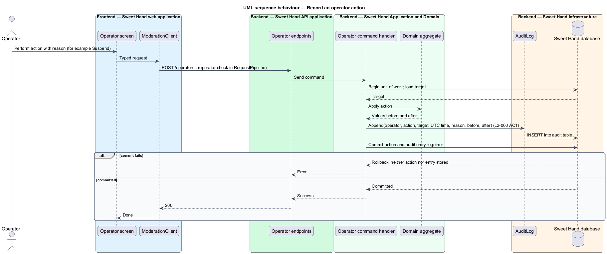
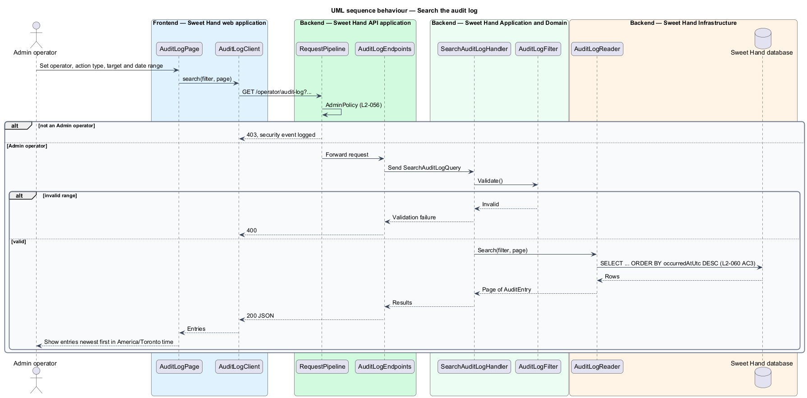
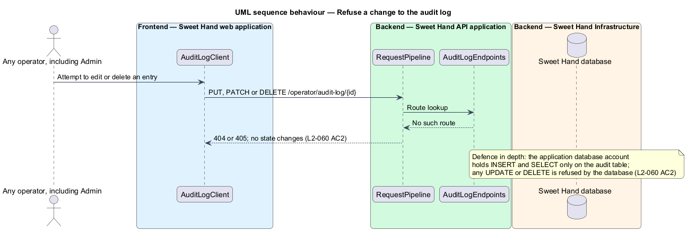

# Query the audit log

## Overview

Operators can change or hide content that caterers and customers created, and
can read private enquiries while handling reports. The audit log makes every
such action traceable (`L1-016`). This feature covers how operator actions are
written to the log, how the log is protected from change, and how an Admin
operator searches it.

- **audit log** — append-only record of every operator action
- **audit entry** — one record in the audit log: operator, action, target record, time in UTC, reason, and values before and after
- **append-only** — property of a store whose rows can be inserted and read but never updated or deleted by the application

The actions logged are approvals, change requests, edits, suspensions,
reinstatements, removals, review moderation, report resolutions, enquiry access
and operator account changes. Every moderation feature in this subsystem writes
its entry in the same unit of work as the action itself. Entries are kept for
7 years (`L2-073`).

## Description

The slice runs from the Admin audit log screen to the database, and includes
the shared write path used by every operator command. Technology choices for
every container are `<TO SUPPLY>` pending architecture decision records (ADRs)
in `docs/adr/`.

**Frontend — Sweet Hand web application**

- **`AuditLogPage`** — Admin-only screen. It shows filters for operator, action type, target and date range, and lists matching entries newest first (`L2-060` AC3). Times display in `America/Toronto`.
- **`AuditEntryDialog`** — dialog that shows one entry's reason and the values before and after.
- **`AuditLogClient`** — API client contract the page depends on.

**Backend — Sweet Hand API application**

- **`AuditLogEndpoints`** — `GET /operator/audit-log?operatorId=&action=&targetType=&targetId=&from=&to=&page=`, behind `AdminPolicy` in `RequestPipeline` (`L2-056`). The group defines no update or delete route (`L2-060` AC2).

**Backend — Sweet Hand Application and Domain**

- **`AuditEntry`** — immutable entity: `id`, `operatorId`, `action`, `targetType`, `targetId`, `occurredAtUtc`, `reason`, `before`, `after` and optional `relatedReportId` (enquiry access, `L2-034` AC3).
- **`AuditAction`** — enumeration: `Approve`, `RequestChanges`, `Edit`, `Revert`, `RemoveItem`, `Suspend`, `Reinstate`, `Remove`, `ApproveReview`, `HideReview`, `RestoreReview`, `RemoveReview`, `DismissReports`, `ResolveReports`, `EnquiryAccess`, `CreateOperator`, `DeactivateOperator`.
- **`SearchAuditLogQuery` / `SearchAuditLogHandler`** — validates the `AuditLogFilter` and returns a page of entries ordered by `occurredAtUtc` descending.
- **`AuditLogFilter`** — value object with optional operator, action, target and UTC date range; the range start precedes the end.

**Backend — Sweet Hand Infrastructure and worker**

- **`AuditLog`** — the only writer. `Append(entry)` inserts within the caller's unit of work, so an action and its entry commit or fail together. It exposes no update or delete method.
- **`AuditLogReader`** — runs filtered, paged queries.
- **Database permissions** — an explicit migration grants the application's database account INSERT and SELECT on the audit table and no UPDATE or DELETE (`L2-060` AC2).
- **`RetentionJob`** (worker) — deletes entries older than 7 years (`L2-060` AC4, `L2-073`).

Open points:

- `RetentionJob` deletes audit entries, but the application's database account holds no DELETE permission on the table. The database principal that the retention job uses, and how it is restricted: `<TO SUPPLY>`.
- Page size of search results: `<TO SUPPLY>`.
- Whether audit entries also feed the observability platform: `<TO SUPPLY>`.

## Requirements

The feature realizes the following level-2 (L2) requirements from `docs/specs/L2.md`. Each refines the level-1 (L1) requirement cited beside it. Requirement text is quoted from the specification, with *must* rendered as *shall*.

| L2 ID | Refines (L1) | Requirement |
|-------|--------------|-------------|
| `L2-060` | `L1-016` | Every operator action shall be written to an audit log that can only be added to. This includes approvals, change requests, edits, suspensions, reinstatements, removals, review moderation, report resolutions, enquiry access and operator account changes. Each entry records the operator, the action, the target record, the time, the reason, and the values before and after. |

## Diagrams

### System context

Operators produce audit entries as they work. An Admin operator searches the audit log in Sweet Hand.

### Containers

Every operator command in the API writes its entry to the database. The Admin screen reads entries through the API, and the background worker deletes entries past retention.

### Components

Operator command handlers call `AuditLog.Append`; `AuditLogEndpoints` and `SearchAuditLogHandler` read through `AuditLogReader`. No component offers update or delete.

### Class structure

`AuditEntry` is immutable and carries an `AuditAction`. `SearchAuditLogHandler` applies an `AuditLogFilter`; `AuditLog` only appends.

### Behaviour — record an operator action

Every operator command handler appends its audit entry inside the action's unit of work. A failed commit stores neither the action nor the entry.

### Behaviour — search the audit log

Only an Admin operator reaches the search. The handler validates the filter and returns entries newest first.

### Behaviour — refuse a change to the audit log

No endpoint edits or deletes an entry, and the database refuses UPDATE and DELETE from the application account.

