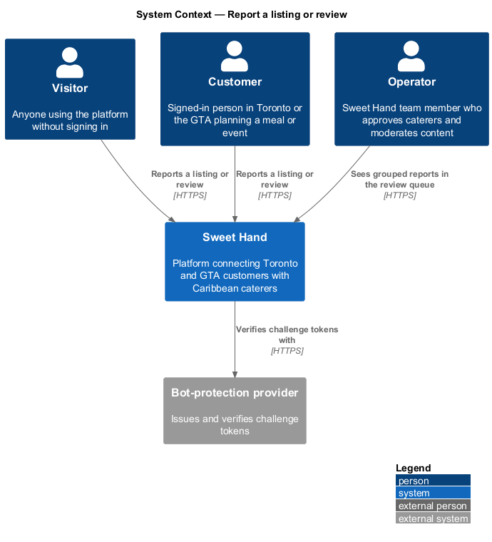
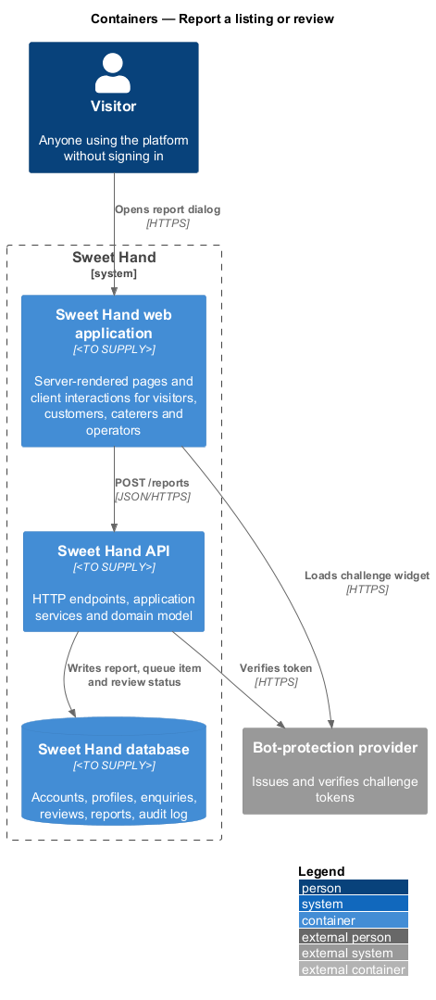
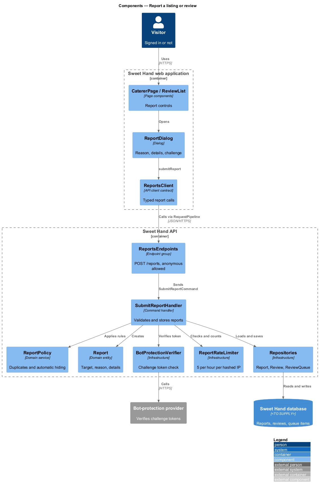
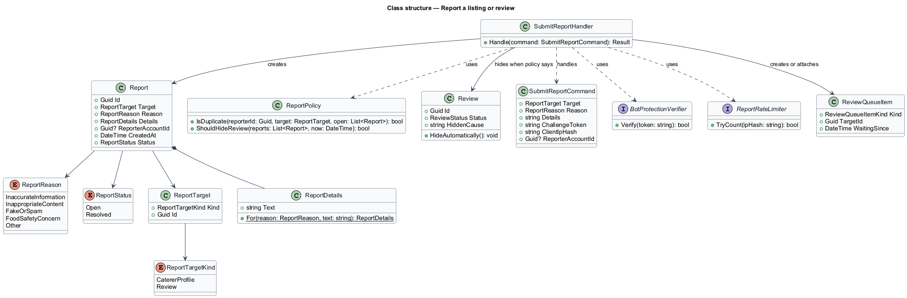
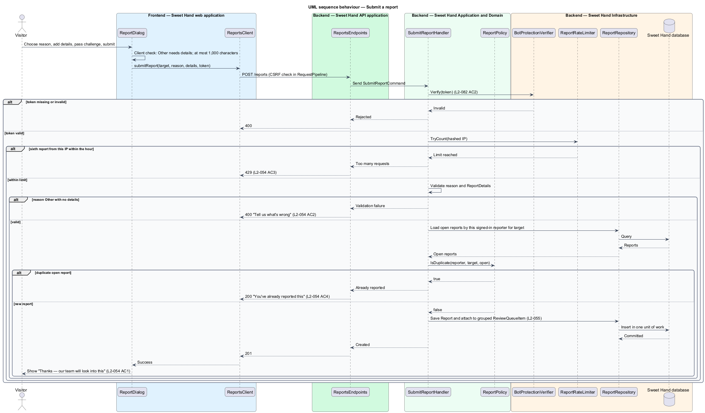
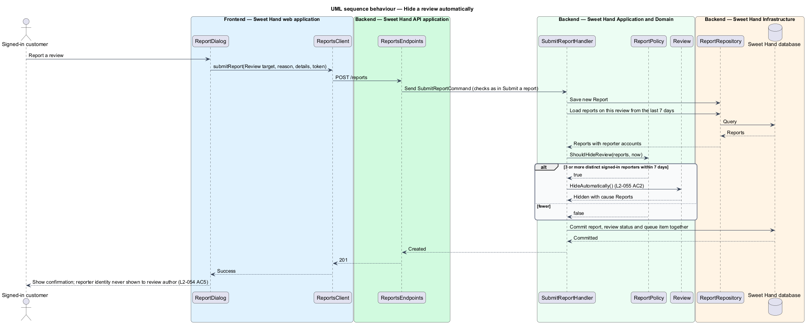

# Report a listing or review

## Overview

Anyone using Sweet Hand can flag a caterer listing or a review for operator
attention (`L1-015`). Reports are how operators learn about inaccurate
information, inappropriate content, fake reviews or food safety concerns
between their own checks.

- **report** — request from any user for operator attention to one caterer profile or one review, with a reason and optional details
- **report target** — the reported item: a caterer profile or a review
- **report reason** — one value from a fixed list: Inaccurate information, Inappropriate content, Fake or spam, Food safety concern, Other
- **automatic hiding** — removal of a review from the public page, without operator action, after reports from 3 different signed-in users within 7 days

A visitor does not need an account to report. Anonymous reports pass a
bot-protection challenge, and each IP address may submit at most 5 reports per
hour. A report never reveals the reporter to the reported caterer or review
author. Every report lands in the review queue, grouped with other open reports
about the same item; operators resolve them in handle-reports.

## Description

The slice runs from a report dialog on public pages to the database. Technology
choices for every container are `<TO SUPPLY>` pending architecture decision
records (ADRs) in `docs/adr/`.

**Frontend — Sweet Hand web application**

- **`CatererPage`** and **`ReviewList`** — public components that show a "Report" control for the caterer and for each review.
- **`ReportDialog`** — dialog with the reason list, a details field (up to 1,000 characters) and the bot-protection widget. "Other" with no details shows "Tell us what's wrong" (`L2-054` AC2). Success shows "Thanks — our team will look into this" (`L2-054` AC1). A duplicate shows "You've already reported this" (`L2-054` AC4).
- **`ReportsClient`** — API client contract the dialog depends on.

**Backend — Sweet Hand API application**

- **`RequestPipeline`** — CSRF check and correlation ID. The report endpoint is an explicit anonymous-access endpoint.
- **`ReportsEndpoints`** — `POST /reports` with `targetKind`, `targetId`, `reason`, `details` and `challengeToken`.

**Backend — Sweet Hand Application and Domain**

- **`SubmitReportCommand` / `SubmitReportHandler`** — verifies the challenge token, checks the per-IP limit, validates the input, applies the duplicate rule, stores the `Report`, attaches it to the target's review queue item and applies automatic hiding.
- **`Report`** — entity: `id`, `target`, `reason`, `details`, `reporterAccountId` (empty for anonymous reports), `createdAt`, `status` (`Open` or `Resolved`).
- **`ReportTarget`** — value object: `kind` (`CatererProfile` or `Review`) and `id`. Only a published profile or a published review is a valid target.
- **`ReportReason`** — enumeration of the five fixed reasons.
- **`ReportDetails`** — value object: plain text up to 1,000 characters; required when the reason is `Other`.
- **`ReportPolicy`** — domain service holding two rules: a signed-in user with an open report on the same target creates no new report (`L2-054` AC4); a third report on a review from distinct signed-in users within 7 days hides the review (`L2-055` AC2).
- **`Review`** — `HideAutomatically()` sets status `Hidden` with cause `Reports`; handle-reports undoes it on dismissal.

**Backend — Sweet Hand Infrastructure**

- **`BotProtectionVerifier`** — verifies the challenge token with the bot-protection provider (`L2-082` AC2).
- **`ReportRateLimiter`** — counts reports per hashed IP address in a rolling hour and refuses the sixth with HTTP 429 (`L2-054` AC3). It stores no raw IP address (`L2-084`).
- **`ReportRepository`**, **`ReviewRepository`**, **`ReviewQueueRepository`** — persist reports, review status and the grouped queue item.

**Reporter privacy.** Public and caterer-facing responses never include
`reporterAccountId` or any other reporter detail (`L2-054` AC5). Only operator
endpoints read it.

Open points:

- Whether signed-in users also complete the bot-protection challenge: `<TO SUPPLY>` (`L2-082` AC2 names only anonymous report forms).
- Duplicate rule for anonymous reports: `<TO SUPPLY>`.
- Whether reports may target enquiries or messages, which `L2-034` implies through operator enquiry access: `<TO SUPPLY>`.

## Requirements

The feature realizes the following level-2 (L2) requirements from `docs/specs/L2.md`. Each refines the level-1 (L1) requirement cited beside it. Requirement text is quoted from the specification, with *must* rendered as *shall*.

| L2 ID | Refines (L1) | Requirement |
|-------|--------------|-------------|
| `L2-054` | `L1-015` | Any visitor, signed in or not, shall be able to report a caterer profile or a review. A report has a reason from a fixed list (Inaccurate information, Inappropriate content, Fake or spam, Food safety concern, Other) and optional details of up to 1,000 characters. |

## Diagrams

### System context

Visitors and customers report caterer profiles and reviews to Sweet Hand. Sweet Hand checks anonymous submissions with the bot-protection provider, and operators see the result in their queue.

### Containers

The report dialog in the web application posts to the API. The API verifies the challenge token, enforces limits and writes the report and queue item to the database.

### Components

`ReportsEndpoints` sends `SubmitReportCommand` to its handler, which uses the verifier, the rate limiter and `ReportPolicy` before persisting the `Report`.

### Class structure

A `Report` has a `ReportTarget`, a `ReportReason` and optional `ReportDetails`. `ReportPolicy` decides duplicates and automatic hiding of a `Review`.

### Behaviour — submit a report

The handler checks the challenge token, then the per-IP limit, then the input, then the duplicate rule. A new report joins the grouped review queue item for its target.

### Behaviour — hide a review automatically

After saving a report on a review, the handler counts distinct signed-in reporters in the last 7 days. At 3, the review is hidden until an operator resolves the reports.

