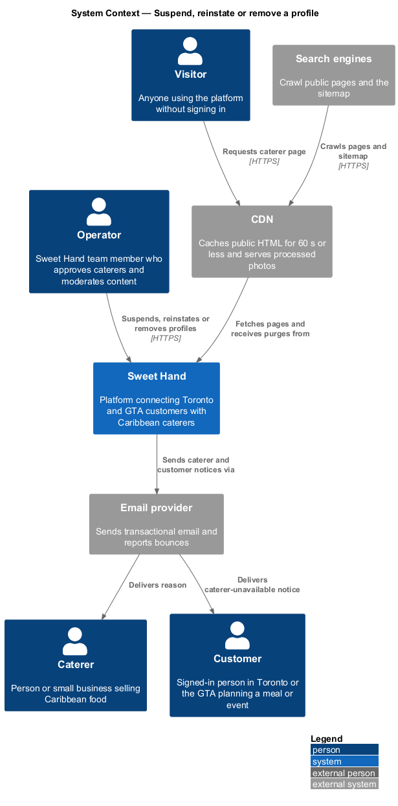
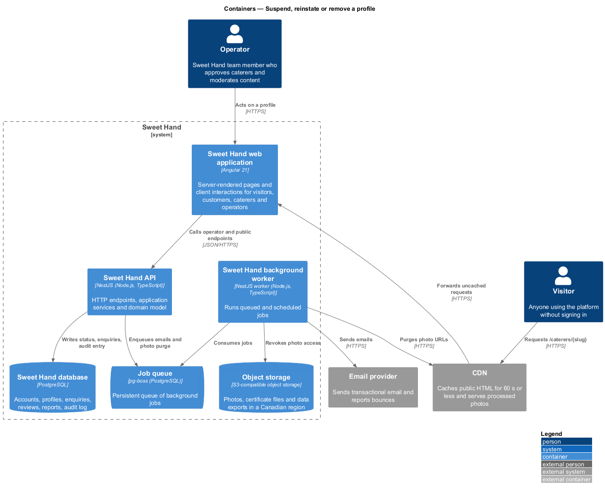
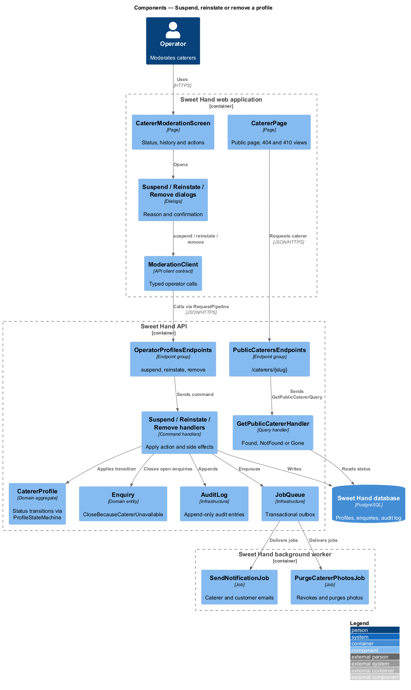
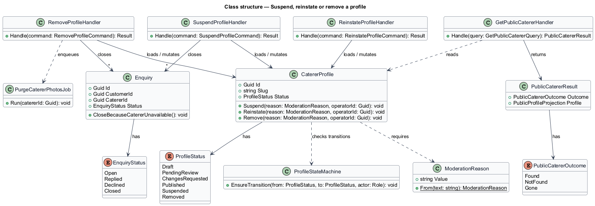
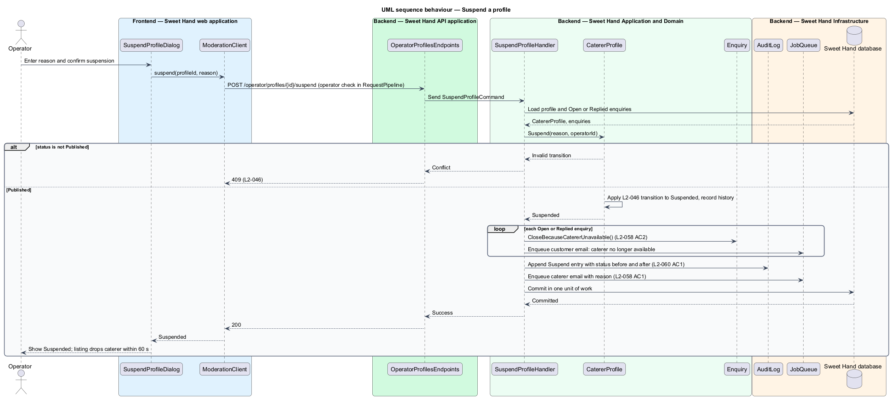
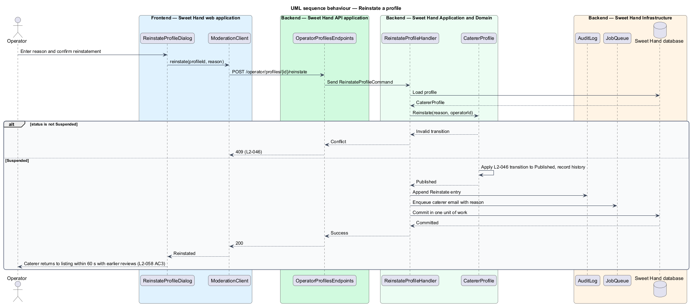
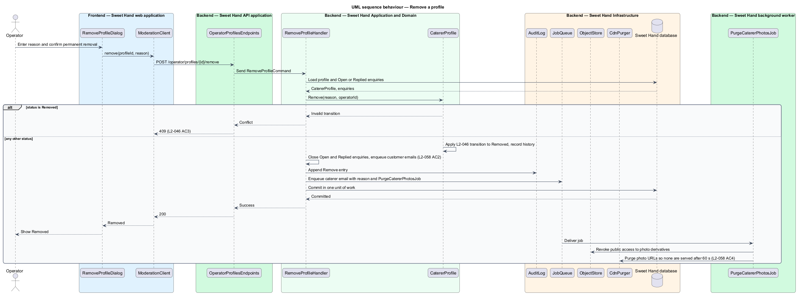
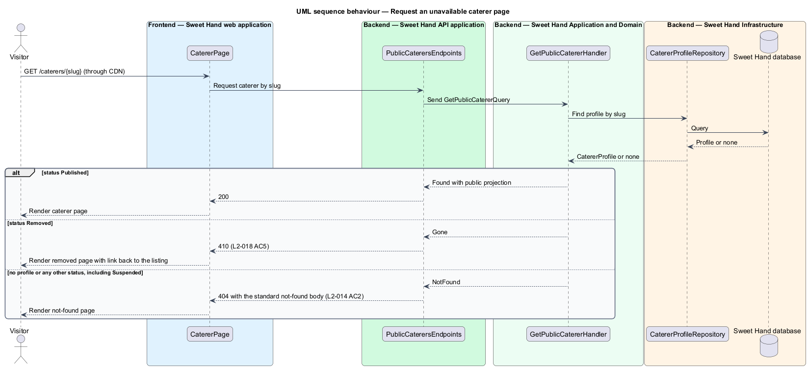

# Suspend, reinstate or remove a profile

## Overview

Operators can take a caterer off Sweet Hand when the profile breaks the rules or
the caterer can no longer trade (`L1-016`). This feature covers three operator
actions on a caterer profile and what visitors see afterwards.

- **suspension** — reversible hiding of a published profile; the profile status becomes `Suspended`
- **reinstatement** — return of a suspended profile to `Published`, with its earlier reviews
- **removal** — permanent end of a profile; the status becomes `Removed` and accepts no further change
- **caterer-unavailable closure** — automatic closing of a caterer's `Open` and `Replied` enquiries when the caterer is suspended or removed

Each action needs a reason, which the caterer receives by email. A suspended
caterer's page returns HTTP 404; a removed caterer's page returns HTTP 410 with a
link back to the listing (`L2-018` AC5). Customers with open enquiries learn
that the caterer is no longer available. The status transitions follow the
lifecycle described in decide-profile-approval (`L2-046`).

## Description

The slice runs from an operator screen to the database, object storage, the CDN
and the email provider, and also covers the public caterer page response.
Technology choices follow ADR 0001 (Angular 21) and ADR 0006 (NestJS on
Node.js, PostgreSQL through Drizzle ORM, S3-compatible object storage);
providers not named there remain `<TO SUPPLY>`.

**Transitions used (`L2-046`).** `Published` → `Suspended` (operator, with a
reason); `Suspended` → `Published` (operator, reinstate); any status except
`Removed` → `Removed` (operator, with a reason). Any other request receives
HTTP 409. Each accepted transition writes a `ProfileStatusChange` and an
`AuditEntry`.

**Frontend — Sweet Hand web application**

- **`CatererModerationScreen`** — operator screen for one caterer. It shows the status and history and offers "Suspend", "Reinstate" or "Remove" according to the status.
- **`SuspendProfileDialog`**, **`ReinstateProfileDialog`**, **`RemoveProfileDialog`** — dialogs that collect the reason and confirm the action. The removal dialog states that removal is permanent.
- **`ModerationClient`** — API client contract the screen and dialogs depend on.
- **`CatererPage`** — public caterer page. It renders the not-found page for HTTP 404 and the removed page with a link to the listing for HTTP 410.

**Backend — Sweet Hand API application**

- **`OperatorProfilesEndpoints`** — `POST /operator/profiles/{profileId}/suspend`, `.../reinstate` and `.../remove`, behind the operator check in `RequestPipeline` (`L2-056`).
- **`PublicCaterersEndpoints`** — serves `/caterers/{slug}`. It maps `PublicCatererResult.NotFound` to HTTP 404 and `PublicCatererResult.Gone` to HTTP 410.

**Backend — Sweet Hand Application and Domain**

- **`SuspendProfileCommand` / `SuspendProfileHandler`** — applies the transition, closes the caterer's `Open` and `Replied` enquiries with `Enquiry.CloseBecauseCatererUnavailable` (`L2-058` AC2), appends the audit entry and enqueues emails to the caterer and each affected customer.
- **`ReinstateProfileCommand` / `ReinstateProfileHandler`** — applies the transition back to `Published`. Reviews are untouched by suspension, so they show again (`L2-058` AC3).
- **`RemoveProfileCommand` / `RemoveProfileHandler`** — applies the transition to `Removed`, closes enquiries as for suspension, appends the audit entry, enqueues emails and enqueues `PurgeCatererPhotosJob`.
- **`CatererProfile`** — aggregate with `Suspend(reason)`, `Reinstate(reason)` and `Remove(reason)`; each delegates to `ProfileStateMachine`.
- **`ModerationReason`** — value object; it rejects an empty reason.
- **`Enquiry`** — `CloseBecauseCatererUnavailable()` moves `Open` or `Replied` to `Closed`.
- **`GetPublicCatererQuery` / `GetPublicCatererHandler`** — returns `Found` only for `Published`, `Gone` for `Removed` and `NotFound` for every other status (`L2-014` AC2, `L2-018` AC5).

**Backend — Sweet Hand Infrastructure and worker**

- **`CatererProfileRepository`**, **`EnquiryRepository`** — persist profile and enquiries.
- **`AuditLog`** — appends the action with the status before and after and the reason (`L2-060` AC1).
- **`JobQueue`**, **`SendNotificationJob`**, **`EmailGateway`** — deliver the caterer email with the reason and the customer emails saying the caterer is no longer available on Sweet Hand.
- **`PurgeCatererPhotosJob`** (worker) with **`ObjectStore`** and **`CdnPurger`** — revokes public access to the caterer's photo derivatives and purges them from the CDN, so they are no longer served within 60 seconds (`L2-058` AC4).

**After removal.** Reviews of a removed caterer are no longer shown, because the
caterer page returns HTTP 410 and no other page renders them. The caterer can
still sign in, read and export the enquiry history (`L2-058` AC5, `L2-071`),
and cannot edit the profile. The sitemap lists published caterers only
(`L2-018` AC6). Listing visibility within 60 seconds rests on the CDN caching
public HTML for 60 s or less (`L2-087` AC4).

Open points:

- Minimum length of a suspension or removal reason: `<TO SUPPLY>` (`L2-048` AC2 sets 10 characters only for change requests).
- Whether photo files of a removed caterer are deleted from object storage, and when: `<TO SUPPLY>`.
- Whether a removed caterer's slug may be reused by a later caterer: `<TO SUPPLY>`.

## Requirements

The feature realizes the following level-2 (L2) requirements from `docs/specs/L2.md`. Each refines the level-1 (L1) requirement cited beside it. Requirement text is quoted from the specification, with *must* rendered as *shall*.

| L2 ID | Refines (L1) | Requirement |
|-------|--------------|-------------|
| `L2-058` | `L1-016` | An operator shall be able to suspend a published profile (hidden, but can be reinstated), reinstate it, or remove a profile permanently. Each action needs a reason and is sent to the caterer. |
| `L2-046` | `L1-013` | A caterer profile shall always have one of these statuses: `Draft`, `Pending review`, `Changes requested`, `Published`, `Suspended` or `Removed`. Only the transitions below are allowed, and only `Published` profiles are publicly visible. (This feature realizes the suspend, reinstate and remove transitions.) |
| `L2-018` | `L1-006` | Each caterer page shall have a stable, readable URL of the form `/caterers/{slug}`, where the slug comes from the business name. Pages shall be rendered on the server and include metadata for search engines and link previews. (This feature realizes AC5: HTTP 410 for `Removed`, HTTP 404 for `Suspended`.) |

## Diagrams

### System context

The operator acts on a caterer's profile. Sweet Hand emails the caterer and affected customers, and visitors and search engines see the page disappear through the CDN.

### Containers

The API writes the status change, enquiry closures and audit entry together. The worker sends emails and purges photos from object storage and the CDN.

### Components

One handler per action mutates `CatererProfile` and the caterer's enquiries. `GetPublicCatererHandler` turns the status into a found, not-found or gone result for the public page.

### Class structure

`CatererProfile` exposes the three actions, each taking a `ModerationReason`. `Enquiry` closes itself when the caterer becomes unavailable, and `PublicCatererResult` drives the HTTP status of the public page.

### Behaviour — suspend a profile

Suspension applies only to a `Published` profile. The handler closes the caterer's open enquiries, notifies each customer and the caterer, and commits everything with the audit entry.

### Behaviour — reinstate a profile

Reinstatement applies only to a `Suspended` profile. Reviews were never touched, so they return with the profile.

### Behaviour — remove a profile

Removal applies to any status except `Removed`. After commit, the worker revokes and purges the caterer's photos so none are served after 60 seconds.

### Behaviour — request an unavailable caterer page

The public query maps the status to a result. Only `Published` renders the page; `Removed` returns HTTP 410 and every other status returns the standard HTTP 404.

