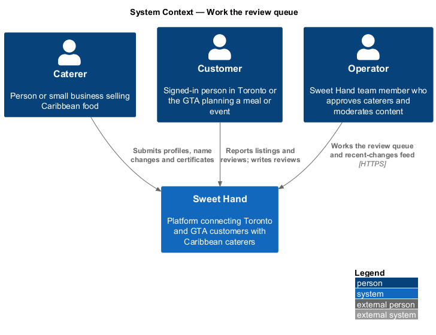
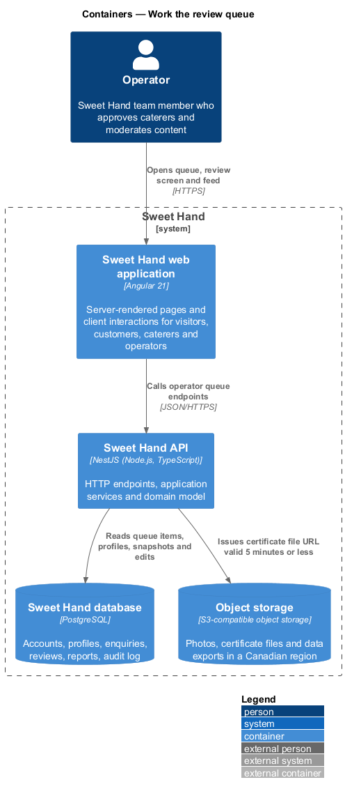
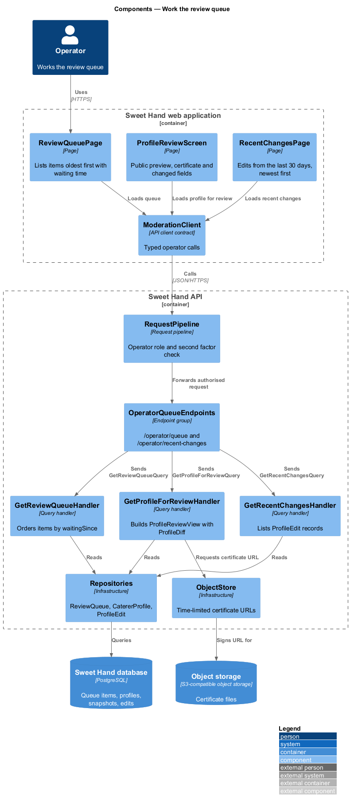
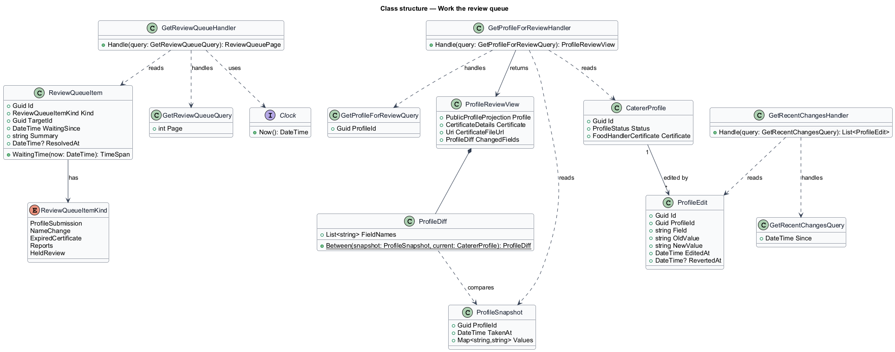
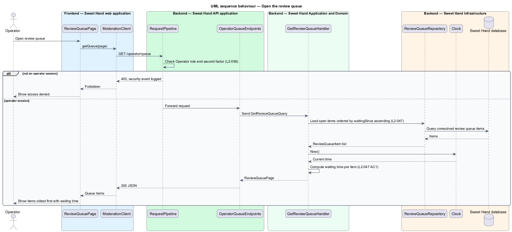
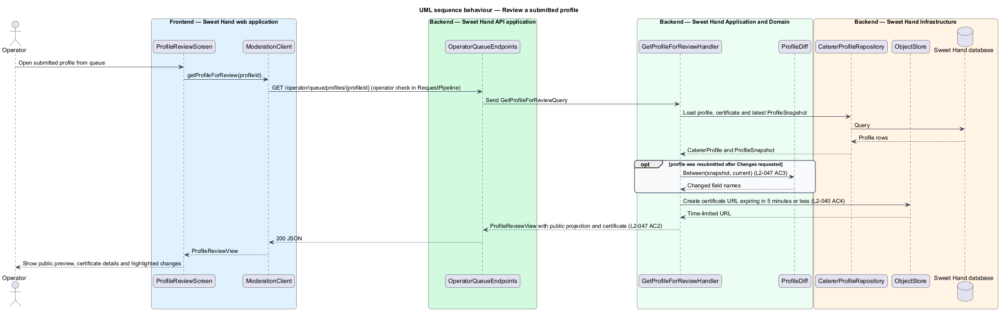
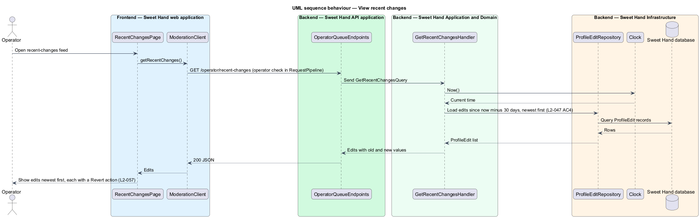

# Work the review queue

## Overview

Sweet Hand publishes a caterer only after an operator approves the profile
(`L1-013`), and operators keep published content accurate after that. This
feature gives operators the two lists they work from: the review queue and the
recent-changes feed.

- **review queue** — operator worklist of items that wait for an operator decision, ordered oldest first
- **review queue item** — one entry in the review queue: a submitted profile, a pending business-name change, an expired food handler certificate, a group of open reports about one item, or a held review
- **recent-changes feed** — list of edits caterers made to published profiles in the last 30 days, newest first
- **resubmitted profile** — profile that returns to `Pending review` after an operator requested changes

Profile submissions arrive from the caterer-profiles subsystem, expired
certificates from the daily maintenance job (`L2-040` AC3), reports from the
report-content feature, and held reviews from the reviews subsystem (`L2-050`
AC3). Each source writes a review queue item. This feature reads and presents
those items. The decisions themselves belong to sibling features:
decide-profile-approval, handle-reports, moderate-reviews and
edit-profile-as-operator (which owns the "Revert" action on the feed).

## Description

The slice is read-only. It runs from the operator screens in the web
application to the database and object storage. Technology choices follow ADR 0001 (Angular 21) and ADR 0006 (NestJS on
Node.js, PostgreSQL through Drizzle ORM, S3-compatible object storage);
providers not named there remain `<TO SUPPLY>`.

**Frontend — Sweet Hand web application**

- **`ReviewQueuePage`** — operator screen that lists review queue items oldest first. Each row shows the item kind, the target name and how long the item has waited (`L2-047` AC1).
- **`ProfileReviewScreen`** — operator screen for one submitted profile. It renders the profile as it will appear publicly, the food handler certificate details and a link to the uploaded certificate file (`L2-047` AC2). For a resubmitted profile it highlights each field that changed since the last "Changes requested" decision (`L2-047` AC3).
- **`RecentChangesPage`** — operator screen that lists edits to published profiles from the last 30 days, newest first, with old and new values and a "Revert" action (`L2-047` AC4).
- **`ModerationClient`** — API client contract the operator screens depend on. The concrete client calls the `OperatorQueueEndpoints`.

**Backend — Sweet Hand API application**

- **`RequestPipeline`** — shared pipeline. For every operator route it checks on the server that the session holds the `Operator` role and a completed second factor (`L2-056`), and it attaches a correlation ID.
- **`OperatorQueueEndpoints`** — endpoint group: `GET /operator/queue`, `GET /operator/queue/profiles/{profileId}`, `GET /operator/profiles/{profileId}/certificate-file` and `GET /operator/recent-changes`.

**Backend — Sweet Hand Application and Domain**

- **`GetReviewQueueQuery` / `GetReviewQueueHandler`** — returns open review queue items ordered by `waitingSince` ascending and computes each item's waiting time from `Clock`.
- **`GetProfileForReviewQuery` / `GetProfileForReviewHandler`** — loads the profile, its certificate and, for a resubmitted profile, the `ProfileSnapshot` taken at the last "Changes requested" decision. It returns a `ProfileReviewView` holding the public projection, the certificate details and a `ProfileDiff`.
- **`GetRecentChangesQuery` / `GetRecentChangesHandler`** — returns `ProfileEdit` records from the last 30 days, newest first.
- **`ReviewQueueItem`** — entity with `kind`, `targetId`, `waitingSince`, `summary` and `resolvedAt`. `waitingSince` holds the submission time, the name-change request time, the certificate expiry detection time, the earliest open report time or the hold time, by kind.
- **`ReviewQueueItemKind`** — enumeration: `ProfileSubmission`, `NameChange`, `ExpiredCertificate`, `Reports`, `HeldReview`.
- **`ProfileSnapshot`** — copy of the profile's field values, stored by decide-profile-approval when an operator requests changes.
- **`ProfileDiff`** — value object listing the field names whose values differ between a `ProfileSnapshot` and the current draft.
- **`ProfileEdit`** — record of one caterer edit to a published profile: `profileId`, `field`, `oldValue`, `newValue`, `editedAt`, `revertedAt`. The caterer-profiles subsystem writes it (`L2-044` AC1).

**Backend — Sweet Hand Infrastructure**

- **`ReviewQueueRepository`**, **`CatererProfileRepository`**, **`ProfileEditRepository`** — read the queue, profiles with snapshots, and recent edits from the Sweet Hand database.
- **`ObjectStore`** — issues a time-limited URL for the certificate file that expires after 5 minutes or less (`L2-040` AC4). The certificate file is never served through a public URL.
- **`Clock`** — current time, shown in `America/Toronto`.

Open points:

- Queue page size and pagination: `<TO SUPPLY>`.
- Whether an operator can claim an item so that two operators do not work the same item: `<TO SUPPLY>`.
- `L2-047` does not list held reviews as a queue item kind, while `L2-050` AC3 places them in the queue. The design includes them as `HeldReview`.

## Requirements

The feature realizes the following level-2 (L2) requirements from `docs/specs/L2.md`. Each refines the level-1 (L1) requirement cited beside it. Requirement text is quoted from the specification, with *must* rendered as *shall*.

| L2 ID | Refines (L1) | Requirement |
|-------|--------------|-------------|
| `L2-047` | `L1-013` | Operators shall have a review queue listing profiles in `Pending review`, pending business-name changes, expired food handler certificates and open reports, oldest first. They shall also have a separate feed of recent edits to published profiles. |

## Diagrams

### System context

Caterers, customers and visitors create the work that lands in the queue. The operator works the queue inside Sweet Hand.

### Containers

The operator screens in the web application call the Sweet Hand API. The API reads the queue and profiles from the database and issues time-limited certificate URLs from object storage.

### Components

`OperatorQueueEndpoints` sends one query per screen to its handler. The handlers read through repositories and never change state.

### Class structure

`ReviewQueueItem` carries a `ReviewQueueItemKind` and a `waitingSince` time. `ProfileReviewView` combines the public projection, the certificate and a `ProfileDiff` computed from a `ProfileSnapshot`.

### Behaviour — open the review queue

The request pipeline rejects any session without the operator role and a completed second factor. The handler orders items by `waitingSince` and computes each waiting time.

### Behaviour — review a submitted profile

The handler loads the profile and its latest snapshot, computes the changed fields for a resubmission, and issues a certificate URL that expires in 5 minutes or less.

### Behaviour — view recent changes

The feed lists edits from the last 30 days, newest first. The "Revert" action on each entry is realized by edit-profile-as-operator.

