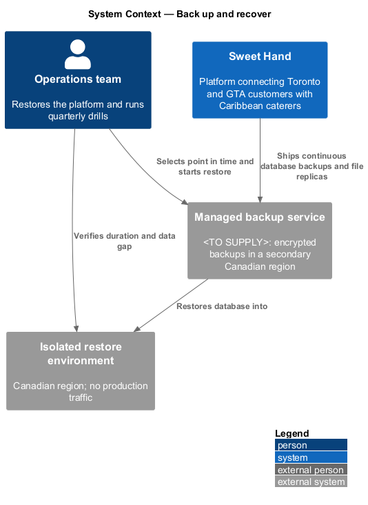
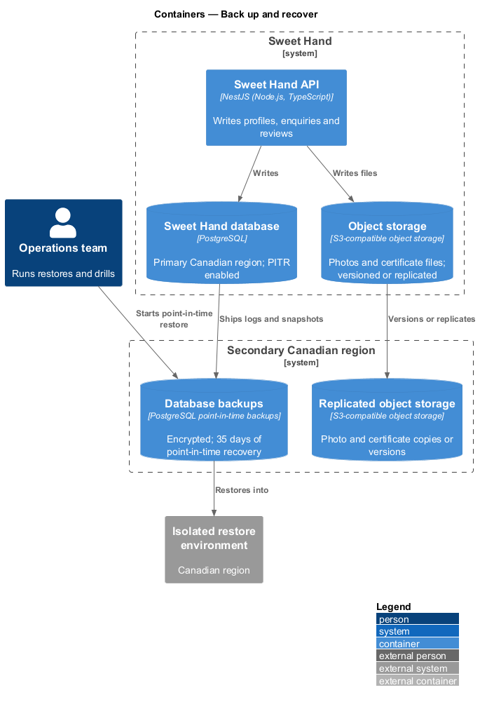
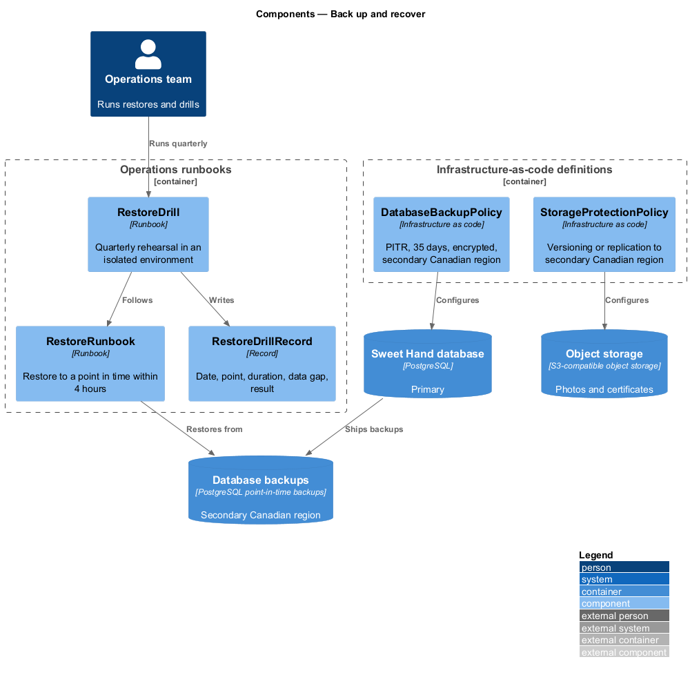
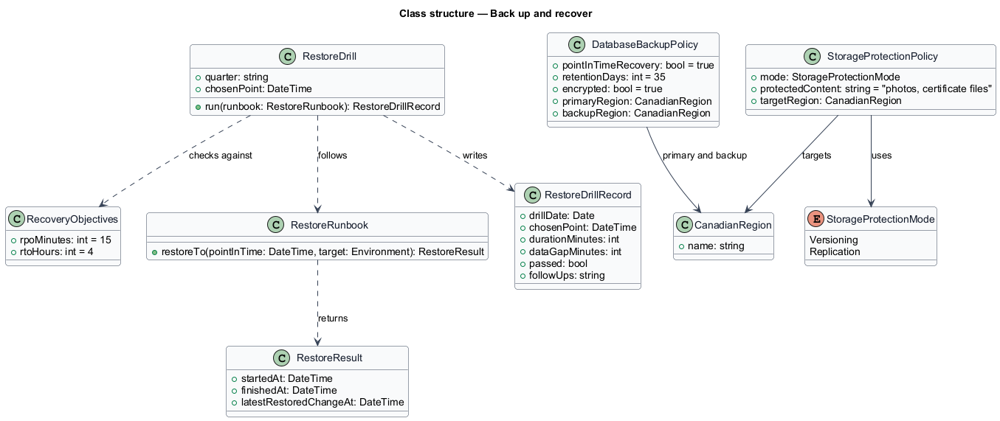
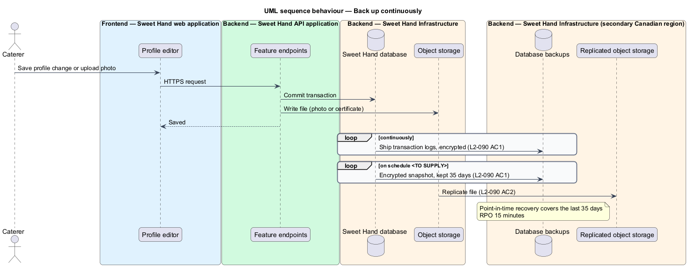
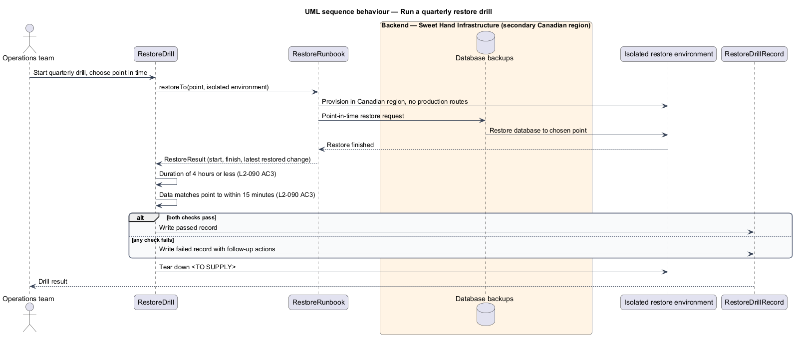

# Back up and recover

## Overview

Sweet Hand connects customers in Toronto and the Greater Toronto Area (GTA) with
caterers who sell Caribbean food. The platform holds data that people cannot
easily recreate: caterer profiles and photos, food handler certificates, and
enquiry threads about events with fixed dates. Level-1 requirement `L1-023`
asks that failures cause no loss of data that customers or caterers have
submitted, and that the operations team can recover the platform.

This feature defines how the database and object storage are backed up, how
far back they can be restored, and how a restore is rehearsed. It is an
operational slice. It has no user-facing screen. It sits in the platform
subsystem beside health monitoring and graceful degradation.

Terms used in this document:

- **recovery point objective (RPO)** — maximum span of data that a restore may lose, here 15 minutes
- **recovery time objective (RTO)** — maximum time to bring the platform back after a failure, here 4 hours
- **point-in-time recovery (PITR)** — database restore to any chosen moment within the retention period
- **restore drill** — rehearsal that restores production backups into an isolated environment and records the outcome
- **secondary region** — Canadian data centre region other than the primary one

## Description

Technology choices follow ADR 0001 (Angular 21) and ADR 0006 (NestJS on
Node.js, PostgreSQL through Drizzle ORM, S3-compatible object storage);
providers not named there remain `<TO SUPPLY>`. Backup settings live in the
infrastructure-as-code definitions, so they are reviewable and subject to the
region policy check in `platform/secure-build-pipeline`.

- **`DatabaseBackupPolicy`** — infrastructure-as-code settings for the Sweet
  Hand database (`L2-090 AC1`):
  - point-in-time recovery enabled, with 35 days of retention
  - backups encrypted at rest
  - backups stored in a secondary Canadian region

  The 35-day retention also bounds how long deleted personal data survives in
  backups (`L2-072 AC5`). PITR provides the 15-minute RPO; the log shipping
  interval that achieves it is `<TO SUPPLY>`.
- **`StorageProtectionPolicy`** — infrastructure-as-code settings for object
  storage. Photo files and certificate files are protected by versioning or by
  replication to a secondary Canadian region (`L2-090 AC2`). The choice
  between the two is `<TO SUPPLY>`. Any version retention keeps deleted files
  for no longer than the deletion rules in `L2-072` and `L2-073` allow.
- **`RestoreRunbook`** — written procedure for restoring the database to a
  chosen point in time and re-pointing the platform to it. It targets the
  4-hour RTO. The runbook's location is `<TO SUPPLY>`.
- **`RestoreDrill`** — quarterly exercise run by the operations team
  (`L2-090 AC3`). It restores the database into an isolated environment at a
  chosen point in time, then checks that the restore finished within 4 hours
  and that the data matches that point to within 15 minutes.
- **`RestoreDrillRecord`** — result of each drill: date, chosen point in time,
  restore duration, measured data gap, pass or fail, and follow-up actions. Its
  storage location is `<TO SUPPLY>`. The method for measuring the data gap is
  `<TO SUPPLY>`.
- **`IsolatedRestoreEnvironment`** — environment with no route to production
  traffic, email or external providers. It stays in a Canadian region, because
  restored data includes personal information (`L2-075`). Access controls and
  teardown after the drill are `<TO SUPPLY>`.

## Requirements

The feature realizes the following level-2 (L2) requirement from
`docs/specs/L2.md`. It refines the level-1 (L1) requirement cited beside it.
Requirement text is quoted from the specification, with *must* rendered as
*shall*.

| L2 ID | Refines (L1) | Requirement |
|-------|--------------|-------------|
| `L2-090` | `L1-023` | Data shall be backed up so that the platform can be restored with no more than 15 minutes of data lost (recovery point objective, RPO) and within 4 hours (recovery time objective, RTO). |

## Diagrams

### System context

The operations team runs restores and quarterly drills. Sweet Hand keeps its
backups in a managed backup service in a secondary Canadian region.

### Containers

The database ships continuous backups to encrypted storage in the secondary
region. Object storage versions or replicates photo and certificate files. A
drill restores into an isolated environment.

### Components

`DatabaseBackupPolicy` and `StorageProtectionPolicy` are declared in the
infrastructure-as-code definitions. `RestoreRunbook` drives a `RestoreDrill`,
which produces a `RestoreDrillRecord`.

### Class structure

The two policies carry the retention, encryption and region settings.
`RestoreDrill` checks its outcome against `RecoveryObjectives` and writes a
`RestoreDrillRecord`.

### Behaviour — back up continuously

The database ships transaction logs and snapshots to encrypted backup storage in
the secondary region. Object storage versions or replicates each new photo or
certificate file.

### Behaviour — run a quarterly restore drill

The operations team picks a point in time and restores into the isolated
environment. The drill measures duration and data gap against the 4-hour RTO
and 15-minute RPO, then records the result (`L2-090 AC3`).

