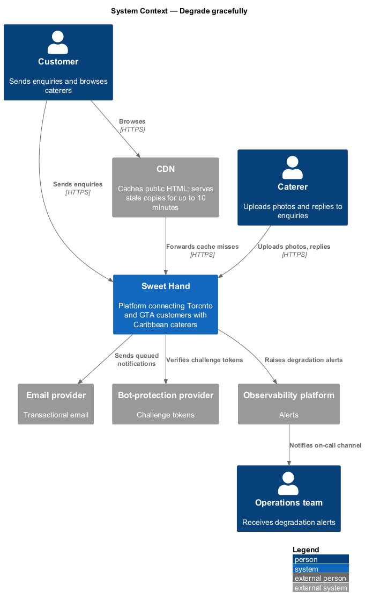
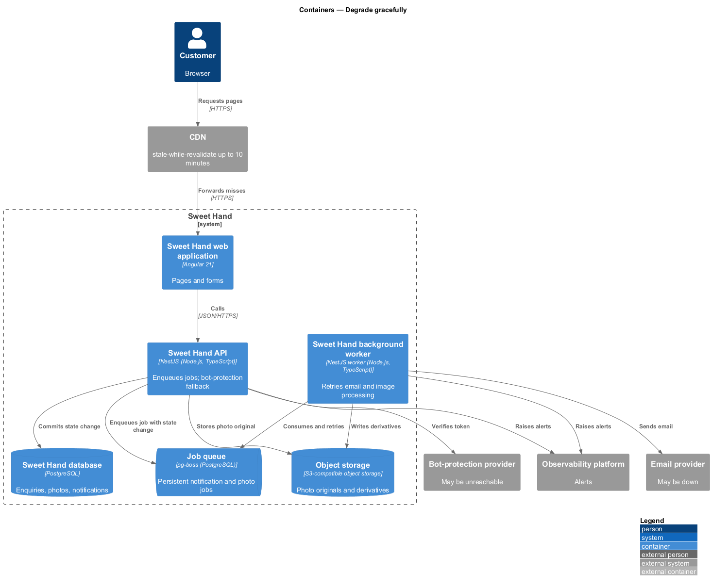
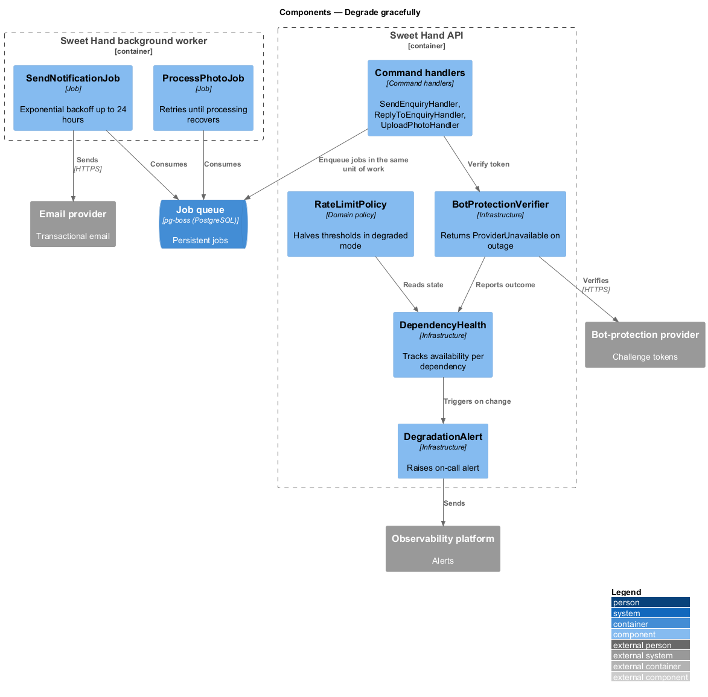
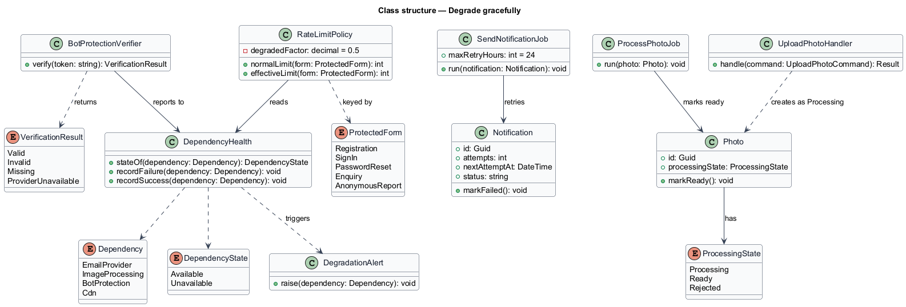
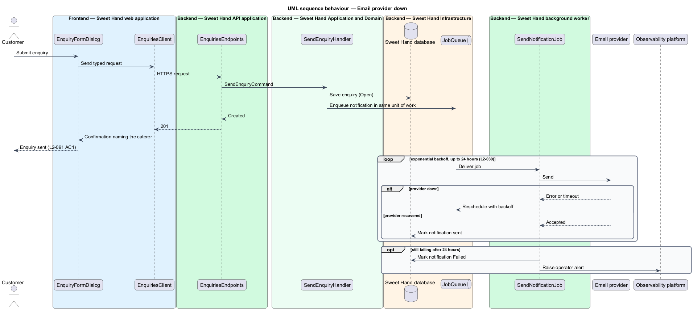
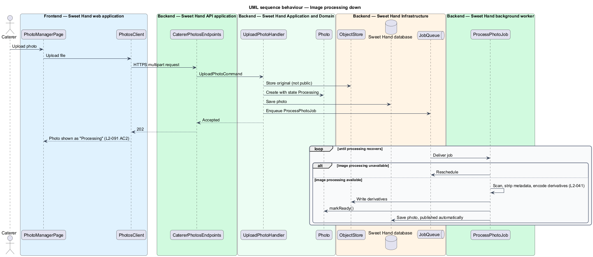
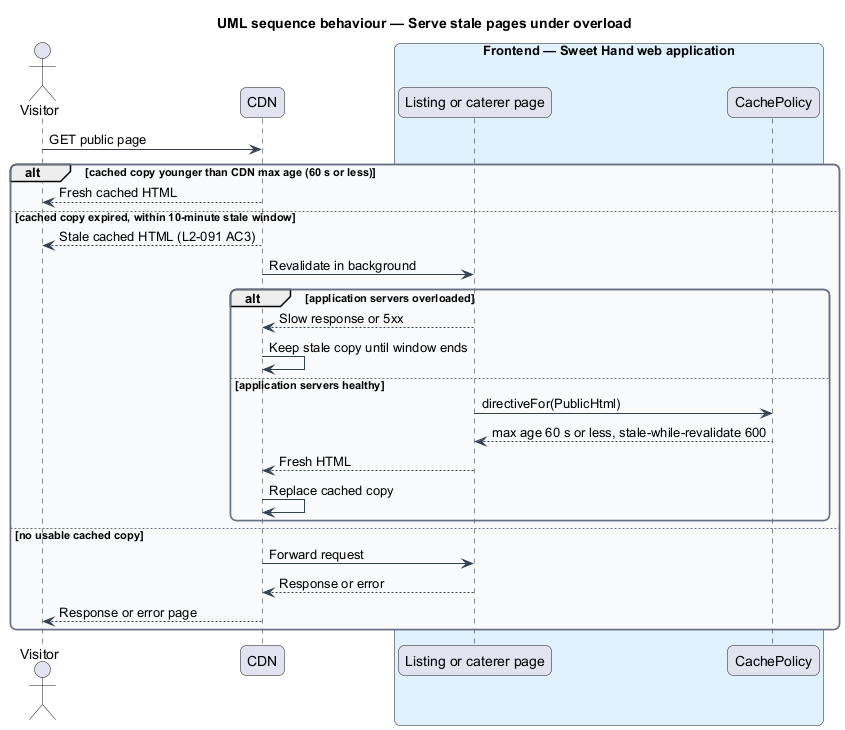
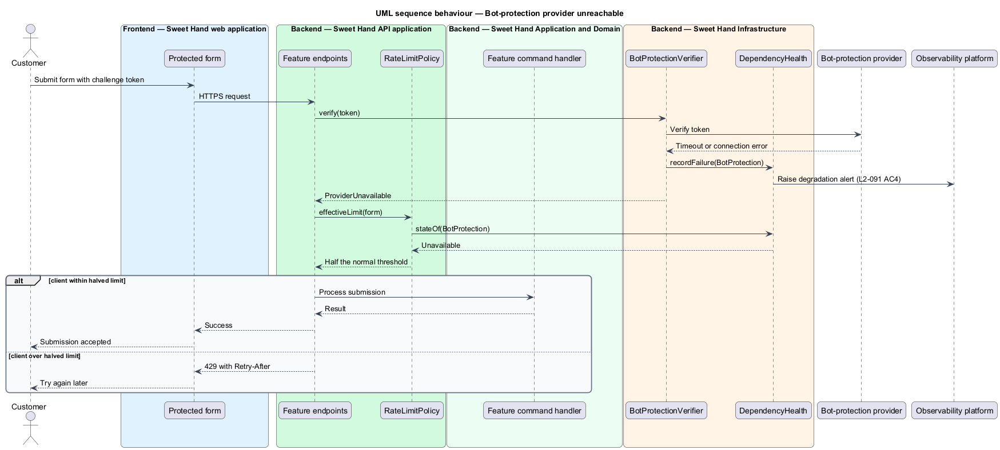

# Degrade gracefully

## Overview

Sweet Hand connects customers in Toronto and the Greater Toronto Area (GTA) with
caterers who sell Caribbean food. The platform depends on outside services: an
email provider, an image processing service, a CDN and a bot-protection
provider. Any of them can fail. A customer whose enquiry fails because email is
down, or a caterer whose upload fails because image processing is slow, loses
trust in the platform.

This feature defines how the platform keeps its core functions working when a
dependency fails. Core functions are browsing caterers, sending enquiries and
replies, and managing a profile. Each failure mode has a defined fallback, and
each fallback limits a feature instead of failing it. The feature sits in the
platform subsystem beside `platform/monitor-health`, which raises the alerts
these fallbacks trigger.

Terms used in this document:

- **dependency** — service outside the request's own process that a feature calls, such as the email provider
- **degraded mode** — state in which a feature runs with a fallback because a dependency is unavailable
- **stale-while-revalidate** — cache rule that lets the CDN serve an expired copy while it fetches a fresh one
- **processing state** — status of an uploaded photo: `Processing` until its derivatives exist, then ready to publish

## Description

Technology choices follow ADR 0001 (Angular 21) and ADR 0006 (NestJS on
Node.js, PostgreSQL through Drizzle ORM, S3-compatible object storage);
providers not named there remain `<TO SUPPLY>`.

**Email provider down (`L2-091 AC1`)**

- **`JobQueue`** — persistent queue in the Sweet Hand infrastructure. Command
  handlers that trigger an email, such as `SendEnquiryHandler` and
  `ReplyToEnquiryHandler`, enqueue a `SendNotificationJob` in the same unit of
  work as the state change. The action succeeds whether or not the email
  provider is reachable. How the enqueue joins the database transaction is
  `<TO SUPPLY>`.
- **`SendNotificationJob`** — background worker job that calls `EmailGateway`.
  On failure it retries with exponential backoff for up to 24 hours, then marks
  the `Notification` `Failed` and raises an operator alert, as defined in
  `L2-030`.

**Image processing down (`L2-091 AC2`)**

- **`UploadPhotoHandler`** — stores the original file, creates a `Photo` with
  processing state `Processing`, and enqueues a `ProcessPhotoJob`. The upload
  succeeds, and the caterer sees the photo marked "Processing".
- **`ProcessPhotoJob`** — scans, strips metadata and encodes derivatives
  (`L2-041`). While the image processing service is down, the job stays on the
  queue and retries. On success it sets the photo ready, and the photo publishes
  automatically. The retry limit for this job is `<TO SUPPLY>`.

**Application servers overloaded (`L2-091 AC3`)**

- **`CachePolicy`** — defined in `platform/deliver-fast-pages`. For public
  listing and caterer pages it adds stale-while-revalidate of up to 10 minutes
  (600 s). When the application servers are slow or failing, the CDN keeps
  serving cached copies for that period. Whether a `stale-if-error` directive is
  also set is `<TO SUPPLY>`. The CDN cache lifetime of 60 s or less is
  unchanged, so the visibility rules in `L2-001` and `L2-044` hold in normal
  operation.

**Bot-protection provider unreachable (`L2-091 AC4`)**

- **`BotProtectionVerifier`** — verifies challenge tokens with the
  bot-protection provider (`L2-082`). When the provider cannot be reached, it
  returns `ProviderUnavailable` instead of rejecting the submission.
- **`DependencyHealth`** — tracks whether each dependency is available, based on
  recent call failures. The thresholds for marking a dependency unavailable or
  recovered are `<TO SUPPLY>`.
- **`RateLimitPolicy`** — normal per-client limits from `L2-025`, `L2-054`,
  `L2-076` and `L2-082`. In degraded mode for bot protection, it halves every
  threshold on the protected forms. The protected forms are registration,
  sign-in after the `L2-076` threshold, password reset, enquiry and anonymous
  report.
- **`DegradationAlert`** — alert to the on-call channel when a fallback
  activates, using the alert path in `platform/monitor-health`.

## Requirements

The feature realizes the following level-2 (L2) requirement from
`docs/specs/L2.md`. It refines the level-1 (L1) requirement cited beside it.
Requirement text is quoted from the specification, with *must* rendered as
*shall*.

| L2 ID | Refines (L1) | Requirement |
|-------|--------------|-------------|
| `L2-091` | `L1-023` | If a dependency fails, the platform shall keep its core functions working, with limited features where needed, rather than failing completely. |

## Diagrams

### System context

Sweet Hand depends on the email provider, the CDN, the bot-protection provider
and image processing. Each dependency has a fallback, and the observability
platform alerts the operations team when one activates.

### Containers

The job queue decouples user actions from email and image processing. The CDN
shields the web application from overload. The API holds the bot-protection
fallback.

### Components

Command handlers enqueue jobs instead of calling providers directly.
`BotProtectionVerifier` reports provider state to `DependencyHealth`, which
switches `RateLimitPolicy` into degraded mode.

### Class structure

`RateLimitPolicy` reads `DependencyHealth` to choose normal or halved limits.
`Photo` carries a `ProcessingState`. `Notification` carries retry state.

### Behaviour — email provider down

The enquiry is created and confirmed. The notification job retries in the
background until the provider recovers or 24 hours pass (`L2-091 AC1`).

### Behaviour — image processing down

The upload is accepted and marked "Processing". The photo publishes
automatically once processing recovers (`L2-091 AC2`).

### Behaviour — serve stale pages under overload

The CDN serves cached listing and caterer pages for up to 10 minutes while the
application servers are overloaded (`L2-091 AC3`).

### Behaviour — bot-protection provider unreachable

The submission goes ahead under halved rate limits, and an alert reaches the
on-call channel (`L2-091 AC4`).

