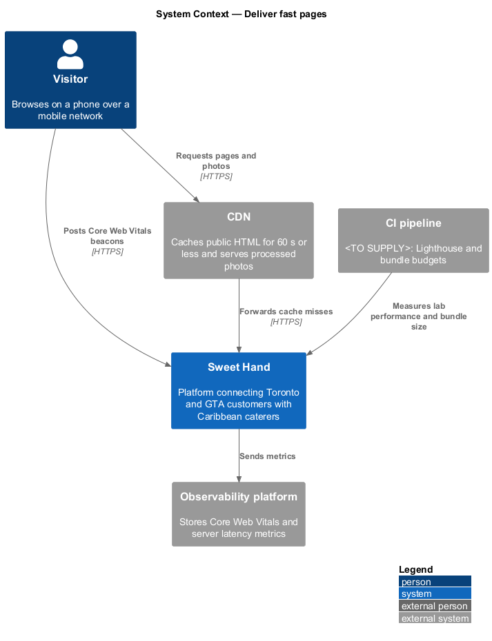
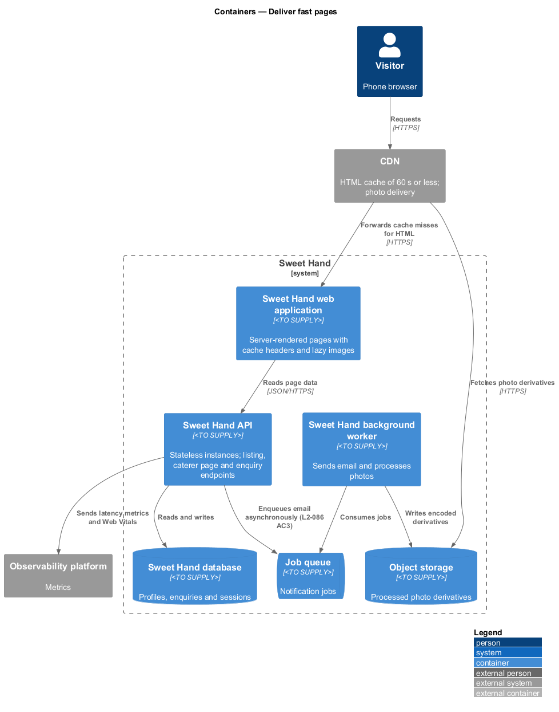
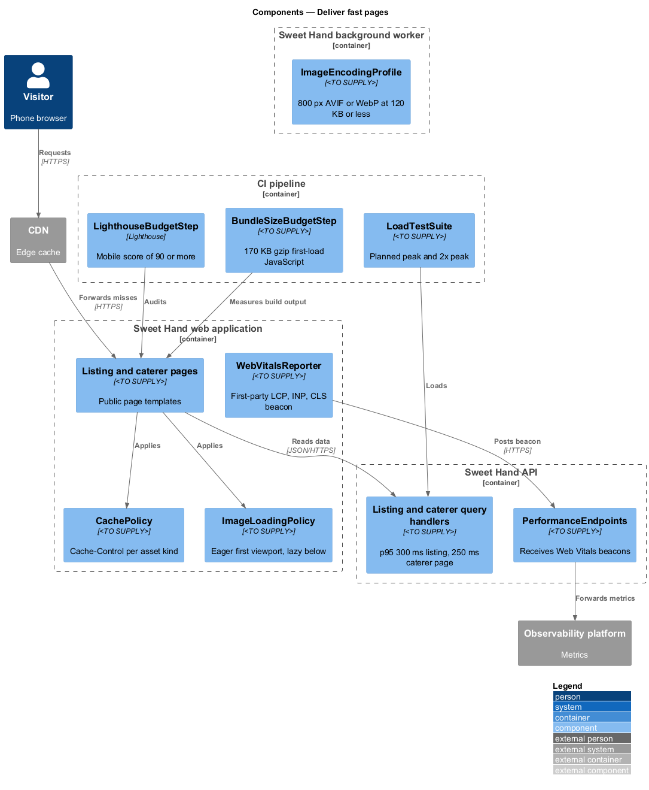
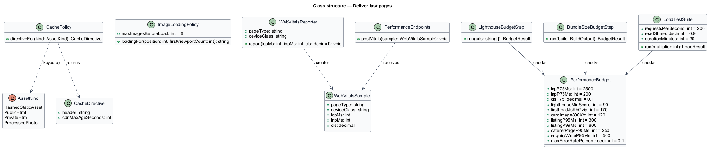
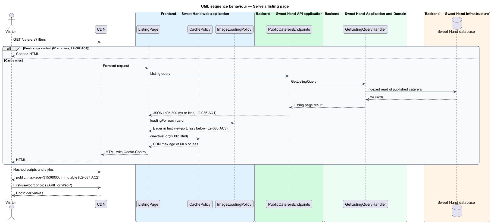
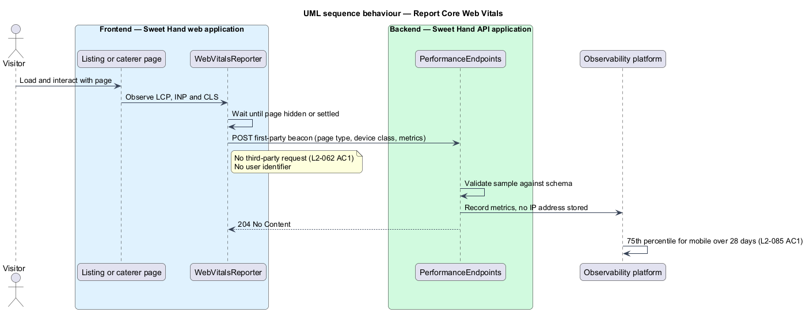
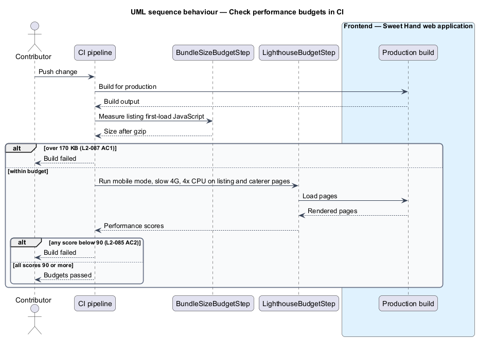

# Deliver fast pages

## Overview

Sweet Hand connects customers in Toronto and the Greater Toronto Area (GTA) with
caterers who sell Caribbean food. Most customers browse the listing and caterer
pages on phones, often on mobile networks. Slow pages lose those customers
before they reach a caterer. Level-1 requirement `L1-022` asks the platform to
load and respond quickly on mobile networks and to stay fast as caterers,
visitors and enquiries grow.

This feature is cross-cutting. It sets the performance budgets, the caching
policy and the measurement points that keep public pages and the API fast. It
covers three layers: what real users experience in the browser, how fast the
server answers under load, and how large and cacheable the front-end assets
are.

Terms used in this document:

- **Core Web Vitals** — browser metrics for loading, responsiveness and visual stability: Largest Contentful Paint (LCP), Interaction to Next Paint (INP) and Cumulative Layout Shift (CLS)
- **real-user monitoring (RUM)** — measurement of Core Web Vitals in visitors' own browsers
- **lab budget** — performance threshold checked in CI against a simulated device and network
- **planned peak load** — 5,000 published caterers, 500,000 enquiries and 200 requests per second, of which 90 % are reads
- **content hash** — fingerprint of a file's content placed in its file name, so a changed file gets a new URL

## Description

Technology choices for every component below are `<TO SUPPLY>`, pending
architecture decision records in `docs/adr/`.

**Browser and assets**

- **`WebVitalsReporter`** — small first-party script on the listing and caterer
  pages. It measures LCP, INP and CLS and posts them, with page type and device
  class, to `PerformanceEndpoints`. It sends no third-party request
  (`L2-062 AC1`) and no user identifier. The 75th percentile for mobile
  visitors over any 28 days meets LCP 2.5 s or less, INP 200 ms or less and CLS
  0.1 or less (`L2-085 AC1`).
- **`ImageLoadingPolicy`** — marks only the images in the first viewport as
  eager and every other image `loading="lazy"`. A 24-card listing page requests
  no more than 6 images before the `load` event (`L2-085 AC3`). Responsive
  `srcset` and `sizes` come from the listing feature (`L2-006`).
- **`CachePolicy`** — sets `Cache-Control` per asset kind (`L2-087 AC2`,
  `L2-087 AC4`):
  - static assets with a content hash: `public, max-age=31536000, immutable`
  - public HTML: CDN cache of 60 s or less, with stale-while-revalidate as
    defined in `platform/degrade-gracefully`
  - signed-in and operator pages: not stored by the CDN; the exact directive
    is `<TO SUPPLY>`
  - processed photos: served from the CDN; their cache lifetime is `<TO SUPPLY>`
- **`BundleBudget`** — limit of 170 KB after gzip for the JavaScript needed on
  the first load of the listing page (`L2-087 AC1`).
- **`ImageEncodingProfile`** — encoder settings used by `ProcessPhotoJob` so a
  listing card image at 800 px wide is 120 KB or less as AVIF or WebP
  (`L2-087 AC3`). The quality settings are `<TO SUPPLY>`.

**Server**

- **`PerformanceEndpoints`** — receives `WebVitalsReporter` beacons and passes
  them to the observability platform as metrics. It stores no IP address.
- **Listing and caterer page query handlers** — read handlers owned by the
  discovery features. This feature sets their latency targets under planned
  peak load: listing and filter requests at p95 300 ms or less and p99 800 ms
  or less (`L2-086 AC1`), caterer pages at p95 250 ms or less (`L2-086 AC2`).
  The database indexes and any read model they use are `<TO SUPPLY>`.
- **Enquiry write path** — enquiry submissions and replies meet p95 500 ms or
  less. Email is sent asynchronously through the job queue (`L2-086 AC3`,
  `L2-030`).
- **Stateless API instances** — API and web application instances keep no
  per-user state in memory; sessions live in the database. Adding instances
  therefore scales throughput to 2× the planned peak with no code changes
  (`L2-086 AC5`).

**CI and load testing**

- **`LighthouseBudgetStep`** — runs Lighthouse in mobile mode with simulated
  slow 4G and 4× CPU slowdown on the listing and caterer pages. It fails the
  build when the performance score is below 90 (`L2-085 AC2`).
- **`BundleSizeBudgetStep`** — measures the first-load JavaScript of the listing
  page in a production build and fails the build above 170 KB gzip
  (`L2-087 AC1`).
- **`LoadTestSuite`** — replays the planned peak load against a staging
  environment for 30 minutes. It checks the latency targets above and an error
  rate below 0.1 % 5xx responses (`L2-086 AC4`). A second run at 2× peak checks
  horizontal scaling. The load tool and its schedule are `<TO SUPPLY>`.

## Requirements

The feature realizes the following level-2 (L2) requirements from
`docs/specs/L2.md`. Each refines the level-1 (L1) requirement cited beside it.
Requirement text is quoted from the specification, with *must* rendered as
*shall*.

| L2 ID | Refines (L1) | Requirement |
|-------|--------------|-------------|
| `L2-085` | `L1-022` | Public pages shall meet Core Web Vitals "good" thresholds for real users, and shall pass a lab performance budget in CI. |
| `L2-086` | `L1-022` | The server shall meet latency targets under the planned peak load: 5,000 published caterers, 500,000 enquiries and 200 requests per second, of which 90% are reads. |
| `L2-087` | `L1-022` | Front-end assets shall stay within size budgets and use caching policies that suit each kind of asset. |

## Diagrams

### System context

Visitors reach Sweet Hand through the CDN, which serves cached HTML and photos.
Sweet Hand sends Core Web Vitals and server timings to the observability
platform. The CI pipeline enforces the lab and bundle budgets.

### Containers

The CDN sits in front of the web application. The web application reads from
the API, which reads from the database. Photos come from object storage through
the CDN, and email leaves through the job queue and background worker.

### Components

`CachePolicy` and `ImageLoadingPolicy` shape every public response.
`WebVitalsReporter` feeds `PerformanceEndpoints`. The CI pipeline holds the
budget steps and the load test suite.

### Class structure

`CachePolicy` maps each `AssetKind` to a `CacheDirective`. `PerformanceBudget`
holds the numeric thresholds that the CI steps and the load test suite check.

### Behaviour — serve a listing page

The CDN answers from cache when it holds a fresh copy. On a miss, the web
application renders the page, applies `CachePolicy`, and marks only
first-viewport images as eager.

### Behaviour — report Core Web Vitals

After the page settles, `WebVitalsReporter` posts LCP, INP and CLS to
`PerformanceEndpoints`. The endpoint forwards them as metrics without storing an
IP address or user identifier.

### Behaviour — check performance budgets in CI

Each build measures the listing bundle and runs Lighthouse on the listing and
caterer pages. Any budget breach fails the build.

