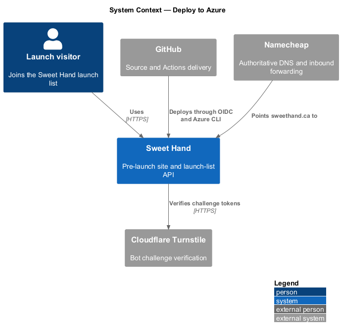
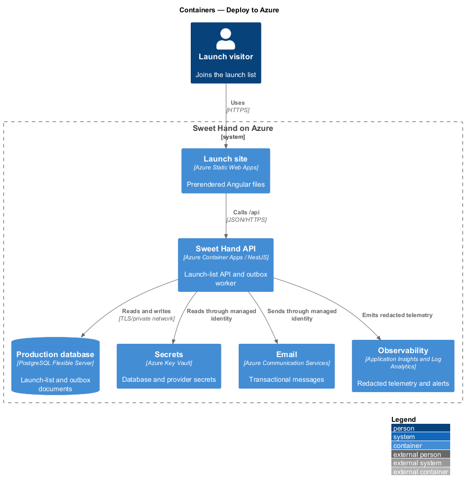
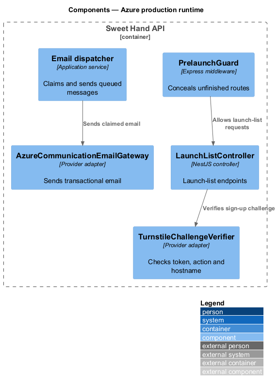
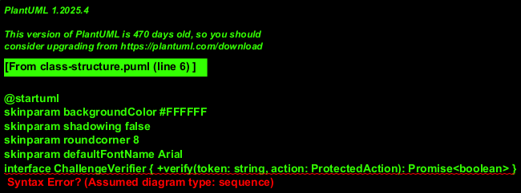
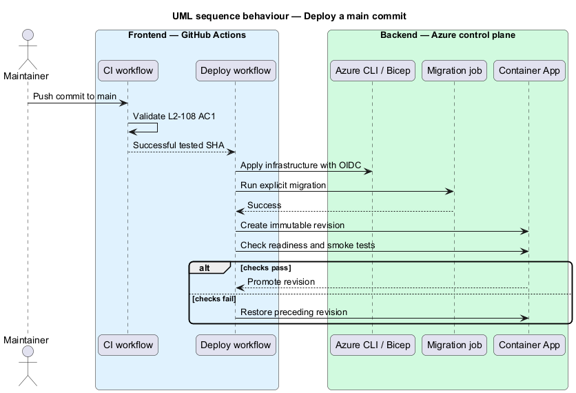

# Deploy to Azure

## Overview

The deployment feature publishes the pre-launch website and launch-list API to the public Sweet Hand domain. It keeps infrastructure reproducible, places persisted data in Canada and promotes only a revision whose migration and health checks succeed.

> **release** — immutable frontend artifact and API container produced from one Git commit

> **pre-launch mode** — API mode that exposes the launch-list surface and conceals unfinished product endpoints

## Description

- **`infra/main.bicep`** — subscription-specific resource graph for Static Web Apps, Container Apps, PostgreSQL, Container Registry, Key Vault, monitoring and Communication Services.
- **`ci.yml`** — change validation for branches and pull requests. It performs no Azure mutation.
- **`deploy.yml`** — `main` delivery using GitHub OIDC and Azure CLI. It applies Bicep, pushes the commit-tagged image, runs the migration job and promotes healthy artifacts.
- **`PrelaunchGuard`** — request middleware that returns HTTP 404 before unfinished product controllers execute.
- **`AzureCommunicationEmailGateway`** — managed-identity adapter that sends queued messages through the verified `sweethand.ca` domain.
- **`TurnstileChallengeVerifier`** — server-side verifier for token, action and hostname. Local tokens remain available only in development and tests.
- **Operations runbook** — records the Azure subscription, resource inventory, DNS changes, rollback, restore, budget and cost assumptions.

## Requirements

| L2 ID | Refines (L1) | Requirement |
|-------|--------------|-------------|
| `L2-075` | `L1-020` | The platform shall keep personal information and its backups in Canada and shall enforce that policy in infrastructure as code. |
| `L2-083` | `L1-021` | Production secrets shall come from the platform secret store, and production containers shall run as a non-root user. |
| `L2-088` | `L1-023` | Production delivery shall preserve availability, readiness checks and rollback within 10 minutes. |
| `L2-090` | `L1-023` | PostgreSQL shall retain recoverable backups for 35 days, with a documented temporary regional RPO exception during launch. |
| `L2-103` | `L1-020` | Launch-list processors, locations, retention and the lazily loaded bot provider shall be disclosed. |
| `L2-104` | `L1-021` | Public launch-list requests shall resist automated submissions and shall disclose no list membership. |
| `L2-108` | `L1-023` | The launch application and API shall be deployed reproducibly to Azure after every successful `main` change. |

## Diagrams

The context view shows GitHub delivering Sweet Hand to Azure while Namecheap and Cloudflare supply DNS and bot verification.

The container view places the static site, API, database, secrets, email and monitoring services.

The component view shows the runtime adapters and pre-launch request boundary.

The class view records the provider ports and implementations.

The deployment sequence runs migration before revision promotion and restores the prior revision after a failed check.

