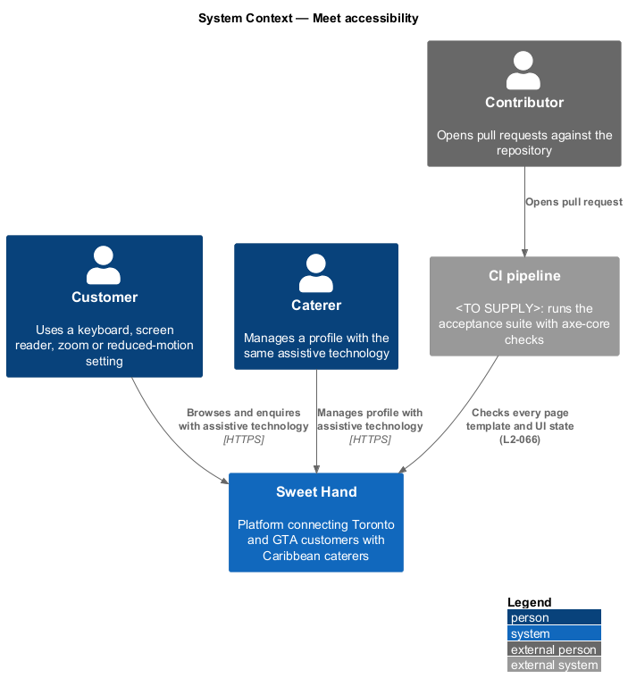
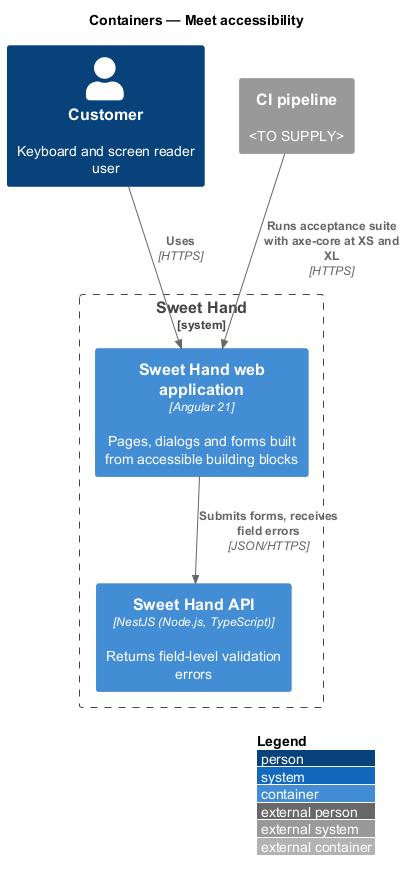
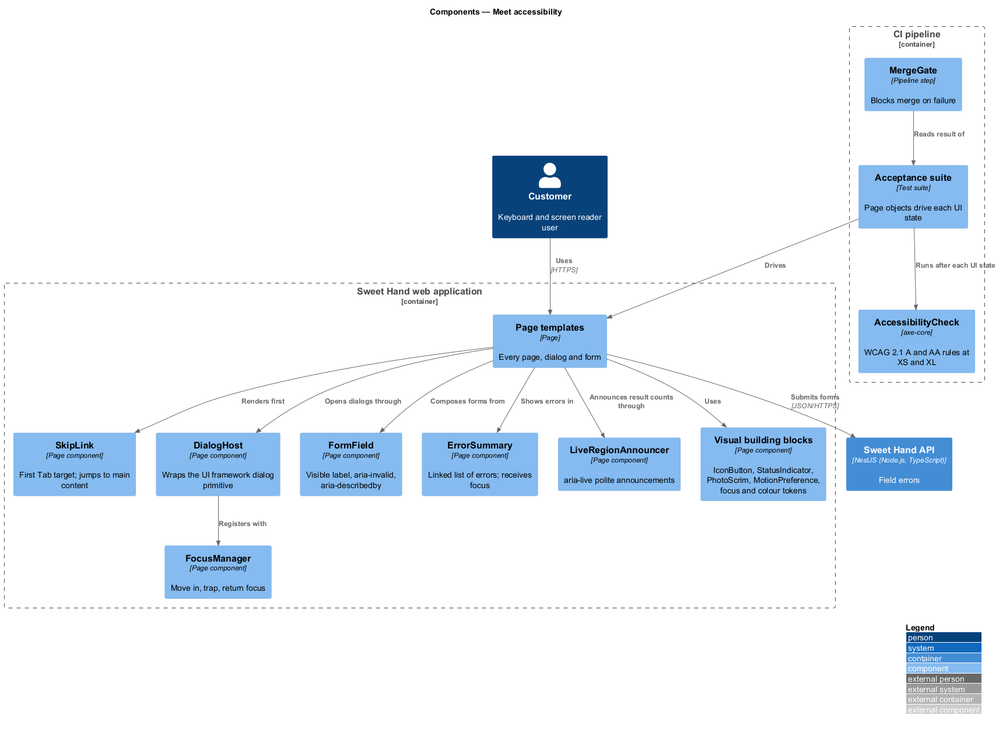
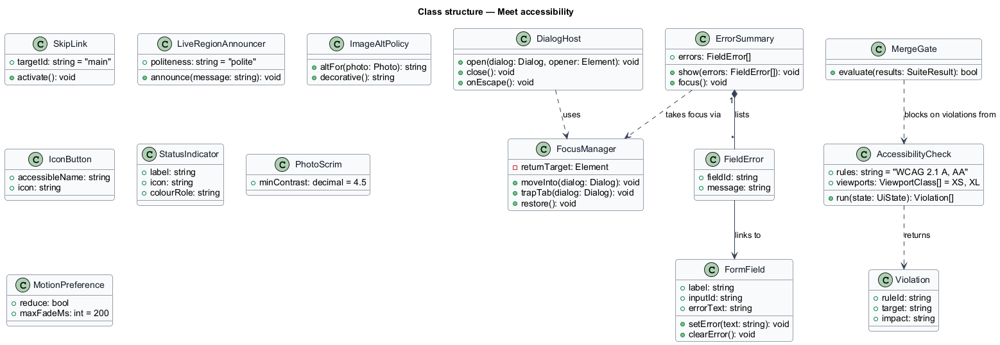
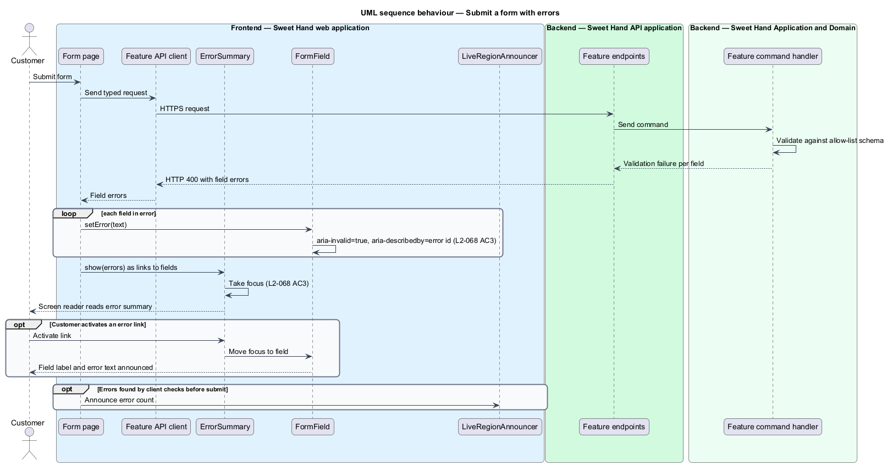
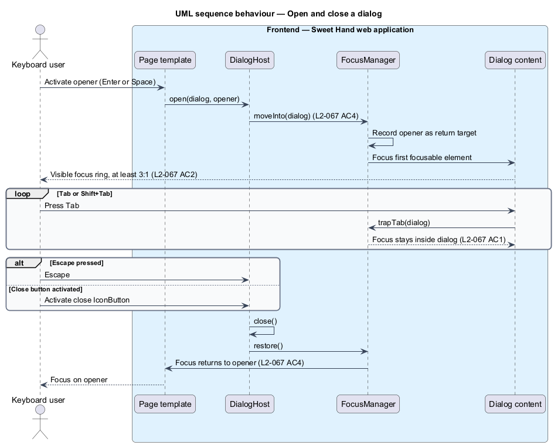
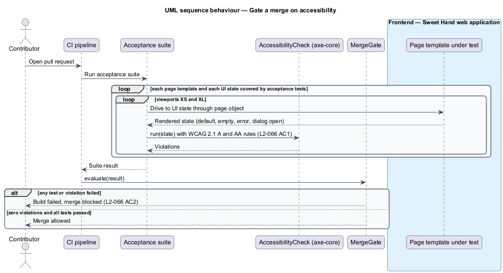

# Meet accessibility

## Overview

Sweet Hand connects customers in Toronto and the Greater Toronto Area (GTA) with
caterers who sell Caribbean food. People who use screen readers, keyboards,
screen magnifiers or reduced-motion settings plan events and run catering
businesses too. Level-1 requirement `L1-019` sets the bar at WCAG 2.1 AA for the
whole platform.

This feature is cross-cutting. It defines the shared accessibility building
blocks that every page, dialog and form uses, and the continuous integration
(CI) gate that blocks a merge when an automated check fails. Features in other
subsystems use these blocks rather than re-implementing focus handling, error
summaries or live announcements.

Terms used in this document:

- **WCAG 2.1 AA** — Web Content Accessibility Guidelines version 2.1, conformance level AA
- **axe-core** — automated accessibility rules engine named in `L2-066`
- **focus trap** — dialog behaviour that keeps keyboard focus inside the dialog while it is open
- **live region** — page area marked `aria-live` whose changes assistive technology announces
- **scrim** — semi-opaque layer between a photo and the text over it, keeping the text readable
- **UI state** — one visible condition of a page, such as default, empty, error, loading or dialog open

**Open conflict — WCAG version.** `L1-019` and `L2-066` to `L2-069` cite WCAG
2.1 AA. AGENTS.md states that the frontend meets WCAG 2.2 AA. The governing
version is `<TO SUPPLY>`. This design follows the specification text.

## Description

Technology choices for every component below are `<TO SUPPLY>`, pending
architecture decision records in `docs/adr/`. Accessible dialogs and overlays
use the UI framework's own primitives, as AGENTS.md requires.

- **`SkipLink`** — first focusable element in `PageShell`
  (`platform/render-responsive-pages`). It appears on the first Tab press and
  moves focus to the main content (`L2-067 AC3`).
- **`FocusManager`** — moves focus into a dialog when it opens, keeps it there
  while it is open, and returns it to the opening element when it closes
  (`L2-067 AC4`). It applies to the filter panel, enquiry form, gallery viewer
  and confirmation dialogs. Focus traps exist only in open dialogs
  (`L2-067 AC1`).
- **`DialogHost`** — wrapper over the UI framework's accessible dialog primitive.
  It registers each dialog with `FocusManager` and closes on Escape.
- **`FocusRingTokens`** — design tokens for a visible focus indicator with at
  least 3:1 contrast against adjacent colours (`L2-067 AC2`). Token names are
  `<TO SUPPLY>` until `docs/design-system/` exists.
- **`LiveRegionAnnouncer`** — single `aria-live="polite"` region per page. Pages
  send it messages, such as a new result count after a filter change
  (`L2-067 AC5`). Message text comes from `ResourceCatalog`.
- **`FormField`** — field wrapper with a visible `<label>` linked to the input.
  Placeholder text never serves as the only label (`L2-068 AC2`). In error it
  sets `aria-invalid="true"` and `aria-describedby` pointing at its error text.
- **`ErrorSummary`** — box at the top of a form that lists each error as a link
  to its field. Focus moves to it when a submission fails (`L2-068 AC3`), on every
  form, the enquiry form included (`L2-022 AC7`). Activating a link in the
  summary moves focus to that field.
- **`ImageAltPolicy`** — food photos use the caterer's caption as `alt` text.
  Decorative images and icons use `alt=""` or `aria-hidden="true"`
  (`L2-068 AC1`).
- **`IconButton`** — button with an icon and no visible text. It requires an
  accessible name that describes the action, such as close or next photo
  (`L2-068 AC4`).
- **`StatusIndicator`** — shows a status, such as an enquiry status, with text
  or an icon as well as colour (`L2-069 AC5`).
- **`PhotoScrim`** — scrim placed behind text that sits on a photo. It keeps
  text contrast at or above 4.5:1 whatever the photo shows (`L2-069 AC2`).
- **`MotionPreference`** — reads `prefers-reduced-motion`. When set to `reduce`,
  animations stop or become an opacity fade of 200 ms or less (`L2-069 AC4`).
- **`ColourTokens`** — colour roles meeting 4.5:1 for normal text, 3:1 for large
  text, and 3:1 for non-text controls and state indicators (`L2-069 AC1`).
  Layouts reflow at 200 % zoom in a 1280 px window without loss or horizontal
  scrolling (`L2-069 AC3`).
- **`AccessibilityCheck`** — step inside the end-to-end acceptance suite. After
  each acceptance test reaches a UI state, it runs axe-core with WCAG 2.1 A and
  AA rules at viewports XS and XL. Any violation fails the test
  (`L2-066 AC1`). It checks rendered behaviour, so it belongs in the acceptance
  suite.
- **`MergeGate`** — CI rule that blocks a pull request when the acceptance suite
  fails, including any accessibility violation (`L2-066 AC2`).
- **`ManualAuditChecklist`** — release-candidate checklist for screen reader
  audits with NVDA on Windows and VoiceOver on iOS. It covers the listing,
  caterer page, enquiry, inbox and caterer onboarding flows (`L2-066 AC3`).
  The owner of the audit is `<TO SUPPLY>`.

## Requirements

The feature realizes the following level-2 (L2) requirements from
`docs/specs/L2.md`. Each refines the level-1 (L1) requirement cited beside it.
Requirement text is quoted from the specification, with *must* rendered as
*shall*.

| L2 ID | Refines (L1) | Requirement |
|-------|--------------|-------------|
| `L2-066` | `L1-019` | Every page template shall pass automated WCAG 2.1 A and AA checks in continuous integration (CI). A failure shall block the merge. |
| `L2-067` | `L1-019` | Everything on the platform shall be usable with a keyboard alone. Focus shall always be visible, and it shall move logically. |
| `L2-068` | `L1-019` | Every image shall have a suitable text alternative. Every form field shall have a visible label. Errors shall be identified in text and announced. |
| `L2-069` | `L1-019` | The interface shall meet WCAG 2.1 AA requirements for contrast, text resizing, reflow and motion. |

## Diagrams

### System context

Customers and other users reach Sweet Hand with keyboards, screen readers and
browser accessibility settings. The CI pipeline runs the automated checks and
blocks merges that fail them.

### Containers

The web application holds every accessibility building block. The CI pipeline
runs the acceptance suite, with its accessibility checks, against the web
application.

### Components

Page templates compose `SkipLink`, `DialogHost`, `FormField`, `ErrorSummary`,
`LiveRegionAnnouncer` and the visual building blocks. In the CI pipeline,
`AccessibilityCheck` runs inside the acceptance suite and `MergeGate` reads the
result.

### Class structure

`DialogHost` depends on `FocusManager`. `ErrorSummary` aggregates `FormField`
errors. `AccessibilityCheck` reports violations that `MergeGate` turns into a
blocked merge.

### Behaviour — submit a form with errors

The server returns field errors. `ErrorSummary` lists them as links, each
`FormField` marks itself invalid, and focus moves to the summary
(`L2-068 AC3`).

### Behaviour — open and close a dialog

`FocusManager` moves focus into the dialog, traps Tab inside it, and returns
focus to the opening control on Escape or close (`L2-067 AC4`).

### Behaviour — gate a merge on accessibility

For each pull request, the acceptance suite drives every page template through
its UI states. `AccessibilityCheck` runs axe-core at XS and XL, and `MergeGate`
blocks the merge on any violation (`L2-066 AC1`, `L2-066 AC2`).

