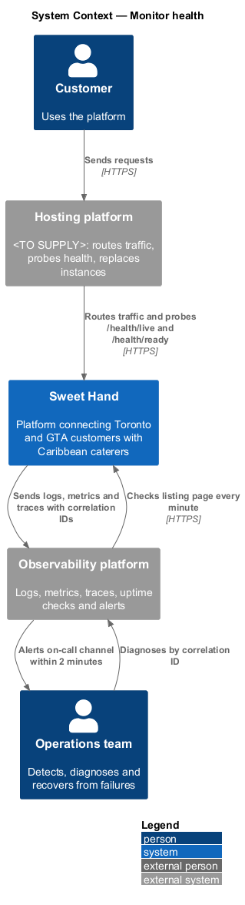
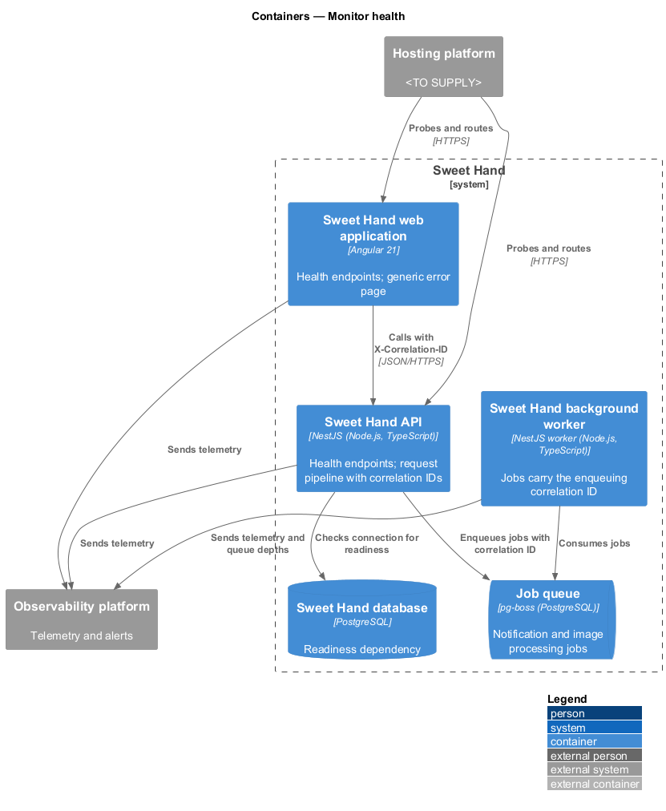
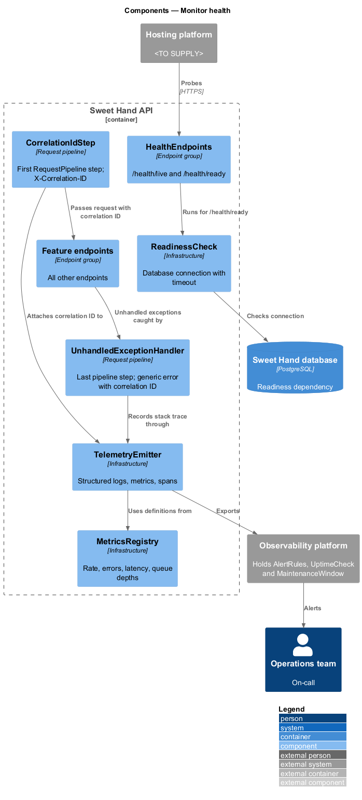
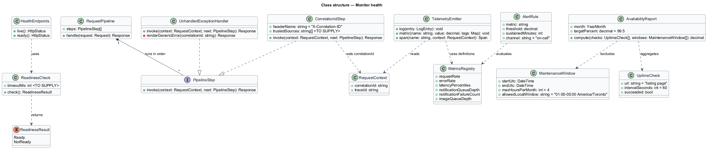
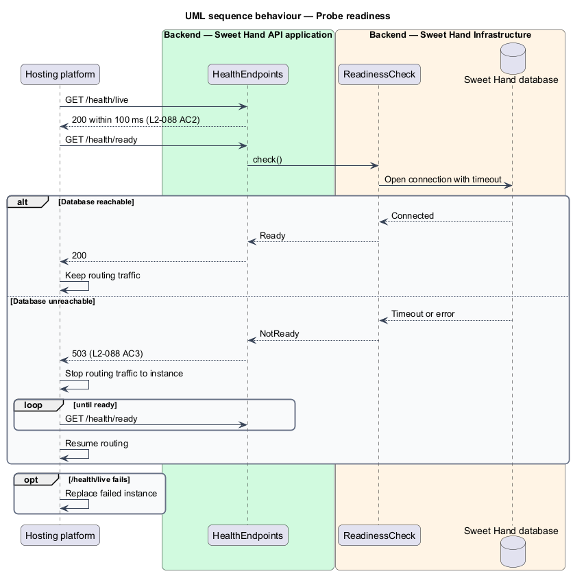
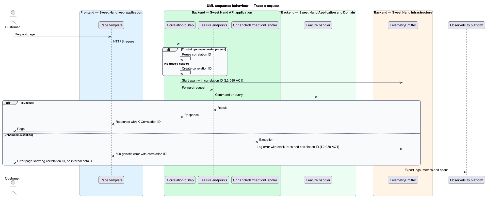
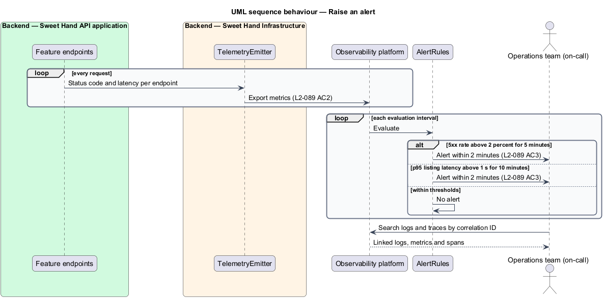

# Monitor health

## Overview

Sweet Hand connects customers in Toronto and the Greater Toronto Area (GTA) with
caterers who sell Caribbean food. Customers send enquiries for weddings,
funerals and other events with fixed dates. An outage at the wrong moment costs
a caterer a booking. Level-1 requirement `L1-023` asks for a platform that is
available, observable and recoverable, and lets the operations team detect,
diagnose and recover from failures.

This feature is cross-cutting. It defines the availability target, the health
endpoints that let the hosting platform replace failed instances, the
correlation ID that links logs, metrics and traces for one request, the alert
rules, and the generic error page. Every endpoint and job in the other
subsystems emits telemetry through the components described here.

Terms used in this document:

- **operations team** — people who run the platform in production and respond to alerts; named in `L1-023`
- **availability** — share of minutes in a calendar month during which the listing page answers external uptime checks, excluding announced maintenance
- **announced maintenance** — downtime of no more than 4 hours a month, between 01:00 and 05:00 `America/Toronto`
- **liveness** — whether an instance's process is running
- **readiness** — whether an instance can serve traffic, which requires a reachable database
- **correlation ID** — identifier attached to one request and to every log entry and trace span it produces
- **on-call channel** — alert destination that the operations team watches

## Description

Technology choices follow ADR 0001 (Angular 21) and ADR 0006 (NestJS on
Node.js, PostgreSQL through Drizzle ORM, S3-compatible object storage);
providers not named there remain `<TO SUPPLY>`. The hosting platform that runs
probes and routes traffic is also `<TO SUPPLY>`.

- **`HealthEndpoints`** — two unauthenticated endpoints on the API and the web
  application. Anonymous access is a deliberate choice, because the hosting
  platform calls them without credentials. They return no internal details.
  - `/health/live` answers HTTP 200 within 100 ms while the process runs
    (`L2-088 AC2`).
  - `/health/ready` runs `ReadinessCheck` and answers HTTP 503 when the
    database is unreachable. The hosting platform then stops routing traffic to
    the instance until it reports ready (`L2-088 AC3`).
- **`ReadinessCheck`** — checks the database connection with a timeout. Whether
  it also checks the job queue and object storage is `<TO SUPPLY>`; the
  specification names only the database.
- **`CorrelationIdStep`** — first step of `RequestPipeline`. It takes the
  correlation ID from a trusted upstream header or creates one. It returns it in
  the `X-Correlation-ID` response header and attaches it to every log entry and
  trace span (`L2-089 AC1`). The list of trusted upstream sources is
  `<TO SUPPLY>`. Jobs on the queue carry the correlation ID of the request that
  enqueued them.
- **`TelemetryEmitter`** — writes structured logs, metrics and trace spans to the
  observability platform. Logs follow the redaction rules in `L2-084`.
- **`MetricsRegistry`** — defines the metrics in `L2-089 AC2`: request rate,
  error rate and latency percentiles per endpoint, notification queue depth and
  failure count, and image processing queue depth.
- **`AlertRules`** — alert definitions held in the observability platform
  (`L2-089 AC3`):
  - 5xx error rate above 2 % for 5 minutes in a row
  - p95 listing latency above 1 second for 10 minutes

  Each alert reaches the on-call channel within 2 minutes of the condition.
  Alerts raised by other features, such as failed notifications (`L2-030`) and
  authorisation failure bursts (`L2-084`), use the same channel.
- **`UnhandledExceptionHandler`** — last step of `RequestPipeline`. It records
  the exception with its stack trace and correlation ID. It returns a generic
  error page that shows the correlation ID and no internal details
  (`L2-089 AC4`). The page text comes from `ResourceCatalog`.
- **`UptimeCheck`** — external check of the listing page every minute. The
  observability platform computes monthly availability from it, with a target
  of at least 99.5 % (`L2-088 AC1`).
- **`MaintenanceWindow`** — record of announced maintenance: start, end and
  announcement. Availability reporting excludes these windows. How maintenance
  is announced to users is `<TO SUPPLY>`.
- **`DeploymentStrategy`** — rolling or blue-green release that drops no
  requests, using readiness to shift traffic. Rollback to the previous release
  completes within 10 minutes (`L2-088 AC4`). The choice between rolling and
  blue-green is `<TO SUPPLY>`.

## Requirements

The feature realizes the following level-2 (L2) requirements from
`docs/specs/L2.md`. Each refines the level-1 (L1) requirement cited beside it.
Requirement text is quoted from the specification, with *must* rendered as
*shall*.

| L2 ID | Refines (L1) | Requirement |
|-------|--------------|-------------|
| `L2-088` | `L1-023` | The platform shall be available 99.5% of the time each calendar month, not counting announced maintenance of no more than 4 hours a month carried out between 01:00 and 05:00 `America/Toronto`. It shall expose health endpoints that let failed instances be found and replaced automatically. |
| `L2-089` | `L1-023` | The platform shall produce structured logs, metrics and traces, linked by a correlation ID, and shall raise alerts on any loss of service quality. |

## Diagrams

### System context

The hosting platform probes Sweet Hand's health endpoints and routes traffic.
Sweet Hand sends telemetry to the observability platform, which runs uptime
checks and alerts the operations team.

### Containers

The web application, API and background worker each emit telemetry with
correlation IDs. The API's readiness depends on the database.

### Components

`RequestPipeline` starts with `CorrelationIdStep` and ends with
`UnhandledExceptionHandler`. `HealthEndpoints` use `ReadinessCheck`.
`TelemetryEmitter` sends everything to the observability platform, where
`AlertRules` run.

### Class structure

`RequestPipeline` composes the correlation and exception steps.
`HealthEndpoints` depend on `ReadinessCheck`. `AlertRule` instances evaluate
metrics defined in `MetricsRegistry`.

### Behaviour — probe readiness

The hosting platform calls `/health/ready`. When the database is unreachable,
the instance answers 503 and stops receiving traffic until it recovers
(`L2-088 AC3`).

### Behaviour — trace a request

`CorrelationIdStep` assigns the correlation ID. Every log entry and span carries
it. On an unhandled exception, the customer sees a generic error page that
shows the ID (`L2-089 AC1`, `L2-089 AC4`).

### Behaviour — raise an alert

The observability platform evaluates `AlertRules` against incoming metrics and
notifies the on-call channel within 2 minutes when a condition holds
(`L2-089 AC3`).

