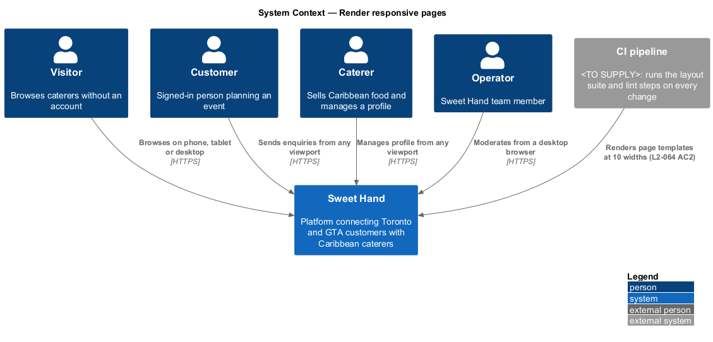
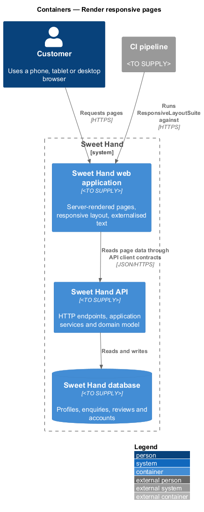
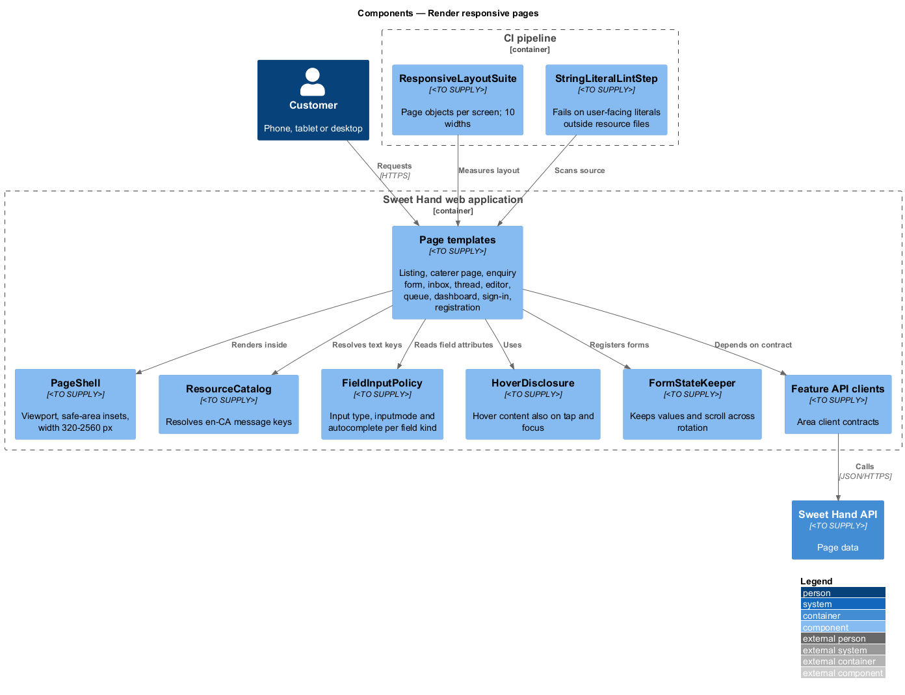
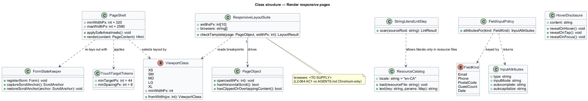
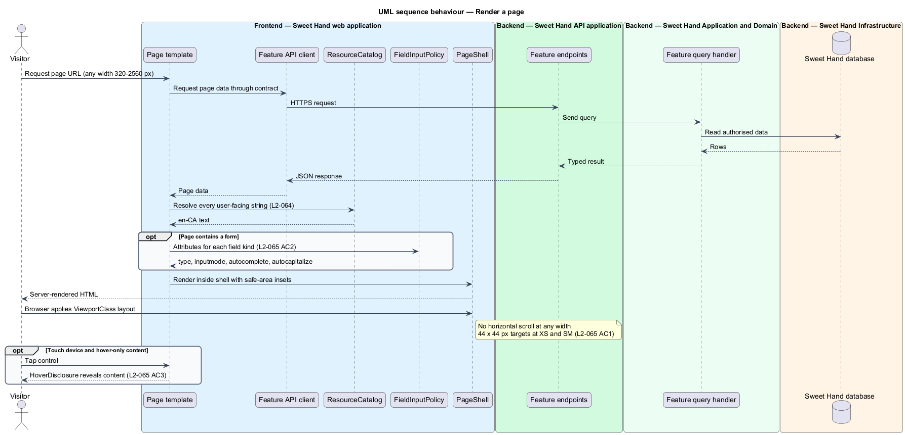
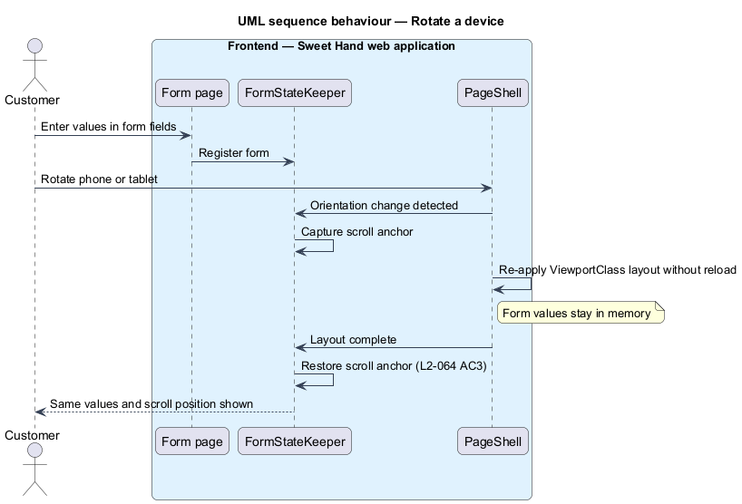

# Render responsive pages

## Overview

Sweet Hand is a web platform that connects customers in Toronto and the Greater
Toronto Area (GTA) with caterers who sell Caribbean food. Customers browse
mostly on phones. Caterers manage their profiles from phones as well as
computers. Operators work at desktop browsers. Every page therefore works on any
screen width, in every supported browser, with touch or with a mouse.

This feature is cross-cutting. It adds no user capability of its own. It
defines the page shell, the breakpoints, the text resource mechanism and the
input conventions that every other feature's pages render with. Features in the
other subsystems cite it rather than repeating these rules.

Terms used in this document:

- **viewport class** — band of CSS pixel widths that selects a layout: XS below 576 px, SM from 576 px, MD from 768 px, LG from 992 px, XL from 1200 px
- **page template** — server-rendered layout shared by every page of one kind: listing, caterer page, enquiry form, inbox, thread, caterer editor, operator queue, metrics dashboard, sign-in and registration
- **resource file** — externalised catalogue of user-facing text, keyed by message identifier
- **touch target** — area of an interactive control that accepts a tap
- **supported browsers** — latest two stable versions of Chrome, Edge, Firefox and Safari (macOS and iOS), plus Samsung Internet

The first release is English only (assumption A-6). All user-facing text still
comes from resource files, so French can be added later without code changes.

## Description

Technology choices for every component below are `<TO SUPPLY>`, pending
architecture decision records in `docs/adr/`. The components are described by
role.

- **`ViewportClass`** — enumeration of XS, SM, MD, LG and XL with their minimum
  widths. It is the single definition of the breakpoints. Layouts and the
  end-to-end suite both read it.
- **`PageShell`** — layout wrapper that every page template renders inside. It
  declares the viewport, applies device safe-area insets, and keeps content
  within the viewport at every width from 320 px to 2560 px. It also hosts the
  skip link defined in `platform/meet-accessibility`.
- **`ResourceCatalog`** — loads the `en-CA` resource file and resolves message
  keys with parameters. Pages, dialogs, notifications, emails and error pages
  obtain every user-facing string from it (`L2-064`). The behaviour for a
  missing key at run time is `<TO SUPPLY>`.
- **`FieldInputPolicy`** — maps each field kind to the input attributes in
  `L2-065 AC2`. Email uses `type="email"`, phone uses `type="tel"`, postal code
  uses `autocapitalize="characters"`, guest count uses `inputmode="numeric"`,
  and date uses `type="date"`. Email, phone and postal code also carry
  `autocomplete="email"`, `"tel"` and `"postal-code"`. The `autocomplete` values
  for guest count and event date are `<TO SUPPLY>`. Form components take their
  attributes from this policy instead of declaring them case by case.
- **`TouchTargetTokens`** — design tokens that set a minimum touch target of
  44 × 44 CSS px and 8 px between neighbouring targets at XS and SM
  (`L2-065 AC1`). The tokens come from `docs/design-system/`, which does not
  exist yet; the token names are `<TO SUPPLY>`.
- **`HoverDisclosure`** — component for information revealed on hover, such as
  tooltips. It reveals the same information on tap and on keyboard focus
  (`L2-065 AC3`).
- **`FormStateKeeper`** — keeps entered form values and the scroll position when
  a phone or tablet rotates (`L2-064 AC3`). Rotation re-lays out the page
  without a reload, so form values stay in memory. `FormStateKeeper` records a
  scroll anchor before the re-layout and restores it afterwards.
- **`ResponsiveLayoutSuite`** — end-to-end suite that renders each page template
  at 320, 575, 576, 767, 768, 991, 992, 1199, 1200 and 2560 px. It checks for
  horizontal scrolling, clipped content and overlapping content
  (`L2-064 AC2`). It uses one page object per screen. The page objects own the
  selectors, and the tests state intent.
- **`StringLiteralLintStep`** — lint step that scans templates and components
  for user-facing string literals outside the resource files (`L2-064 AC4`).
  AGENTS.md forbids architecture tests, such as banned-API or structure scans,
  in the test suite. This check therefore runs as a lint step in the build
  pipeline described in `platform/secure-build-pipeline`. It is not an
  acceptance test.

**Open conflict — browser matrix.** `L2-064 AC1` requires the end-to-end suite
to pass in the latest two stable versions of Chrome, Edge, Firefox, Safari
(macOS), Safari (iOS) and Samsung Internet. AGENTS.md restricts frontend tests
to Chromium. This design does not resolve the conflict. The browser matrix for
`ResponsiveLayoutSuite` is `<TO SUPPLY>`.

## Requirements

The feature realizes the following level-2 (L2) requirements from
`docs/specs/L2.md`. Each refines the level-1 (L1) requirement cited beside it.
Requirement text is quoted from the specification, with *must* rendered as
*shall*.

| L2 ID | Refines (L1) | Requirement |
|-------|--------------|-------------|
| `L2-064` | `L1-018` | Every user-facing page shall work in the supported browsers at every viewport width from 320px to 2560px. All user-facing text shall come from externalised resource files (assumption A-6). |
| `L2-065` | `L1-018` | Interactive controls shall be easy to use by touch, and form fields shall declare input types that bring up the right mobile keyboard. |

## Diagrams

### System context

Visitors, customers, caterers and operators reach Sweet Hand from phone, tablet
and desktop browsers. The CI pipeline runs the layout suite and the string
literal lint step against every change.

### Containers

The web application renders every page template and owns all responsive
behaviour. The API supplies the data each page displays and holds no layout
logic.

### Components

Inside the web application, page templates render inside `PageShell`, read text
from `ResourceCatalog` and read field attributes from `FieldInputPolicy`. The CI
pipeline holds `ResponsiveLayoutSuite` and `StringLiteralLintStep`.

### Class structure

`PageShell` selects a `ViewportClass` and composes the shared helpers.
`FieldInputPolicy` returns an `InputAttributes` value for each `FieldKind`.

### Behaviour — render a page

A page template fetches its data through its API client contract, resolves every
string from `ResourceCatalog` and every field attribute from `FieldInputPolicy`,
then renders inside `PageShell`. The browser applies the layout for the current
viewport class.

### Behaviour — rotate a device

Rotation triggers a re-layout without a reload. `FormStateKeeper` restores the
scroll anchor, and the entered values stay in place (`L2-064 AC3`).

