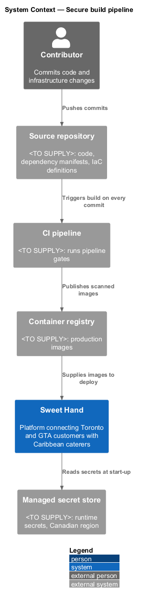
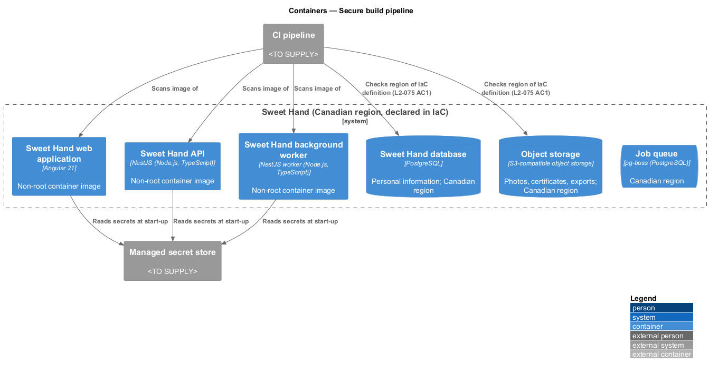
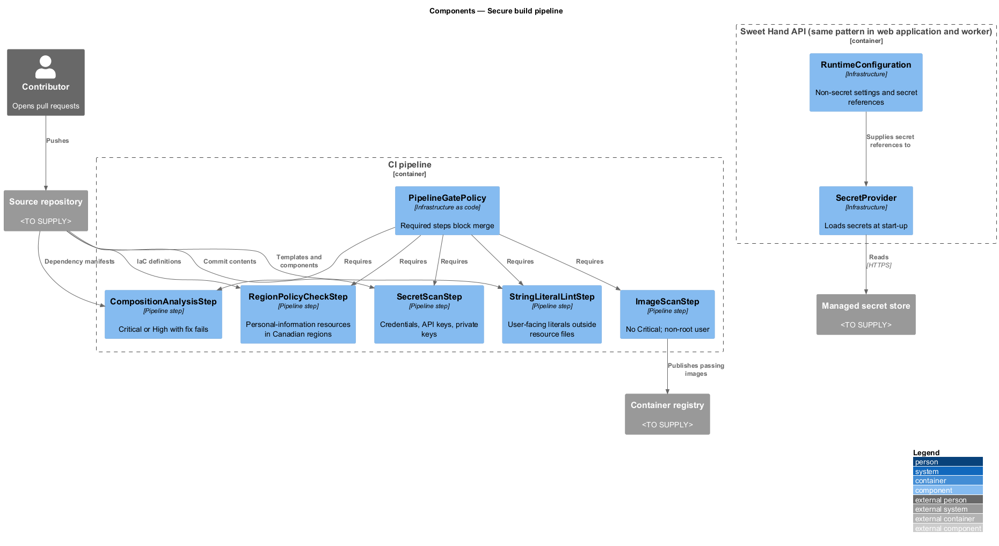
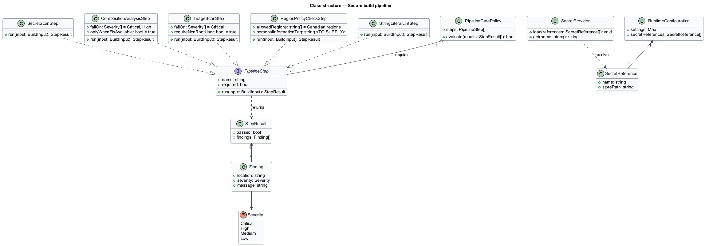
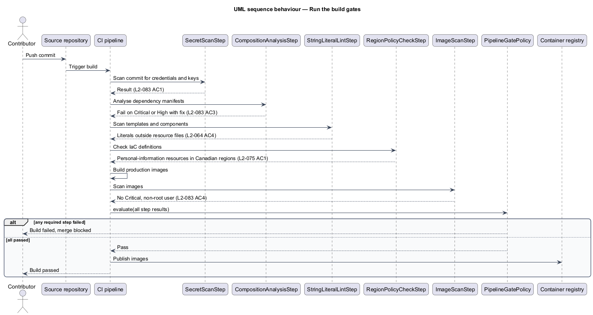
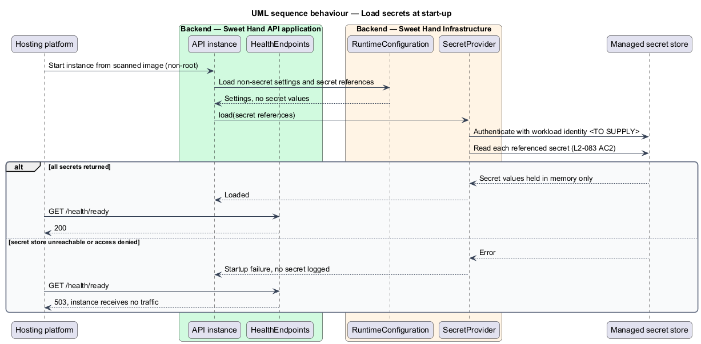

# Secure build pipeline

## Overview

Sweet Hand connects customers in Toronto and the Greater Toronto Area (GTA) with
caterers who sell Caribbean food. It holds personal information about both:
names, email addresses, phone numbers, enquiry messages and food handler
certificates. A leaked credential, a vulnerable dependency, or a database
deployed outside Canada would put that information at risk and break the
platform's privacy commitments under PIPEDA.

This feature defines the continuous integration (CI) pipeline gates that stop
those problems before release, and the runtime rule that secrets come only from
a managed secret store. It covers the build-time half of `L2-083` and the
infrastructure region check in `L2-075 AC1`. It also hosts the string literal
lint step that `platform/render-responsive-pages` defines for `L2-064 AC4`.

AGENTS.md forbids architecture tests in the test suite: no structure, naming or
banned-API scans, and no tests that parse specifications. The region check and
the string literal scan therefore run as pipeline policy and lint steps. They
are not acceptance tests, and the acceptance suite stays limited to behaviour.

Terms used in this document:

- **secret** — credential, API key or private key that grants access to a system
- **software composition analysis (SCA)** — scan of dependency manifests against known vulnerability databases
- **infrastructure-as-code (IaC) definitions** — files in the repository that declare every cloud resource the platform runs on
- **pipeline gate** — CI step whose failure fails the build and blocks the merge
- **managed secret store** — hosted service that holds secrets and releases them to authorised workloads at run time

## Description

Technology choices follow ADR 0001 (Angular 21) and ADR 0006 (NestJS on
Node.js, PostgreSQL through Drizzle ORM, S3-compatible object storage);
providers not named there remain `<TO SUPPLY>`. The CI service, source
repository host, container registry and secret store products are all
`<TO SUPPLY>`.

**Pipeline gates**

- **`SecretScanStep`** — runs on every commit. It scans the repository for
  credentials, API keys and private keys. A detection fails the build
  (`L2-083 AC1`).
- **`CompositionAnalysisStep`** — runs software composition analysis on every
  dependency manifest. It fails the build when any dependency has a known
  Critical or High vulnerability with a fix available (`L2-083 AC3`).
- **`ImageScanStep`** — scans each production container image. It fails the
  build on any Critical vulnerability, and when the image does not run as a
  non-root user (`L2-083 AC4`).
- **`RegionPolicyCheckStep`** — reads the IaC definitions. It fails the build
  when any resource that stores personal information is not deployed to a
  Canadian region (`L2-075 AC1`). Resources in scope are databases, object
  storage, backups and logs. How a resource is tagged as storing personal
  information is `<TO SUPPLY>`.
- **`StringLiteralLintStep`** — scans templates and components for user-facing
  string literals outside resource files (`L2-064 AC4`). The rule itself is
  defined in `platform/render-responsive-pages`.
- **`PipelineGatePolicy`** — marks every step above as required, so a failure
  blocks the merge. It also runs the acceptance suite and the budget steps
  defined in `platform/meet-accessibility` and `platform/deliver-fast-pages`.

**Runtime secrets**

- **`SecretProvider`** — component in the API, web application and background
  worker that reads secrets from the managed secret store at start-up
  (`L2-083 AC2`). Secrets never appear in environment files committed to the
  repository. Whether secrets refresh without a restart is `<TO SUPPLY>`.
- **`RuntimeConfiguration`** — non-secret settings, such as region names and
  feature switches. It may live in the repository. It holds references to
  secrets, never secret values.

The other parts of `L2-075` (the breach register, and the processor list in the
privacy notice) belong to the privacy subsystem, not to this feature.

## Requirements

The feature realizes the following level-2 (L2) requirements from
`docs/specs/L2.md`. Each refines the level-1 (L1) requirement cited beside it.
Requirement text is quoted from the specification, with *must* rendered as
*shall*. This feature realizes only `L2-075 AC1` of `L2-075`.

| L2 ID | Refines (L1) | Requirement |
|-------|--------------|-------------|
| `L2-083` | `L1-021` | Secrets shall never be stored in source control, and third-party dependencies shall be checked for known vulnerabilities on every build. |
| `L2-075` | `L1-020` | Assumption A-7. All personal information, including databases, file storage, backups and logs, shall be stored in Canadian data centres. The platform shall support PIPEDA's rules for recording and reporting breaches. |

## Diagrams

### System context

A contributor pushes to the source repository. The CI pipeline runs every gate
and publishes images to the container registry. At run time, Sweet Hand reads
its secrets from the managed secret store.

### Containers

The API, web application and background worker each read secrets from the
managed secret store. The IaC definitions declare every container and data
store in a Canadian region.

### Components

Inside the CI pipeline, the gate steps run against the repository, the
dependency manifests, the container images and the IaC definitions.
`PipelineGatePolicy` turns any failure into a blocked merge.

### Class structure

Each gate step implements `PipelineStep` and returns a `StepResult`.
`PipelineGatePolicy` aggregates the results. `SecretProvider` reads from the
managed secret store.

### Behaviour — run the build gates

On each commit, the pipeline runs the secret scan, composition analysis, image
scan, region policy check and string literal lint. Any failure fails the build
and blocks the merge.

### Behaviour — load secrets at start-up

Each instance authenticates to the managed secret store with a workload
identity, whose mechanism is `<TO SUPPLY>`. It loads its secrets before it reports ready (`L2-083 AC2`).

