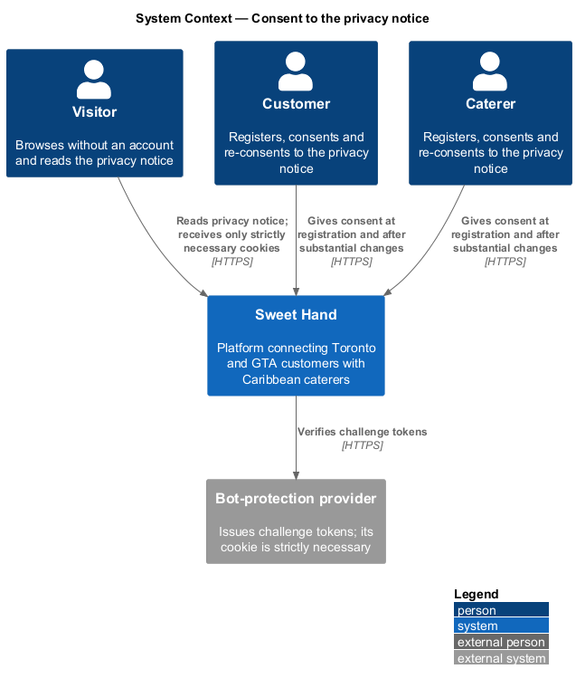
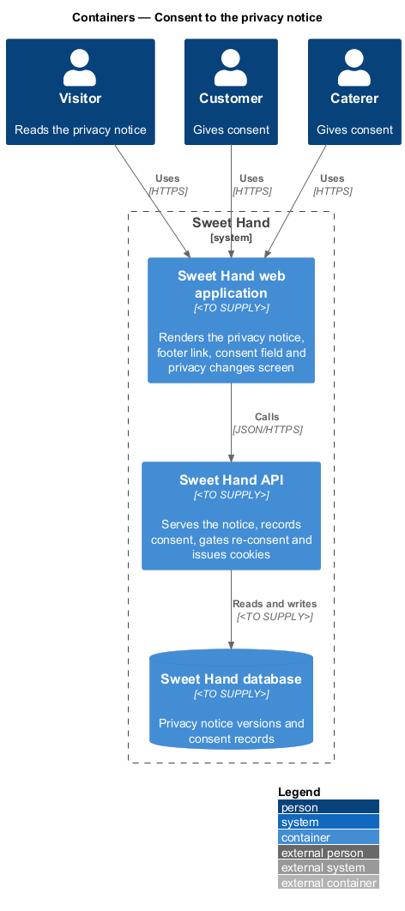
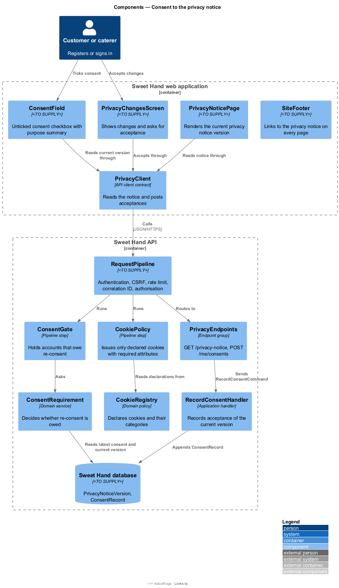
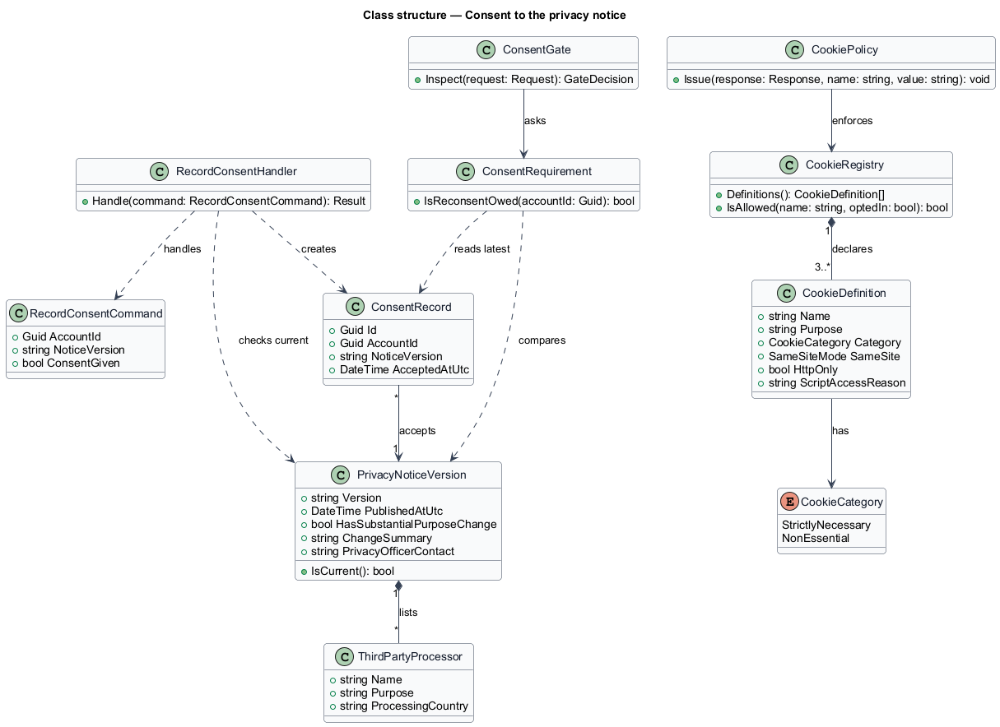
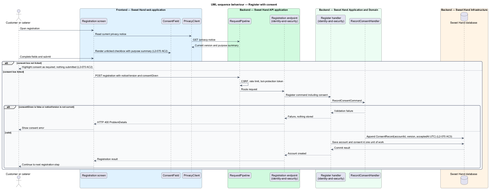
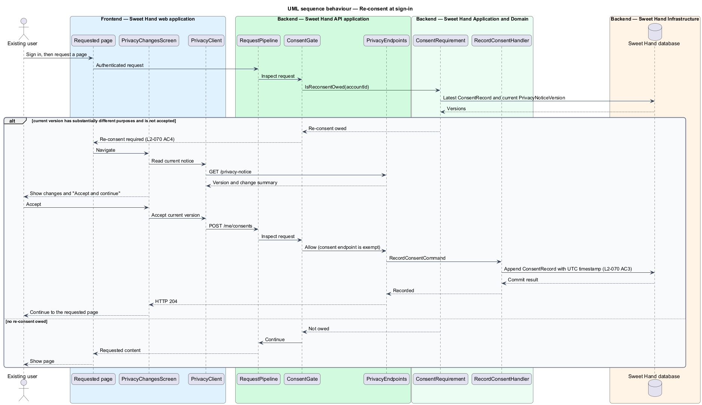
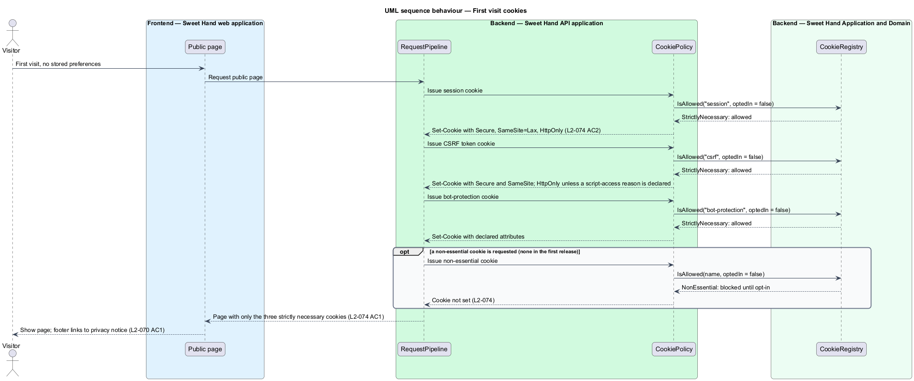

# Consent to the privacy notice

## Overview

Sweet Hand is a web platform that connects people in Toronto and the Greater
Toronto Area (GTA) with caterers who sell Caribbean food. The platform collects
personal information from customers and caterers, so it falls under the
*Personal Information Protection and Electronic Documents Act* (PIPEDA), the
Canadian federal privacy law. This feature belongs to the `privacy` subsystem.
It covers the two points at which the platform asks for, or depends on, a
person's consent: the privacy notice a person accepts, and the cookies a
browser receives.

The feature has three parts.

- The platform publishes a privacy notice and links it from the footer of every
  page.
- Registration records consent against the exact version of the notice the
  person accepted. A later notice with substantially different purposes asks
  each existing user to accept the changes at their next sign-in.
- Before any consent, the platform sets only strictly necessary cookies. The
  first release has no other kind.

Terms used in this document:

**privacy notice** — public statement of what personal information the platform collects, why, who receives it, how long it is kept and how to reach the privacy officer

**privacy notice version** — immutable, numbered revision of the privacy notice with its publication time and a flag for substantially different purposes

**consent record** — stored fact that one account accepted one privacy notice version at a UTC time

**re-consent** — acceptance of a newer privacy notice version by a user who consented to an earlier one

**strictly necessary cookie** — cookie the platform cannot work without: the session cookie, the CSRF token cookie and the bot-protection cookie

**privacy officer** — person at Sweet Hand accountable for privacy compliance, reachable through the contact address in the notice

Account registration itself (fields, password rules, email verification)
belongs to the `identity-and-security` subsystem. This feature supplies the
consent step that registration includes.

## Description

Technology choices for every component below are `<TO SUPPLY>`, pending
architecture decision records in `docs/adr/`. Components are named by role.

### Frontend — Sweet Hand web application

- **`SiteFooter`** — shared layout component rendered on every page. It holds a
  link to `PrivacyNoticePage` (`L2-070 AC1`).
- **`PrivacyNoticePage`** — public page that renders the current privacy notice
  version: purposes, recipients and third-party processors with their
  processing countries (`L2-075 AC3`), retention periods, the cookie list with
  each cookie's purpose (`L2-074 AC1`), and the privacy officer contact address.
- **`ConsentField`** — form component used by the customer and caterer
  registration screens. It renders an unticked checkbox with a short summary of
  purposes beside it and a link to the full notice (`L2-070 AC2`). It carries
  the version identifier of the notice it shows.
- **`PrivacyChangesScreen`** — screen shown after sign-in when the account has
  not accepted the current version and that version has substantially
  different purposes. It lists the changes and offers "Accept and continue".
  Every other screen stays unreachable until acceptance (`L2-070 AC4`).
- **`PrivacyClient`** — API client contract the pages depend on. It reads the
  current notice and posts acceptances.

### Backend — Sweet Hand API application

- **`PrivacyEndpoints`** — endpoint group.
  - `GET /privacy-notice` — public by deliberate choice; returns the current
    published version.
  - `POST /me/consents` — authenticated; accepts the current version for the
    signed-in account.
- **`RequestPipeline`** — shared request pipeline. Two of its steps belong to
  this feature:
  - **`ConsentGate`** — after authentication, rejects requests from an account
    that owes re-consent, except sign-out, the notice and the consent endpoint.
    The rejection directs the web application to `PrivacyChangesScreen`.
  - **`CookiePolicy`** — the single place that issues cookies. It issues only
    cookies declared in `CookieRegistry`, applies the `Secure`, `SameSite` and
    `HttpOnly` attributes, and refuses any non-essential cookie unless the
    visitor has opted in (`L2-074`).

### Backend — Sweet Hand Application and Domain

- **`PrivacyNoticeVersion`** — entity with `version`, `publishedAtUtc`,
  `hasSubstantialPurposeChange`, `changeSummary`, `privacyOfficerContact` and a
  list of `ThirdPartyProcessor` entries. A published version is never edited; a
  change publishes a new version.
- **`ConsentRecord`** — entity with `accountId`, `noticeVersion` and
  `acceptedAtUtc` (`L2-070 AC3`). Records are only ever added.
- **`RecordConsentCommand`** and **`RecordConsentHandler`** — record an
  acceptance. The handler rejects the command when the consent flag is false or
  the submitted version is not the current version.
- **`ConsentRequirement`** — domain service that decides whether an account
  owes re-consent. Re-consent is owed when the account's latest consent record
  names an older version and a newer version has `hasSubstantialPurposeChange`
  set.
- **`CookieRegistry`** — declared set of `CookieDefinition` entries. Each entry
  holds a name, purpose, category (`StrictlyNecessary` or `NonEssential`),
  `SameSite` mode, `httpOnly` flag and, where `httpOnly` is false, the written
  reason client scripts read the cookie (`L2-074 AC2`). The first release
  declares exactly three strictly necessary cookies and no non-essential
  cookies.

The registration handlers in `identity-and-security` call
`RecordConsentHandler` in the same unit of work that creates the account, so an
account never exists without a consent record.

Publishing a new privacy notice version is an operational task. Whether it uses
an operator screen or a content deployment is `<TO SUPPLY>`. The person who
decides that a revision has substantially different purposes, and the wording of
the purpose summary, are `<TO SUPPLY>` (privacy officer). The mechanism for a
future non-essential cookie opt-in is `<TO SUPPLY>`; the first release needs
none.

### Backend — Sweet Hand Infrastructure

- **`PrivacyNoticeRepository`** and **`ConsentRecordRepository`** — persistence
  in the Sweet Hand database.

## Requirements

The feature realizes the following level-2 (L2) requirements from
`docs/specs/L2.md`. Each refines the level-1 (L1) requirement cited beside it.
Requirement text is quoted from the specification, with *must* rendered as
*shall*.

| L2 ID | Refines (L1) | Requirement |
|-------|--------------|-------------|
| `L2-070` | `L1-020` | The platform shall publish a privacy notice that explains what personal information is collected, why, who it is shared with, how long it is kept and how to contact the privacy officer. Users shall give consent that is meaningful under PIPEDA when they register. |
| `L2-074` | `L1-020` | Before a visitor gives consent, the platform shall set only cookies that are strictly needed. The first release uses no non-essential cookies. If any are added later, they shall stay blocked until the visitor opts in. |

## Diagrams

### System context

Visitors read the notice and receive only strictly necessary cookies. Customers
and caterers give consent when they register, and again after a substantial
change to the notice.

### Containers

The web application renders the notice and the consent controls. The API
issues cookies, gates re-consent and records consent in the Sweet Hand database.

### Components

`ConsentField` and `PrivacyChangesScreen` reach `PrivacyEndpoints` through
`PrivacyClient`. `ConsentGate` asks `ConsentRequirement` on each authenticated
request, and `CookiePolicy` issues only the cookies that `CookieRegistry`
declares.

### Class structure

A `ConsentRecord` links one account to one `PrivacyNoticeVersion`.
`CookieRegistry` composes the `CookieDefinition` entries that `CookiePolicy`
enforces.

### Behaviour — register with consent

Registration is refused while the consent box is unticked. On success, the
account and its consent record, with notice version and UTC timestamp, are
saved in one unit of work.

### Behaviour — re-consent at sign-in

After sign-in, `ConsentGate` holds an account that owes re-consent on
`PrivacyChangesScreen` until it accepts the current version.

### Behaviour — first visit cookies

On a first visit with no stored preferences, `CookiePolicy` sets only the
session, CSRF token and bot-protection cookies, each with its declared
attributes, and blocks any non-essential cookie.

