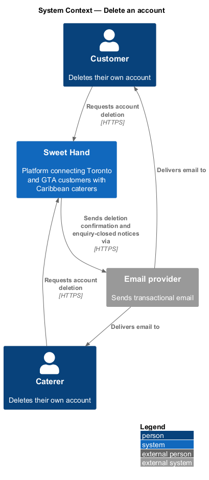
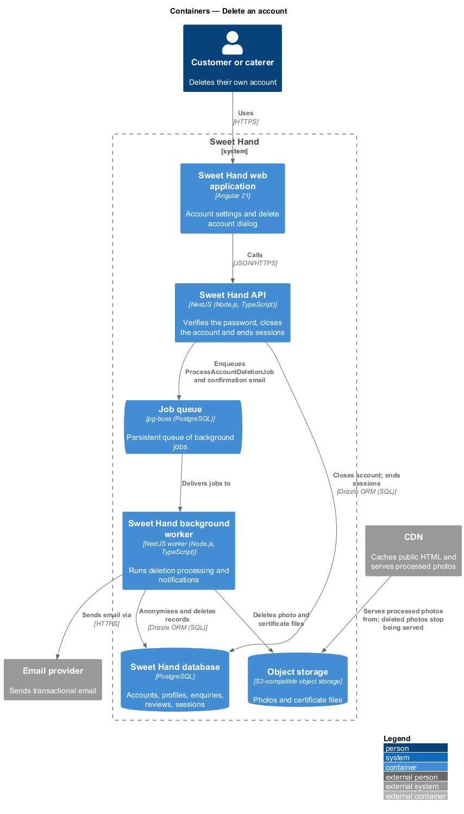
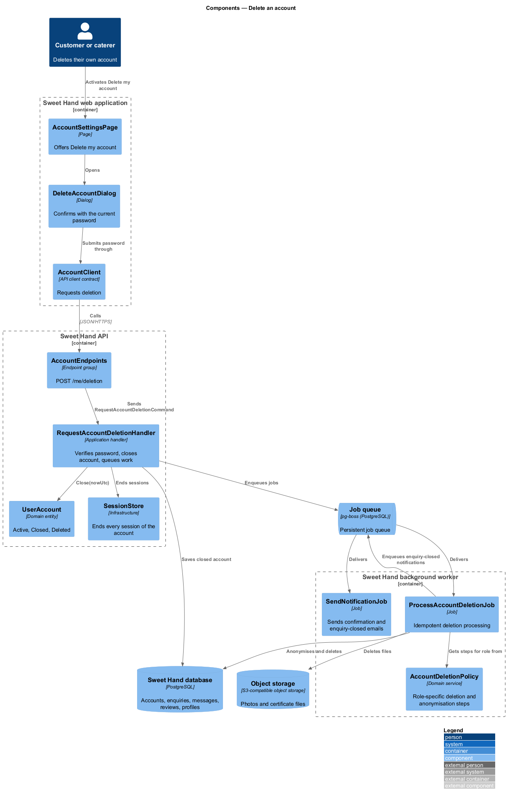
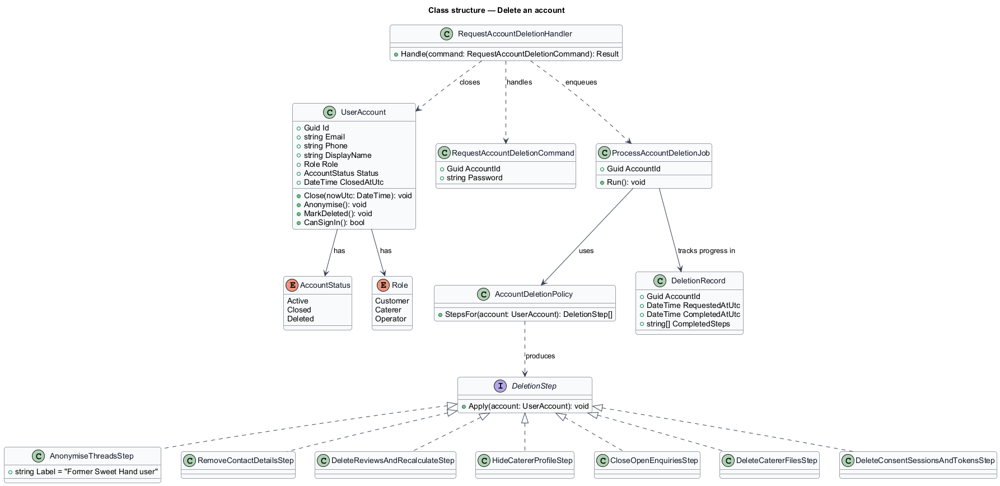
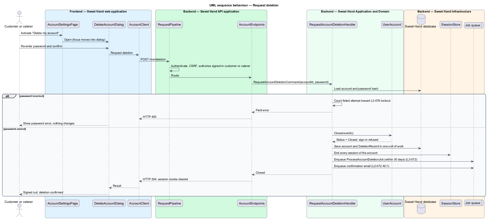
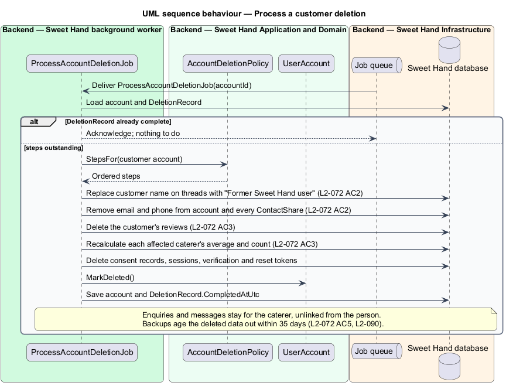
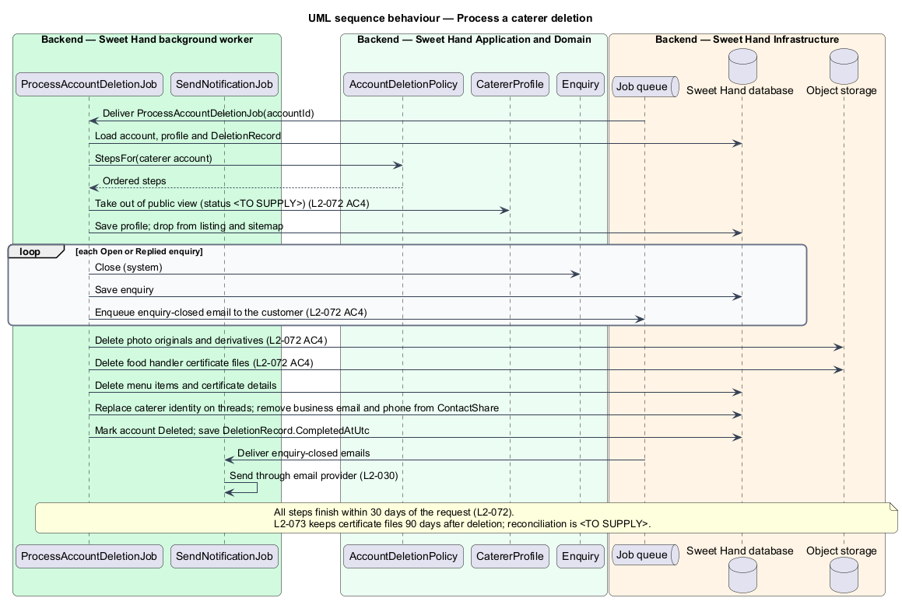

# Delete an account

## Overview

Sweet Hand is a web platform that connects people in Toronto and the Greater
Toronto Area (GTA) with caterers who sell Caribbean food. Canadian privacy law
(PIPEDA) expects an organisation to stop holding personal information it no
longer needs. This feature, in the `privacy` subsystem, lets a customer or
caterer delete their own account.

Deletion happens in two stages.

1. **Request.** The user confirms by re-entering their password. The account is
   closed at once: the user is signed out, cannot sign in again and receives a
   confirmation email.
2. **Processing.** The background worker deletes or anonymises the user's
   personal information within 30 days. Content that the other party in a
   conversation still needs, such as enquiry messages, stays in place but is no
   longer linked to the deleted person.

Backups are not edited. Deleted data leaves every backup as the backups age out,
within 35 days of processing.

Terms used in this document:

**closed account** — account whose owner has asked for deletion; it accepts no sign-in and has no active sessions

**anonymisation** — replacement of a person's identifying details with the fixed label "Former Sweet Hand user" and removal of their contact details, while keeping the content other people need

**deletion processing** — background work that deletes or anonymises a closed account's personal information and files

**counterparty** — other person in an enquiry thread: the caterer for a customer, or the customer for a caterer

## Description

Technology choices follow ADR 0001 (Angular 21) and ADR 0006 (NestJS on
Node.js, PostgreSQL through Drizzle ORM, S3-compatible object storage);
providers not named there remain `<TO SUPPLY>`. Components are named by role.

### Frontend — Sweet Hand web application

- **`AccountSettingsPage`** — signed-in account screen. Its "Delete my account"
  button opens `DeleteAccountDialog`.
- **`DeleteAccountDialog`** — confirmation dialog. It states what is deleted and
  what stays anonymised, asks for the current password and confirms the
  request. On success the web application shows a signed-out confirmation
  screen.
- **`AccountClient`** — API client contract the dialog depends on.

### Backend — Sweet Hand API application

- **`AccountEndpoints`** — endpoint group. `POST /me/deletion` accepts the
  password, requires an authenticated customer or caterer and requires a CSRF
  token. Operator accounts are managed in the `moderation` subsystem and are
  out of scope here.

### Backend — Sweet Hand Application and Domain

- **`RequestAccountDeletionCommand`** and **`RequestAccountDeletionHandler`** —
  verify the password through the password hasher, call
  `UserAccount.Close(nowUtc)`, end every session of the account, enqueue
  `ProcessAccountDeletionJob` and enqueue the confirmation email
  (`L2-072 AC1`). A wrong password fails with a field error and changes
  nothing. Failed confirmations count toward the lockout rules of `L2-076`.
- **`UserAccount`** — gains `Status` (`Active`, `Closed`, `Deleted`),
  `closedAtUtc` and `Close(nowUtc)`. Sign-in refuses an account that is not
  `Active`.
- **`AccountDeletionPolicy`** — domain service that lists what processing does
  for each role.
  - **Customer:** replace the display name on enquiries and messages with
    "Former Sweet Hand user"; remove email and phone from the account and from
    every `ContactShare`; delete the customer's reviews and recalculate each
    affected caterer's average (`L2-072 AC2`, `AC3`); delete consent records,
    sessions and tokens.
  - **Caterer:** take the profile out of public view; delete photos, menu items
    and food handler certificate files from object storage; close each `Open` or
    `Replied` enquiry and notify its customer (`L2-072 AC4`); anonymise the
    caterer's side of enquiry threads in the same way as for a customer.
- **`DeletionRecord`** — minimal entry that records that an account was deleted
  and when, without personal details, so that processing is idempotent and its
  completion is provable. Its retention period is `<TO SUPPLY>`.

### Backend — Sweet Hand background worker

- **`ProcessAccountDeletionJob`** — applies `AccountDeletionPolicy` and marks the
  account `Deleted`. It is idempotent: a retry after a partial failure finishes
  the remaining steps. It runs within 30 days of the request (`L2-072`). The
  exact delay before processing, immediate or a grace period, is
  `<TO SUPPLY>`.
- **`SendNotificationJob`** — sends the confirmation email to the user and the
  enquiry-closed emails to affected customers.

### Backend — Sweet Hand Infrastructure

- **`UserAccountRepository`**, **`EnquiryRepository`**, **`ReviewRepository`**,
  **`CatererProfileRepository`** — persistence in the Sweet Hand database.
- **`SessionStore`** — ends every session of the account.
- **`ObjectStore`** — deletes photo and certificate files.
- **`JobQueue`** — persistent job queue.

### Points that are not settled in the specifications

- `L2-072 AC4` requires certificate files to be deleted within 30 days of
  account deletion. The retention table in `L2-073` keeps certificate files for
  90 days after account deletion. The reconciled rule is `<TO SUPPLY>`. This
  design follows `L2-072 AC4`.
- `L2-046` allows only operators to set a profile to `Removed`. The status a
  caterer profile takes when its owner deletes the account, `Removed` or a
  separate deleted state, is `<TO SUPPLY>`. Either way the profile is not
  public and its page returns the not-found or gone response.
- The 35-day backup age-out in `L2-072 AC5` relies on the 35-day point-in-time
  recovery retention in `L2-090`. Backup configuration belongs to the
  `platform` subsystem.

## Requirements

The feature realizes the following level-2 (L2) requirements from
`docs/specs/L2.md`. Each refines the level-1 (L1) requirement cited beside it.
Requirement text is quoted from the specification, with *must* rendered as
*shall*.

| L2 ID | Refines (L1) | Requirement |
|-------|--------------|-------------|
| `L2-072` | `L1-020` | A user shall be able to delete their account themselves. Their personal information is deleted or made anonymous within 30 days. Content the other party in a conversation needs is kept but no longer linked to the deleted person. |

## Diagrams

### System context

A customer or caterer deletes their account in Sweet Hand. Sweet Hand emails the
confirmation and, for a caterer, tells affected customers that their enquiries
are closed.

### Containers

The API closes the account and queues processing. The background worker
anonymises and deletes data in the database and removes files from object
storage.

### Components

`AccountEndpoints` dispatches to `RequestAccountDeletionHandler`.
`ProcessAccountDeletionJob` applies `AccountDeletionPolicy` across the
repositories and object storage.

### Class structure

`UserAccount` carries the account status. `AccountDeletionPolicy` produces the
role-specific steps that `ProcessAccountDeletionJob` runs, and
`DeletionRecord` keeps the processing idempotent.

### Behaviour — request deletion

A correct password closes the account, ends every session, queues processing
and sends the confirmation email. A wrong password changes nothing.

### Behaviour — process a customer deletion

The worker anonymises the customer's threads, removes contact details, deletes
reviews and recalculates the affected caterers' averages.

### Behaviour — process a caterer deletion

The worker hides the profile, closes open enquiries with a notification to each
customer, deletes the caterer's files and anonymises the caterer's side of each
thread.

