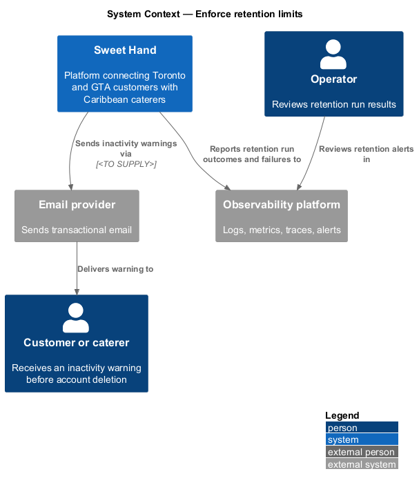
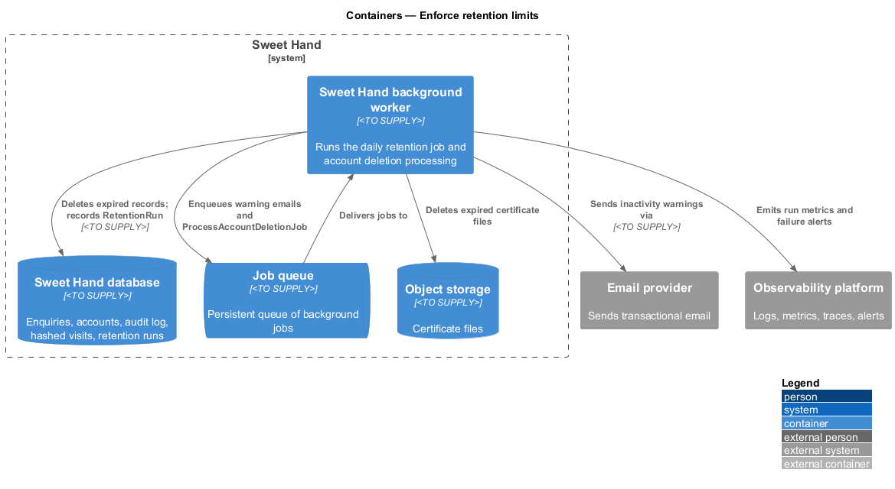
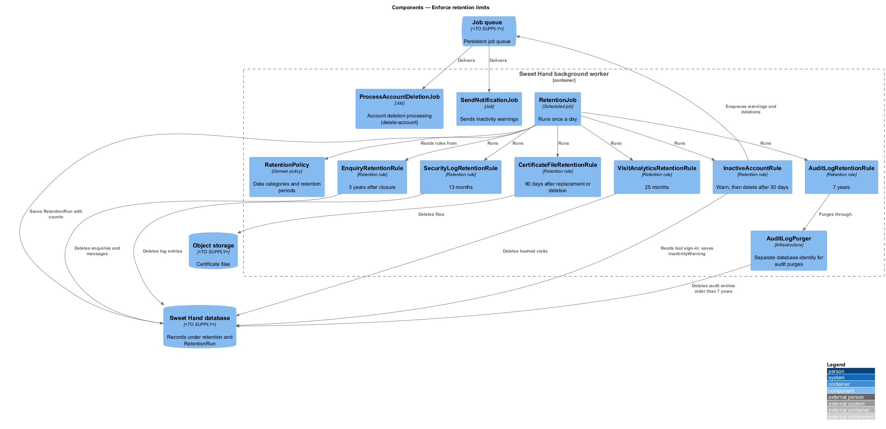
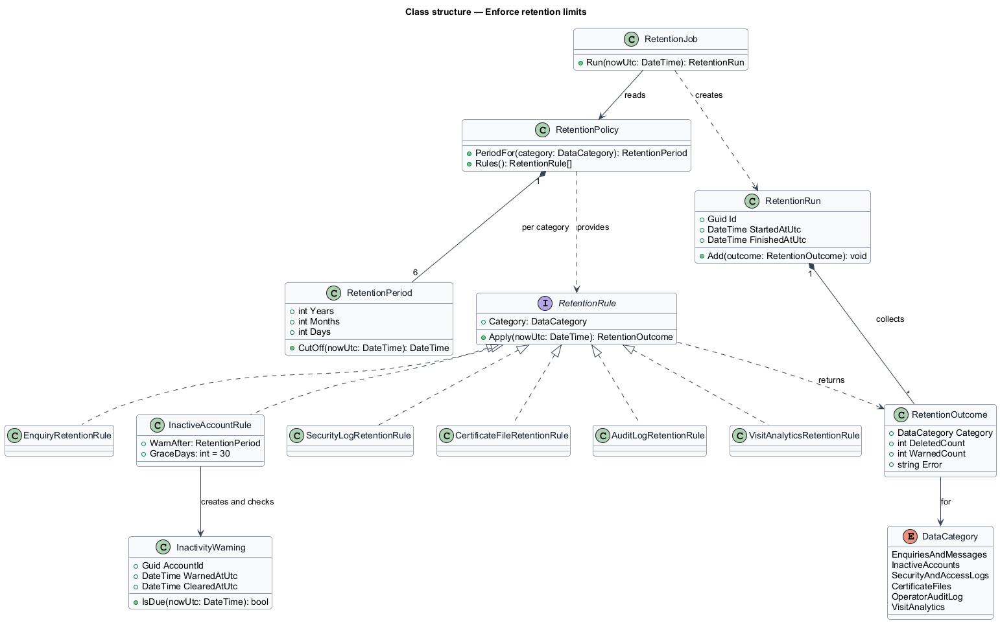
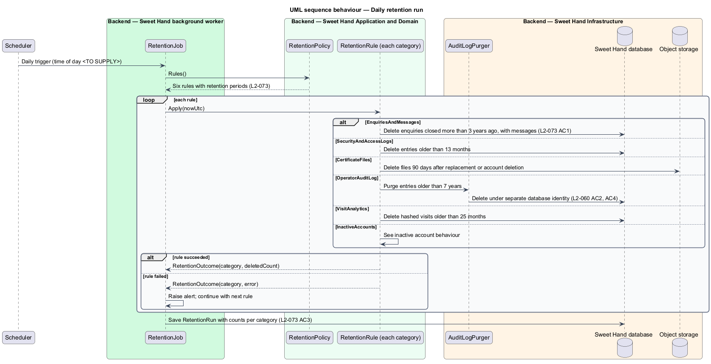
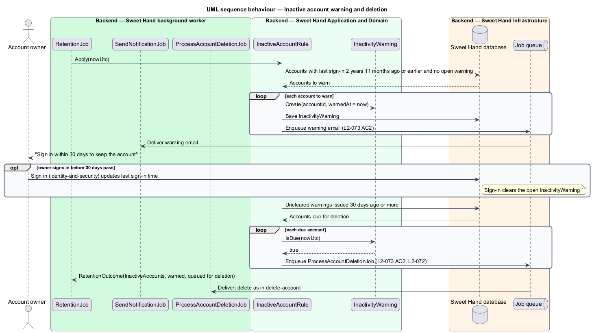

# Enforce retention limits

## Overview

Sweet Hand is a web platform that connects people in Toronto and the Greater
Toronto Area (GTA) with caterers who sell Caribbean food. Canadian privacy law
(PIPEDA) expects an organisation to keep personal information only as long as
it needs it. This feature, in the `privacy` subsystem, removes each kind of
personal data once its retention period has passed.

A daily retention job in the background worker applies one rule per data
category. Each rule finds the records older than its limit, deletes them, and
reports how many it deleted. The run is recorded so that operators can show the
rules are applied. One rule differs from the rest: before an inactive account is
deleted, its owner receives a warning email and 30 days to sign in.

Terms used in this document:

**retention period** — length of time a data category is kept, counted from the event the category names (closure, last sign-in, creation, replacement)

**data category** — group of records that share one retention period, such as enquiries and messages or hashed visit analytics

**retention rule** — code that selects and deletes the records of one data category once its retention period has passed

**retention run** — one execution of the daily retention job, with the count of deleted records for each data category

**inactive account** — customer or caterer account with no sign-in for the period the retention table gives

## Description

Technology choices for every component below are `<TO SUPPLY>`, pending
architecture decision records in `docs/adr/`. Components are named by role.

### Retention periods

`L2-073` sets the following periods. Each becomes one retention rule.

| Data category | Retention period | Retention rule |
|---|---|---|
| Enquiries and messages | 3 years after the enquiry was closed | `EnquiryRetentionRule` |
| Accounts with no sign-in | Deleted 3 years after the last sign-in, after a warning email 30 days before | `InactiveAccountRule` |
| Security and access logs | 13 months | `SecurityLogRetentionRule` |
| Food handler certificate files | Deleted 90 days after the certificate is replaced or the account is deleted | `CertificateFileRetentionRule` |
| Operator audit log | 7 years | `AuditLogRetentionRule` |
| Visit analytics (hashed) | 25 months | `VisitAnalyticsRetentionRule` |

### Backend — Sweet Hand background worker

- **`RetentionJob`** — scheduled job that runs once a day. Its time of day is
  `<TO SUPPLY>`; it should run outside the announced maintenance window in
  `L2-088`. It asks `RetentionPolicy` for the rules, runs each rule in turn,
  and writes one `RetentionRun`. A failure in one rule is recorded against that
  category and does not stop the other rules. Each rule deletes in batches; the
  batch size is `<TO SUPPLY>`.
- **`ProcessAccountDeletionJob`** — the deletion processing from the
  `delete-account` feature. `InactiveAccountRule` enqueues it, so an inactive
  account is deleted in the same way as a self-deleted one (`L2-073 AC2`).
- **`SendNotificationJob`** — sends the inactivity warning email.

### Backend — Sweet Hand Application and Domain

- **`RetentionPolicy`** — holds the `DataCategory` list and the
  `RetentionPeriod` for each, as set in the table above. Periods are
  configuration of the domain, not literals spread through the rules.
- **`RetentionRule`** — contract with `Category` and
  `Apply(nowUtc): RetentionOutcome`. Each implementation below realizes one row
  of the table.
  - **`EnquiryRetentionRule`** — permanently deletes enquiries whose
    `closedAtUtc` is more than 3 years ago, together with their messages,
    contact shares and read state (`L2-073 AC1`).
  - **`InactiveAccountRule`** — sends a warning to each account whose last
    sign-in was 2 years and 11 months ago and that has no warning yet. It
    enqueues deletion for each account warned at least 30 days ago with no
    sign-in since (`L2-073 AC2`). A sign-in clears the warning.
  - **`SecurityLogRetentionRule`** — deletes security and access log entries
    older than 13 months.
  - **`CertificateFileRetentionRule`** — deletes certificate files 90 days after
    the certificate was replaced or the owning account was deleted.
  - **`AuditLogRetentionRule`** — deletes operator audit entries older than
    7 years (`L2-060 AC4`).
  - **`VisitAnalyticsRetentionRule`** — deletes hashed visit records older than
    25 months.
- **`InactivityWarning`** — entity that records when an account was warned and
  whether a later sign-in cleared it.
- **`RetentionRun`** — entity with `startedAtUtc`, `finishedAtUtc` and one
  `CategoryOutcome` per category: deleted count, warned count where it applies,
  and any error (`L2-073 AC3`).

### Backend — Sweet Hand Infrastructure

- **`RetentionRepository`** — category-specific delete queries against the
  Sweet Hand database, each bounded by the cut-off date.
- **`ObjectStore`** — deletes certificate files.
- **`RetentionRunRepository`** — persists `RetentionRun` records.
- **`AuditLogPurger`** — the only component allowed to delete audit entries. The
  application's database account has no UPDATE or DELETE permission on the
  audit table (`L2-060 AC2`). The purge therefore runs under a separate,
  narrowly scoped database identity whose exact mechanism is `<TO SUPPLY>`.

### Points that are not settled in the specifications

- `L2-073 AC2` sends the warning at 2 years and 11 months; the table says
  deletion follows 3 years after the last sign-in. This design deletes 30 days
  after the warning, which is the observable rule in `AC2`.
- Where security and access logs are stored, in the Sweet Hand database or in
  the observability platform, is `<TO SUPPLY>`. When they live in the
  observability platform, the 13-month limit is enforced by that platform's
  retention setting instead of `SecurityLogRetentionRule`.
- `L2-072 AC4` deletes certificate files within 30 days of account deletion,
  while this table keeps them 90 days. The reconciled rule is `<TO SUPPLY>`.
- Breach records are kept for at least 24 months (`L2-075 AC2`). No retention
  rule deletes them; their eventual deletion period is `<TO SUPPLY>`.

## Requirements

The feature realizes the following level-2 (L2) requirements from
`docs/specs/L2.md`. Each refines the level-1 (L1) requirement cited beside it.
Requirement text is quoted from the specification, with *must* rendered as
*shall*. The retention table that follows the statement in the specification is
reproduced under Description.

| L2 ID | Refines (L1) | Requirement |
|-------|--------------|-------------|
| `L2-073` | `L1-020` | The platform shall keep personal information only as long as needed, following these retention periods: |

## Diagrams

### System context

Sweet Hand applies retention limits on its own schedule. Its only outward
effects are the inactivity warning email and the operational record of each run.

### Containers

The background worker runs the retention job against the Sweet Hand database
and object storage, and queues warning emails and account deletions.

### Components

`RetentionJob` reads `RetentionPolicy` and runs one `RetentionRule` per data
category. `InactiveAccountRule` reuses `ProcessAccountDeletionJob`.

### Class structure

`RetentionPolicy` maps each `DataCategory` to a `RetentionPeriod`. Six
`RetentionRule` implementations each return a `RetentionOutcome`, which
`RetentionRun` collects.

### Behaviour — daily retention run

The job runs each rule, isolates failures per category, and records how many
records it deleted of each type.

### Behaviour — inactive account warning and deletion

An account is warned at 2 years and 11 months without sign-in. If no sign-in
follows within 30 days, the account is deleted through the account deletion
processing.

