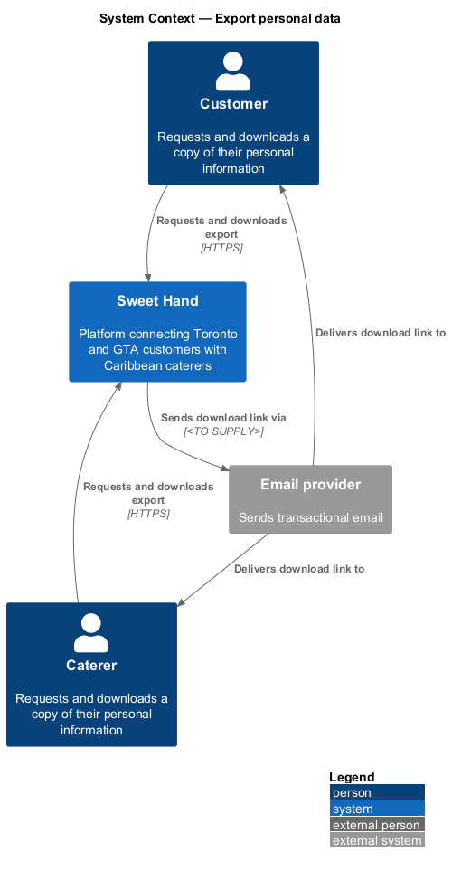
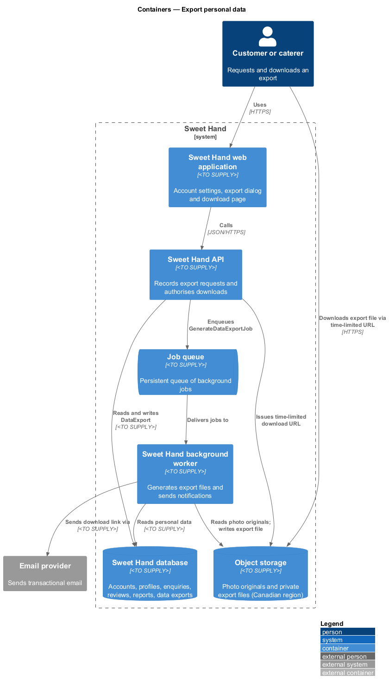
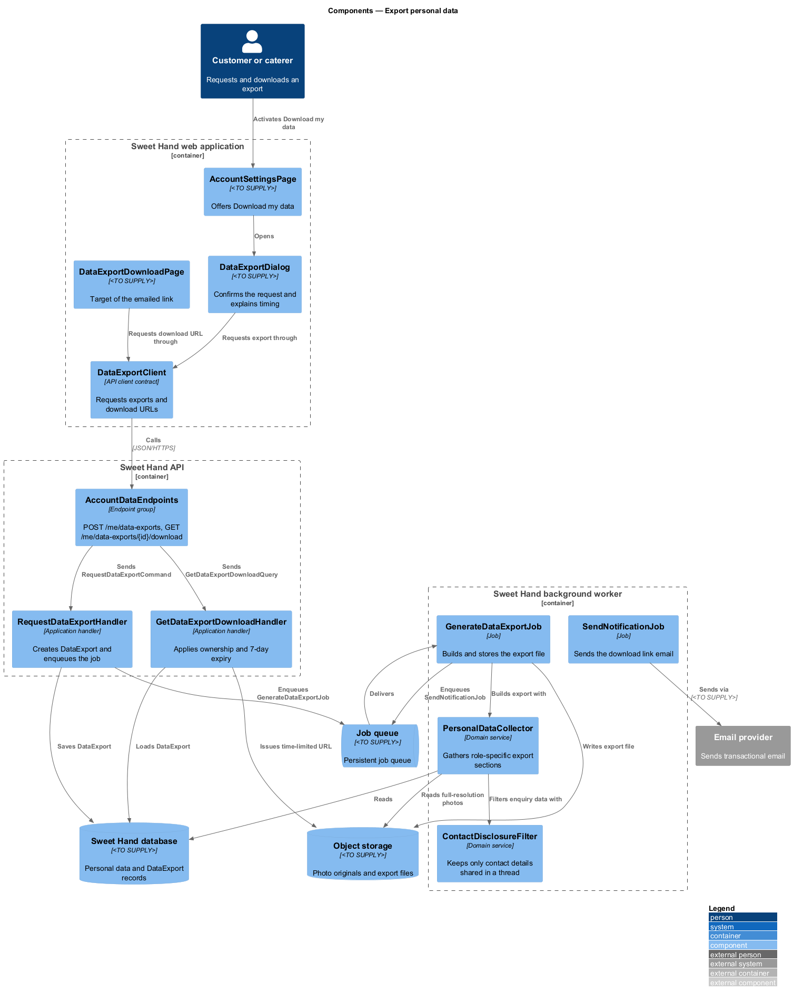
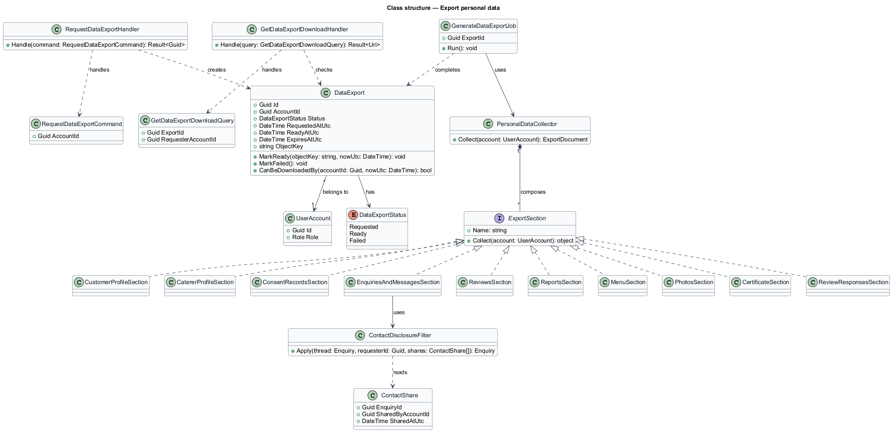
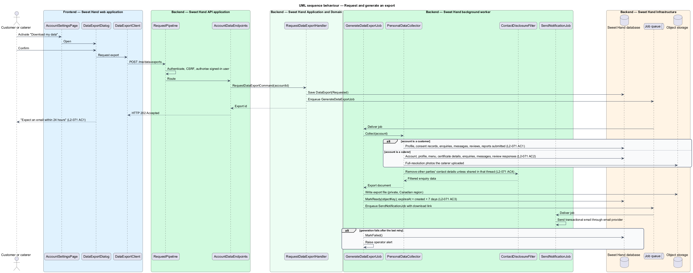
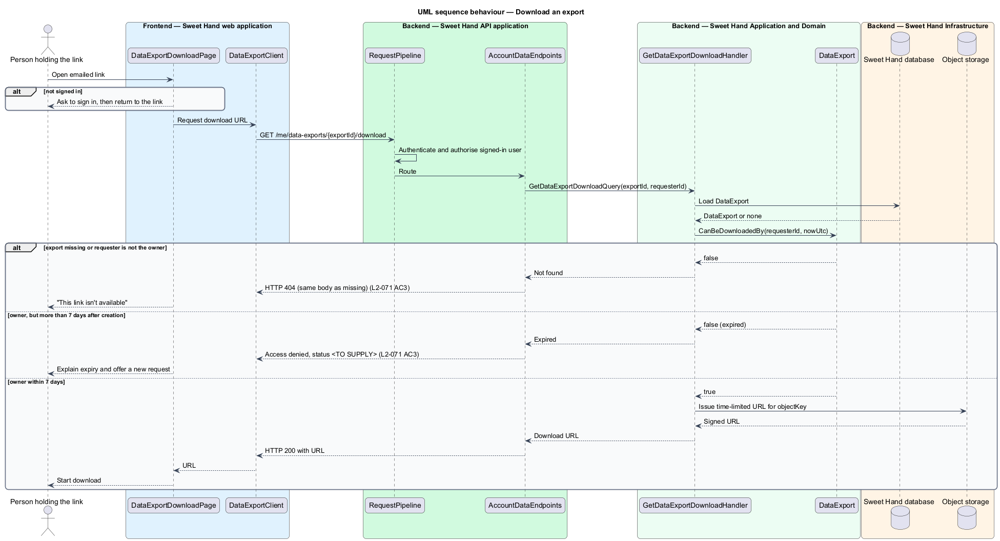

# Export personal data

## Overview

Sweet Hand is a web platform that connects people in Toronto and the Greater
Toronto Area (GTA) with caterers who sell Caribbean food. Canadian privacy law
(PIPEDA) gives each person a right to see the personal information an
organisation holds about them. This feature, in the `privacy` subsystem, lets a
signed-in customer or caterer request a copy of that information and download
it.

The export runs in the background. A user activates "Download my data" in
account settings. The background worker gathers the data, writes an export file
to private object storage and emails the user a download link within 24 hours.
The link works only for the user who asked for it and only for 7 days.

The export holds the requester's own data. Other people's contact details
appear only where they were shared with the requester in an enquiry thread.

Terms used in this document:

**data export** — one request for a copy of a user's personal information, with its status, generated file and expiry

**export file** — machine-readable file that holds the requester's personal information, stored privately in object storage

**export section** — part of the export file that covers one kind of data, such as enquiries or reviews

**contact share** — record that one party chose to show their email address or phone number to the other party in one enquiry thread (`L2-035`)

**download link** — URL in the notification email that leads to the export after the platform checks the requester and the expiry

## Description

Technology choices for every component below are `<TO SUPPLY>`, pending
architecture decision records in `docs/adr/`. Components are named by role.

### Frontend — Sweet Hand web application

- **`AccountSettingsPage`** — signed-in account screen. Its "Download my data"
  button opens `DataExportDialog`.
- **`DataExportDialog`** — confirmation dialog. It explains that the export
  arrives by email within 24 hours and that the link expires after 7 days. It
  shows the outcome of the request.
- **`DataExportDownloadPage`** — target of the emailed link. It asks the user
  to sign in when needed, then starts the download or explains that the link
  has expired.
- **`DataExportClient`** — API client contract the pages depend on.

### Backend — Sweet Hand API application

- **`AccountDataEndpoints`** — endpoint group. Every endpoint requires an
  authenticated customer or caterer.
  - `POST /me/data-exports` — creates a data export request.
  - `GET /me/data-exports/{exportId}/download` — returns a short-lived storage
    URL when the caller owns the export and it has not expired. Any other
    caller receives the not-found response.

### Backend — Sweet Hand Application and Domain

- **`RequestDataExportCommand`** and **`RequestDataExportHandler`** — create a
  `DataExport` in `Requested` status and enqueue `GenerateDataExportJob`. The
  number of outstanding requests one user may hold is `<TO SUPPLY>`.
- **`DataExport`** — entity with an unguessable `id`, `accountId`,
  `requestedAtUtc`, `status` (`Requested`, `Ready`, `Failed`), `objectKey`,
  `readyAtUtc` and `expiresAtUtc`. `expiresAtUtc` is 7 days after the export
  file was created (`L2-071 AC3`). `CanBeDownloadedBy(accountId, now)` holds the
  ownership and expiry rule.
- **`GetDataExportDownloadQuery`** and **`GetDataExportDownloadHandler`** —
  apply `CanBeDownloadedBy`, then ask `ObjectStore` for a time-limited URL. The
  URL lifetime is `<TO SUPPLY>`.
- **`PersonalDataCollector`** — builds the export from role-specific sections.
  - **Customer sections** (`L2-071 AC1`): profile, consent records, enquiries,
    messages, reviews and reports the customer submitted.
  - **Caterer sections** (`L2-071 AC2`): account, profile, full-resolution
    photos the caterer uploaded, menu, food handler certificate details,
    enquiries, messages and responses to reviews.
- **`ContactDisclosureFilter`** — removes every other user's email address and
  phone number from enquiry and message data, except details that party shared
  in that thread through a `ContactShare` (`L2-071 AC4`).

### Backend — Sweet Hand background worker

- **`GenerateDataExportJob`** — runs `PersonalDataCollector`, writes the export
  file to `ObjectStore`, marks the `DataExport` as `Ready` and enqueues a
  `SendNotificationJob` with the download link. On failure it retries; after
  the last retry it marks the export `Failed` and raises an operator alert. The
  retry schedule is `<TO SUPPLY>`. The 24-hour delivery limit in `L2-071 AC1`
  bounds it.
- **`SendNotificationJob`** — sends the transactional email through the email
  provider (`L2-030`).

### Backend — Sweet Hand Infrastructure

- **`DataExportRepository`** — persists `DataExport` records.
- **`ObjectStore`** — stores export files in a private area of object storage in
  a Canadian region and issues time-limited URLs. Export files are not
  reachable through the CDN.
- **`JobQueue`** — persistent job queue.

The export file format is JSON (`L2-071 AC1`). How the caterer export packages
full-resolution photos alongside the JSON, for example as an archive or as
separate signed links, is `<TO SUPPLY>`. How long the platform keeps an expired
export file before deleting it is `<TO SUPPLY>`.

## Requirements

The feature realizes the following level-2 (L2) requirements from
`docs/specs/L2.md`. Each refines the level-1 (L1) requirement cited beside it.
Requirement text is quoted from the specification, with *must* rendered as
*shall*.

| L2 ID | Refines (L1) | Requirement |
|-------|--------------|-------------|
| `L2-071` | `L1-020` | A signed-in user shall be able to see and download the personal information the platform holds about them. |

## Diagrams

### System context

A customer or caterer requests an export from Sweet Hand and receives the
download link by email.

### Containers

The API records the request and queues a job. The background worker gathers the
data from the database and object storage, writes the export file, and queues
the notification email.

### Components

`AccountDataEndpoints` dispatches to the request and download handlers.
`GenerateDataExportJob` uses `PersonalDataCollector`, which passes enquiry data
through `ContactDisclosureFilter` before writing.

### Class structure

`DataExport` owns the ownership and expiry rule. `PersonalDataCollector`
composes role-specific `ExportSection` implementations and depends on
`ContactDisclosureFilter`.

### Behaviour — request and generate an export

The request returns at once. The worker gathers the role-specific sections,
filters other users' contact details, stores the file and emails a link within
24 hours.

### Behaviour — download an export

The download endpoint returns a short-lived storage URL only to the owner of an
unexpired export. Every other caller, and any request after 7 days, is denied.

