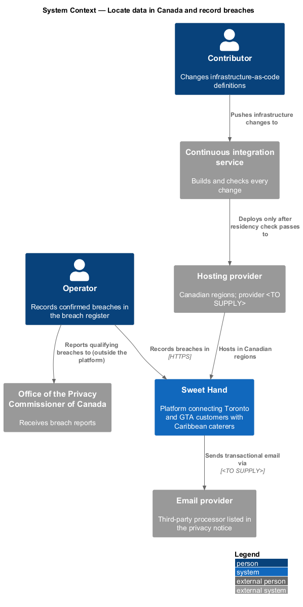
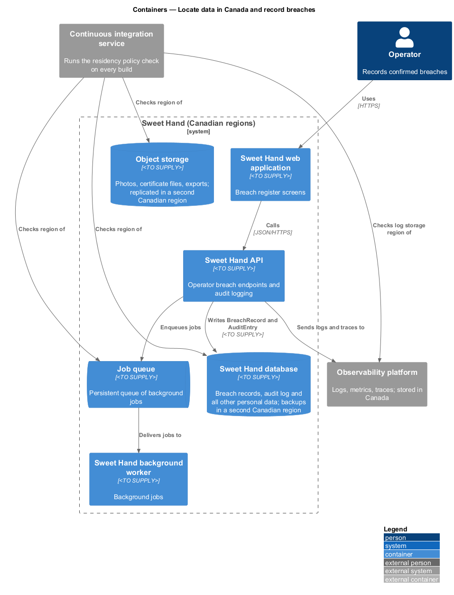
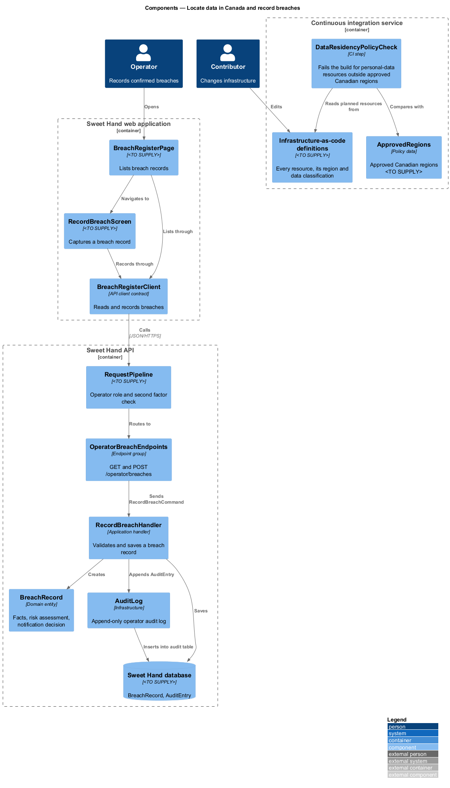
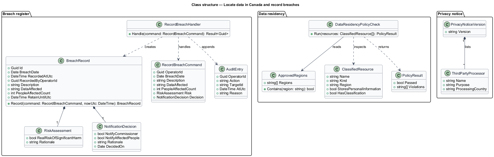
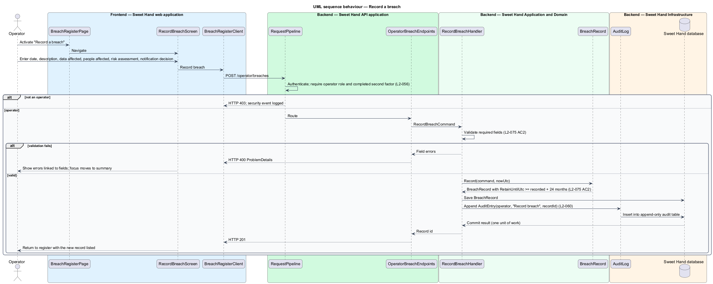
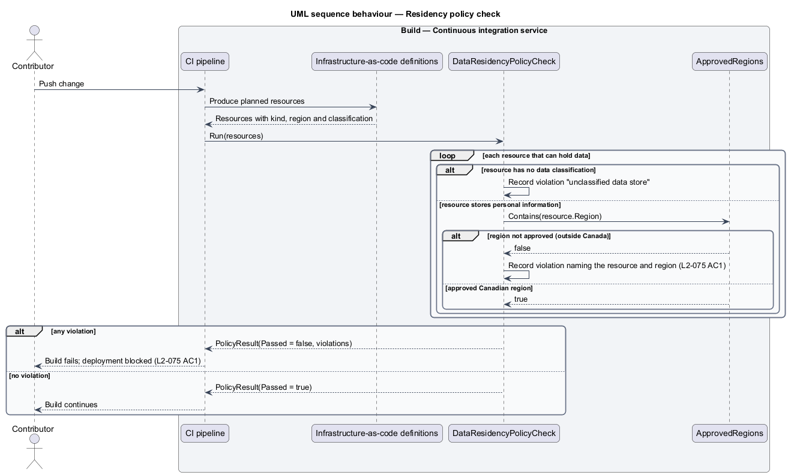

# Locate data in Canada and record breaches

## Overview

Sweet Hand is a web platform that connects people in Toronto and the Greater
Toronto Area (GTA) with caterers who sell Caribbean food. Assumption A-7 in
`docs/specs/L1.md` commits the platform to storing all personal information in
Canadian data centres. Canadian privacy law (PIPEDA) also requires an
organisation to keep a record of every breach of security safeguards involving
personal information, and to report breaches that pose a real risk of
significant harm. This feature, in the `privacy` subsystem, covers both
obligations.

The feature has three parts.

- **Data residency check.** Infrastructure is described as code. A policy check
  in continuous integration (CI) fails the build when any resource that stores
  personal information is placed outside a Canadian region.
- **Third-party processors.** The privacy notice lists each third-party
  processor, such as the email provider, with the country where it processes
  data.
- **Breach register.** Operators record each confirmed breach in a register
  inside the platform. Each record holds the facts, the risk assessment and the
  notification decision, and is kept for at least 24 months.

Reporting a breach to the Office of the Privacy Commissioner of Canada and
notifying affected people happen outside the platform. The register records the
decision about them.

Terms used in this document:

**data residency** — requirement that personal information, including databases, file storage, backups and logs, is stored only in Canadian data centres

**infrastructure-as-code definitions** — version-controlled files that declare every deployed resource and its region

**residency policy check** — CI step that reads the infrastructure-as-code definitions and fails the build for any personal-data resource outside a Canadian region

**third-party processor** — outside organisation that handles personal information on Sweet Hand's behalf

**breach of security safeguards** — loss of, unauthorised access to, or unauthorised disclosure of personal information caused by a failure of the platform's safeguards (PIPEDA term)

**breach record** — entry in the breach register describing one confirmed breach

**real risk of significant harm** — PIPEDA threshold that decides whether a breach is reported to the Commissioner and to affected people

## Description

Technology choices for every component below are `<TO SUPPLY>`, pending
architecture decision records in `docs/adr/`. The hosting provider, the
infrastructure-as-code tool and the list of approved Canadian regions are all
`<TO SUPPLY>`. Components are named by role.

### Data residency

- **Infrastructure-as-code definitions** — declare the Sweet Hand database, its
  backups and replicas, object storage and its replica, the job queue, log and
  trace storage, and the compute that runs the containers. Each resource that
  stores personal information carries a classification marker. The marker
  format is `<TO SUPPLY>`.
- **`DataResidencyPolicyCheck`** — CI step that runs on every build. It reads the
  planned resources and the `ApprovedRegions` list, and fails the build naming
  each classified resource whose region is not approved (`L2-075 AC1`). A
  resource that stores data but has no classification marker also fails the
  check, so a new store cannot bypass it.
- **Backups in a second region** — `L2-090` asks for backups in a different
  Canadian region from the primary. The policy check treats the backup region
  like any other region.

### Third-party processors

- **`ThirdPartyProcessor`** — entry on `PrivacyNoticeVersion` (see
  `consent-to-privacy-notice`) with name, purpose and processing country. The
  privacy notice renders the list (`L2-075 AC3`). Adding a processor publishes a
  new privacy notice version. The review step that confirms each processor's
  location before it is added is an operational procedure owned by the privacy
  officer; its form is `<TO SUPPLY>`.

### Breach register — Frontend — Sweet Hand web application

- **`BreachRegisterPage`** — operator screen that lists breach records, newest
  first. Its "Record a breach" button navigates to `RecordBreachScreen`.
- **`RecordBreachScreen`** — operator screen with the fields of a breach record.
  It validates on the client for immediate feedback and shows server errors.
- **`BreachRegisterClient`** — API client contract the screens depend on.

### Breach register — Backend — Sweet Hand API application

- **`OperatorBreachEndpoints`** — endpoint group. `GET /operator/breaches` and
  `POST /operator/breaches`. The request pipeline checks the operator role and a
  completed second factor on the server (`L2-056`). Whether any operator or only
  an `Admin` operator may record a breach is `<TO SUPPLY>`.

### Breach register — Backend — Sweet Hand Application and Domain

- **`RecordBreachCommand`** and **`RecordBreachHandler`** — validate the
  command, create a `BreachRecord`, and write an `AuditEntry` in the same unit of
  work (`L2-060`).
- **`BreachRecord`** — entity with `breachDate`, `recordedAtUtc`,
  `recordedByOperatorId`, `description`, `dataAffected`,
  `peopleAffectedCount`, a `RiskAssessment` and a `NotificationDecision`
  (`L2-075 AC2`). `retainUntilUtc` is at least 24 months after `recordedAtUtc`.
- **`RiskAssessment`** — value object holding whether the breach poses a real
  risk of significant harm, and the rationale.
- **`NotificationDecision`** — value object holding whether the Commissioner
  and affected people are to be notified, the rationale and the decision date.
- Whether a breach record can be amended after it is saved, and how amendments
  are kept, is `<TO SUPPLY>`. No retention rule in `enforce-retention` deletes
  breach records.

### Breach register — Backend — Sweet Hand Infrastructure

- **`BreachRecordRepository`** — persistence in the Sweet Hand database, which
  sits in a Canadian region like every other personal-data store.
- **`AuditLog`** — append-only operator audit log.

## Requirements

The feature realizes the following level-2 (L2) requirements from
`docs/specs/L2.md`. Each refines the level-1 (L1) requirement cited beside it.
Requirement text is quoted from the specification, with *must* rendered as
*shall*.

| L2 ID | Refines (L1) | Requirement |
|-------|--------------|-------------|
| `L2-075` | `L1-020` | Assumption A-7. All personal information, including databases, file storage, backups and logs, shall be stored in Canadian data centres. The platform shall support PIPEDA's rules for recording and reporting breaches. |

## Diagrams

### System context

Contributors change infrastructure through CI, which enforces data residency.
Operators record breaches in Sweet Hand and report them to the Commissioner
outside the platform. The email provider appears as a listed third-party
processor.

### Containers

Every Sweet Hand container that stores personal information runs in a Canadian
region and is checked by CI. The breach register lives in the web application,
the API and the Sweet Hand database.

### Components

In CI, `DataResidencyPolicyCheck` reads the infrastructure-as-code definitions.
In the platform, `RecordBreachScreen` reaches `RecordBreachHandler` through
`BreachRegisterClient` and `OperatorBreachEndpoints`.

### Class structure

`BreachRecord` composes a `RiskAssessment` and a `NotificationDecision`. The
residency check compares each `ClassifiedResource` with `ApprovedRegions`.

### Behaviour — record a breach

An operator records a confirmed breach. The handler validates the record, saves
it with a retention date at least 24 months away, and writes an audit entry.

### Behaviour — residency policy check

On each build, CI fails when any classified resource is outside an approved
Canadian region or when a data store has no classification.

