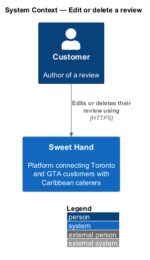
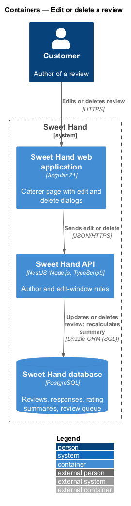
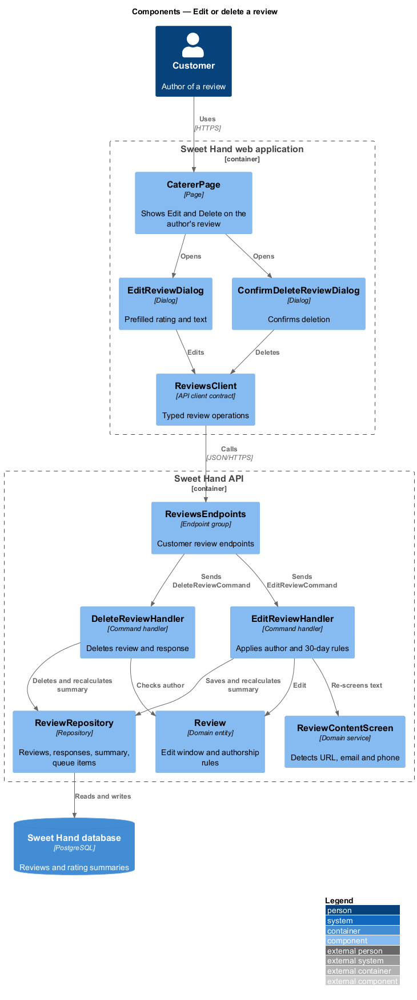
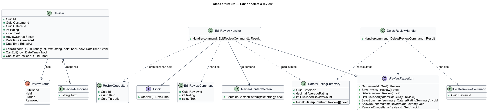
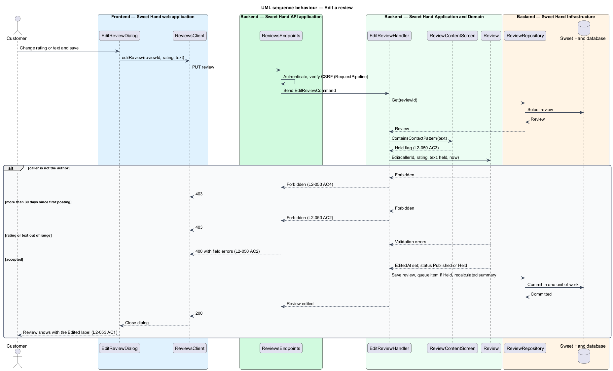
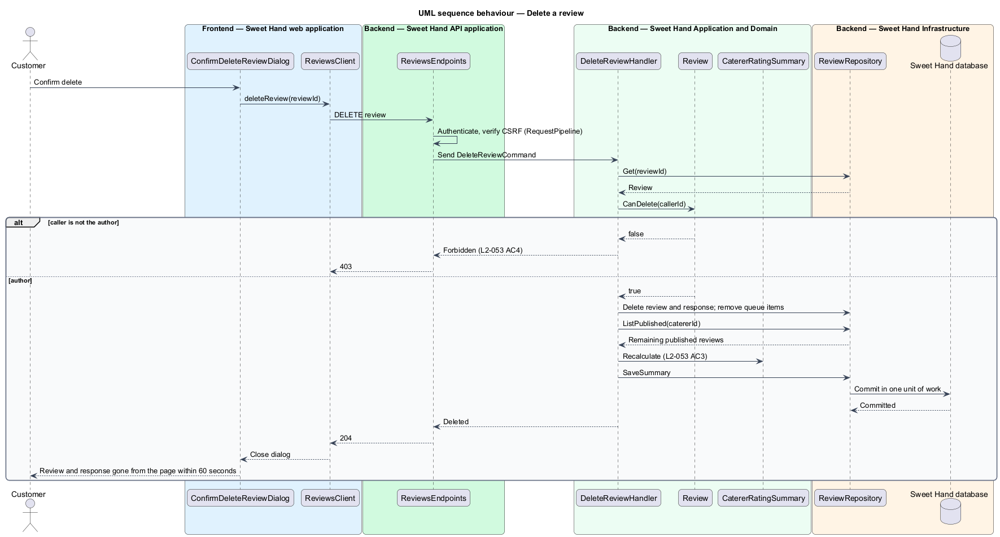

# Edit or delete a review

## Overview

Sweet Hand is a platform that connects people in Toronto and the Greater Toronto
Area (GTA) with caterers who sell Caribbean food. A customer who has dealt with
a caterer may review them (`reviews/write-review`). This feature lets the author
of a review change their mind: edit the review within 30 days of first posting
it, or delete it at any time.

The edit window keeps reviews stable once other customers have relied on them,
while still letting an author correct a mistake soon after posting. Deletion is
always open because a review is the author's own content. An edited review
carries an "Edited" label so readers know it changed.

The feature sits in the reviews subsystem. Operators moderate reviews through
a separate path (`L2-059`, moderation subsystem); this feature covers only the
author.

Terms used in this document:

- **review author** — customer account that created the review
- **edit window** — period of 30 days from the review's first posting during which the author may edit it
- **edited label** — "Edited" marker shown with a review whose text or rating changed after posting

## Description

Technology choices follow ADR 0001 (Angular 21) and ADR 0006 (NestJS on
Node.js, PostgreSQL through Drizzle ORM, S3-compatible object storage);
providers not named there remain `<TO SUPPLY>`. The components are named by
role.

Frontend — Sweet Hand web application:

- **`CatererPage`** — for a signed-in author, the author's own review shows
  "Edit" while the edit window is open and "Delete" at all times
  (`L2-053 AC2`). The page reads both flags from the review eligibility
  response that `reviews/write-review` defines (`AlreadyReviewed` result), which
  this feature extends with `canEdit` and `canDelete`. A "My reviews" screen in
  the customer account area is `<TO SUPPLY>` until the mocks in `docs/mocks/`
  cover it.
- **`EditReviewDialog`** — accessible dialog prefilled with the current rating
  and text. It applies the same client checks as `WriteReviewDialog`.
- **`ConfirmDeleteReviewDialog`** — confirmation dialog. It states that the
  caterer's response, if any, is removed with the review.
- **`ReviewsClient`** — API client contract. The page and dialogs depend on
  this contract, not on the concrete HTTP client.

Backend — Sweet Hand API application:

- **`ReviewsEndpoints`** — customer review endpoint group. This feature adds
  `PUT /reviews/{reviewId}` and `DELETE /reviews/{reviewId}`. Route shapes are
  `<TO SUPPLY>`. Both require a signed-in session and a valid CSRF token
  (`L2-081`).

Backend — Sweet Hand Application and Domain:

- **`EditReviewCommand`** / **`EditReviewHandler`** — carries `reviewId`,
  `rating` and `text`. The handler loads the review and calls `Review.Edit`. A
  caller who is not the author receives HTTP 403 (`L2-053 AC4`). An edit after
  the window closes receives HTTP 403 (`L2-053 AC2`). The new text passes
  through `ReviewContentScreen` again, so an edit that adds a URL, email address
  or phone number moves the review to `Held` and creates a `ReviewQueueItem`
  (`L2-050 AC3`). The handler recalculates `CatererRatingSummary` in the same
  unit of work.
- **`DeleteReviewCommand`** / **`DeleteReviewHandler`** — carries `reviewId`.
  The handler checks authorship (HTTP 403 otherwise, `L2-053 AC4`), deletes the
  review and its `ReviewResponse`, removes any open `ReviewQueueItem` for it,
  and recalculates `CatererRatingSummary` in one unit of work
  (`L2-053 AC3`). Deletion is permanent. Whether open reports about the deleted
  review (`L2-054`) are closed automatically is `<TO SUPPLY>`.
- **`Review`** — domain entity. `Edit(authorId, rating, text, held, now)`
  checks authorship, checks that `now` is within 30 days of `createdAt`,
  validates the rating (1 to 5) and text (20 to 2,000 characters), sets
  `editedAt`, and sets `status` from the screening result. Whether the window
  is measured in elapsed hours or in `America/Toronto` calendar days is
  `<TO SUPPLY>`; the design measures 30 × 24 hours from `createdAt` in UTC.
  `CanEdit(now)` and `CanDelete(callerId)` back the flags the page reads.
  Editing a review in the `Hidden` or `Removed` state is rejected, because those
  states belong to operator moderation (`L2-059`).
- **`ReviewContentScreen`** — shared with `reviews/write-review`.
- **`CatererRatingSummary`** — shared read model, recalculated after each edit
  or deletion that changes the set or values of published reviews.

Backend — Sweet Hand Infrastructure:

- **`ReviewRepository`** — loads, saves and deletes reviews, responses, queue
  items and the summary.
- **`Clock`** — current UTC time.

Changes reach the public caterer page within 60 seconds because public HTML is
cached for 60 seconds or less (`L2-087 AC4`).

## Requirements

The feature realizes the following level-2 (L2) requirements from
`docs/specs/L2.md`. Each refines the level-1 (L1) requirement cited beside it.
Requirement text is quoted from the specification, with *must* rendered as
*shall*.

| L2 ID | Refines (L1) | Requirement |
|-------|--------------|-------------|
| `L2-053` | `L1-014` | The author of a review can edit it within 30 days of first posting it, and can delete it at any time. |

## Diagrams

### System context

The review author edits or deletes their review through Sweet Hand. No external
system takes part.

### Containers

The web application calls the Sweet Hand API, which applies the author and
time-window rules and updates the Sweet Hand database.

### Components

The dialogs call `ReviewsClient`. `ReviewsEndpoints` dispatches the edit and
delete commands, whose handlers apply the rules on `Review` and recalculate the
rating summary.

### Class structure

`Review` holds the edit window and authorship rules. Both handlers depend on
the repository and the summary; the edit handler also uses the content screen.

### Behaviour — edit a review

The handler checks authorship and the 30-day window, re-screens the text, and
saves the edited review with the "Edited" label.

### Behaviour — delete a review

After confirmation, the handler removes the review and its response and
recalculates the rating summary in one unit of work.

