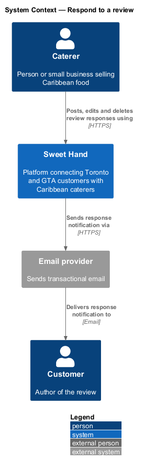
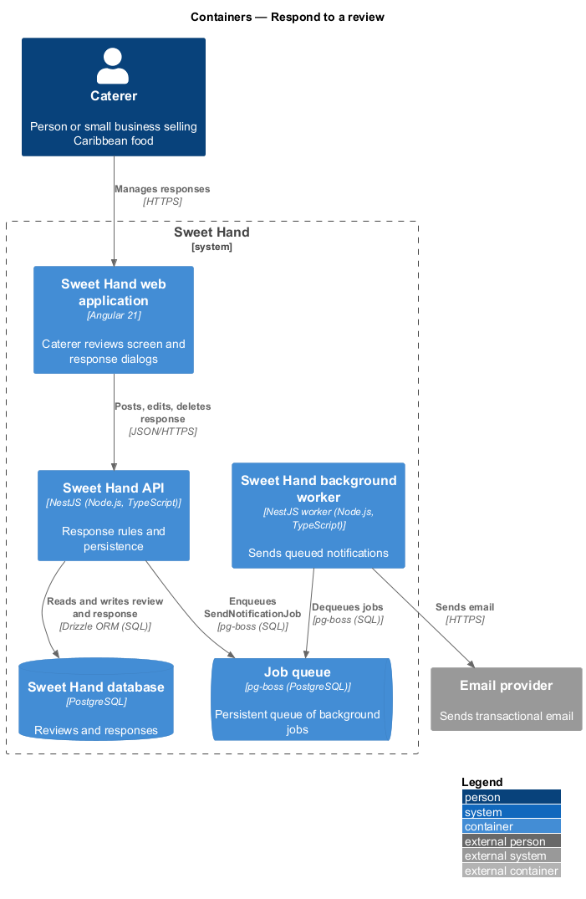
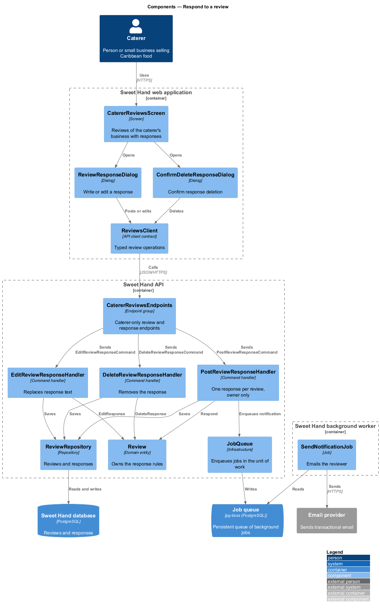
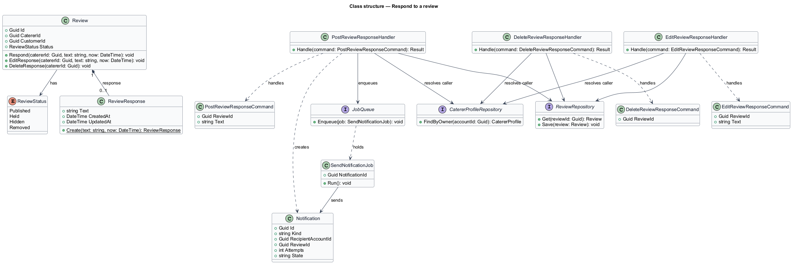
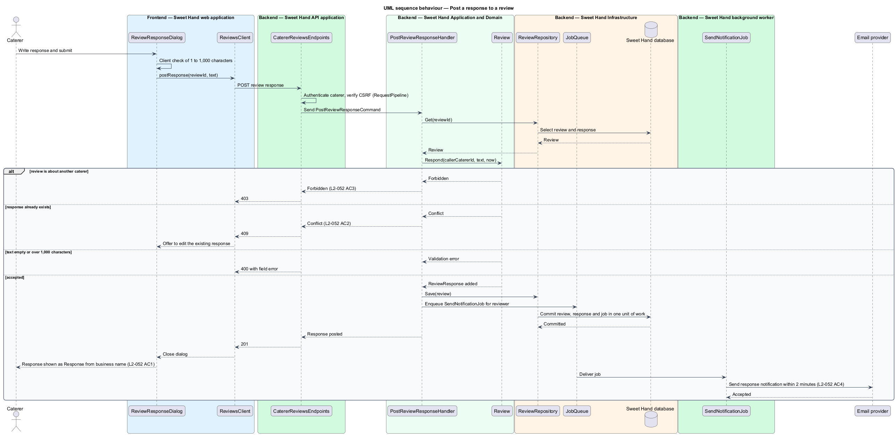
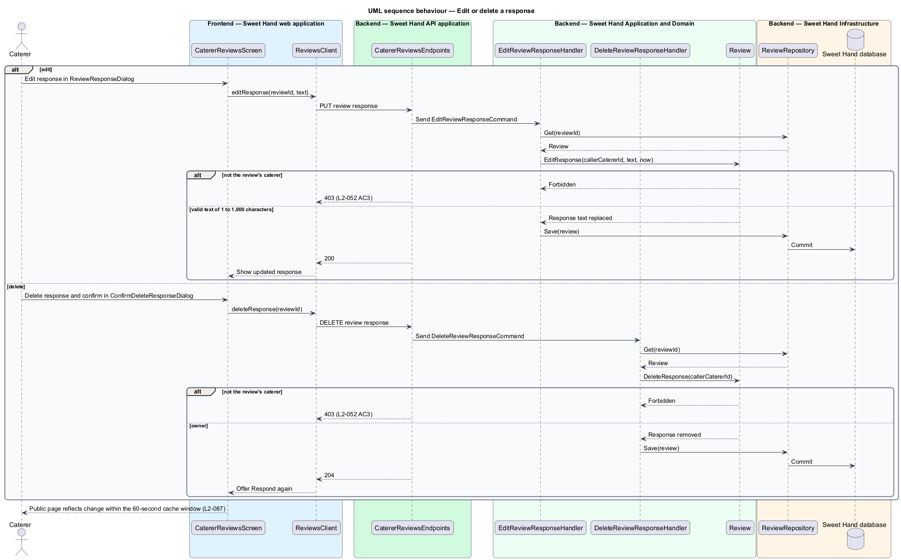

# Respond to a review

## Overview

Sweet Hand is a platform that connects people in Toronto and the Greater Toronto
Area (GTA) with caterers who sell Caribbean food. Customers who have dealt with
a caterer may review them (`reviews/write-review`), and the reviews appear on
the caterer's public page (`reviews/show-reviews`). This feature lets the
caterer answer: post one public response under each review of their business,
then edit or delete it at any time.

A response gives the caterer a voice next to the customer's account of the
event. It is public, so it follows the same plain-text rules as reviews. The
reviewer is told by email when a response is posted.

The feature sits in the reviews subsystem. It is used from the caterer's
signed-in area, and it sends its email through the notification queue that the
enquiries subsystem also uses (`L2-030`).

Terms used in this document:

- **review response** — plain text of 1 to 1,000 characters that a caterer posts under one review of their business
- **responding caterer** — caterer whose profile the review is about, and the only caterer allowed to respond to it
- **response notification** — transactional email telling the reviewer that a response was posted

## Description

Technology choices follow ADR 0001 (Angular 21) and ADR 0006 (NestJS on
Node.js, PostgreSQL through Drizzle ORM, S3-compatible object storage);
providers not named there remain `<TO SUPPLY>`. The components are named by
role.

Frontend — Sweet Hand web application:

- **`CatererReviewsScreen`** — screen in the caterer's signed-in area that lists
  the reviews of their business with the current response, if any. Each review
  offers "Respond", or "Edit response" and "Delete response" when a response
  exists. The screen's placement in caterer navigation is `<TO SUPPLY>` until
  the mocks in `docs/mocks/` cover it.
- **`ReviewResponseDialog`** — accessible dialog for writing or editing a
  response. It shows the remaining character count, checks 1 to 1,000
  characters on the client, and shows server errors inline.
- **`ConfirmDeleteResponseDialog`** — confirmation dialog for deleting a
  response.
- **`ReviewsClient`** — API client contract. The screen and dialogs depend on
  this contract, not on the concrete HTTP client.

Backend — Sweet Hand API application:

- **`CatererReviewsEndpoints`** — endpoint group for the signed-in caterer:
  list reviews of the caller's business, and `POST`, `PUT` and `DELETE` on a
  review's response. Route shapes are `<TO SUPPLY>`. Every endpoint requires a
  caterer session. The `RequestPipeline` checks the CSRF token on each
  state-changing request.

Backend — Sweet Hand Application and Domain:

- **`PostReviewResponseCommand`** / **`PostReviewResponseHandler`** — carries
  `reviewId` and `text`. The handler loads the review, checks that its
  `catererId` is the caller's caterer profile, and rejects any other caterer
  with HTTP 403 (`L2-052 AC3`). A second response is rejected with HTTP 409 and
  the UI offers to edit the existing one (`L2-052 AC2`). On success it saves the
  response and enqueues a `SendNotificationJob` for the reviewer in the same
  unit of work.
- **`EditReviewResponseCommand`** / **`EditReviewResponseHandler`** — replaces
  the response text after the same ownership check.
- **`DeleteReviewResponseCommand`** / **`DeleteReviewResponseHandler`** —
  deletes the response after the same ownership check.
- **`Review`** — domain entity. `Respond(catererId, text, now)` enforces one
  response per review and the owner rule. `EditResponse` and `DeleteResponse`
  apply the same owner rule. Whether a caterer may respond to a review in the
  `Held` or `Hidden` state is `<TO SUPPLY>`; the design allows responses only
  to `Published` reviews.
- **`ReviewResponse`** — value held by a review: trimmed plain text of 1 to
  1,000 characters (`L2-052`), `createdAt` and `updatedAt`. Text is stored as
  given and rendered as literal text (`L2-080`).
- **`Notification`** — queued email record of kind `ReviewResponsePosted`
  addressed to the reviewer. Whether editing a response also notifies the
  reviewer is `<TO SUPPLY>`; the design notifies on first posting only, as
  `L2-052 AC4` states.

Backend — Sweet Hand Infrastructure:

- **`ReviewRepository`** — loads and saves the review with its response.
- **`CatererProfileRepository`** — resolves the caller's caterer profile.
- **`JobQueue`** — persistent queue that accepts the notification job inside the
  same unit of work as the response.

Backend — Sweet Hand background worker:

- **`SendNotificationJob`** — sends the response notification through the
  `EmailGateway` within 2 minutes at the 95th percentile (`L2-052 AC4`), with
  the retry rules of `L2-030`. The email names the caterer and links to the
  caterer page.

A suspended or removed caterer cannot edit their profile (`L2-044 AC4`,
`L2-058 AC5`). Whether that block also covers review responses is
`<TO SUPPLY>`; the design rejects response changes from a caterer whose status
is `Suspended` or `Removed`.

## Requirements

The feature realizes the following level-2 (L2) requirements from
`docs/specs/L2.md`. Each refines the level-1 (L1) requirement cited beside it.
Requirement text is quoted from the specification, with *must* rendered as
*shall*.

| L2 ID | Refines (L1) | Requirement |
|-------|--------------|-------------|
| `L2-052` | `L1-014` | A caterer can post one public response to each review of their business. A response is 1 to 1,000 characters of plain text, and the caterer can edit or delete it at any time. |

## Diagrams

### System context

The caterer posts responses through Sweet Hand. Sweet Hand emails the customer
who wrote the review through the email provider.

### Containers

The API saves the response and queues the notification in one unit of work.
The background worker sends the email.

### Components

`CatererReviewsScreen` and its dialogs call `ReviewsClient`.
`CatererReviewsEndpoints` dispatches the post, edit and delete commands, whose
handlers apply the rules on `Review`.

### Class structure

`Review` owns at most one `ReviewResponse`. Each handler depends on its command
and the review repository. The post handler also creates a `Notification`.

### Behaviour — post a response

The handler checks ownership and the one-response rule, saves the response,
and queues the reviewer's email.

### Behaviour — edit or delete a response

Editing replaces the text and deleting removes the response. Both repeat the
ownership check.

