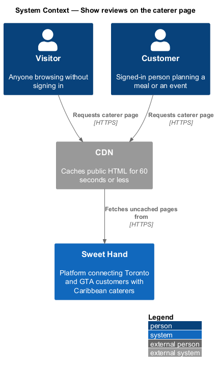
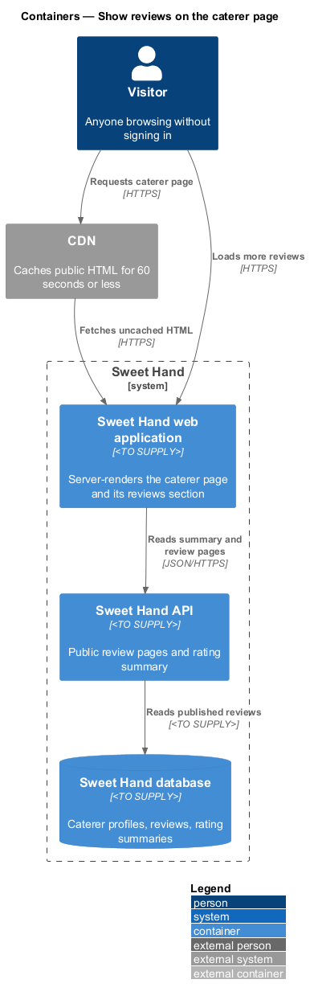
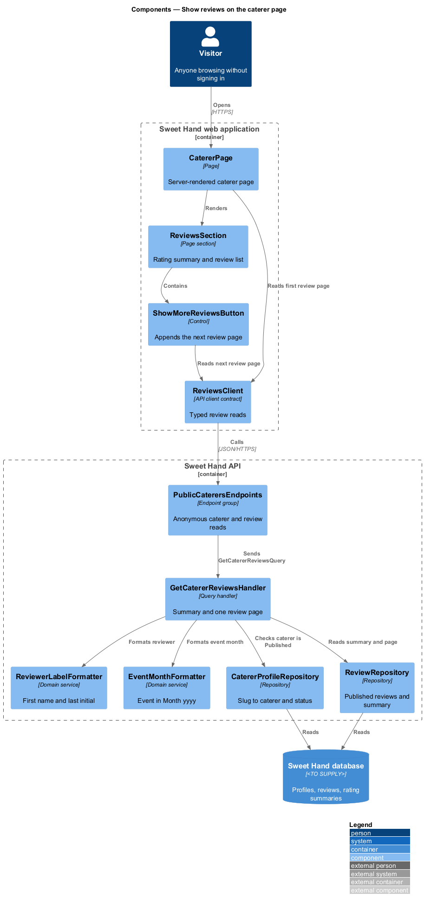
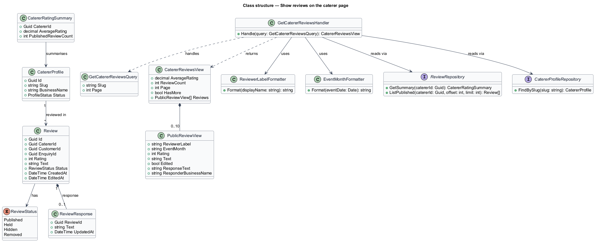
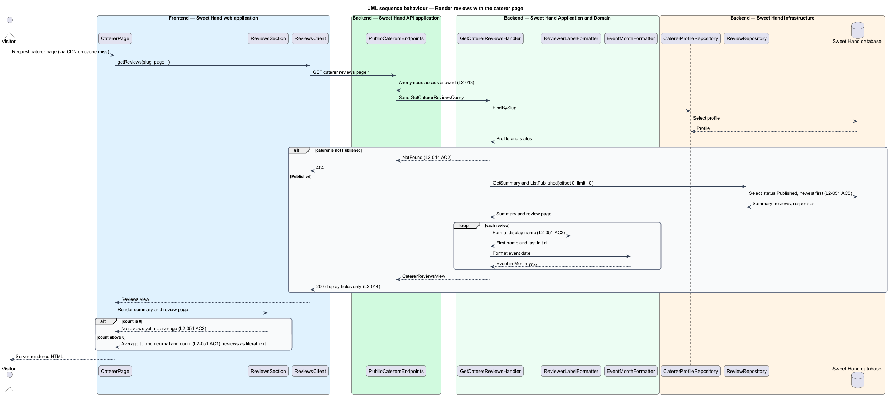
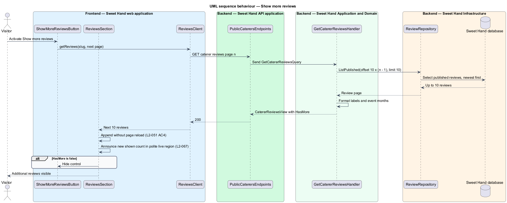

# Show reviews on the caterer page

## Overview

Sweet Hand is a platform that connects people in Toronto and the Greater Toronto
Area (GTA) with caterers who sell Caribbean food. Each published caterer has a
public page (`L2-015`) that ends with the reviews other customers have left.
This feature covers how those reviews appear: a rating summary at the top,
followed by the reviews themselves, newest first, in pages of 10.

Reviews help a customer judge a caterer before sending an enquiry. Anyone can
read them without an account (`L2-013`). Only reviews in the published state
count toward the summary or appear in the list. Held, hidden and removed
reviews stay out of both (`L2-051 AC5`).

The feature sits in the reviews subsystem. Writing a review is covered by
`reviews/write-review`, the caterer's public response by
`reviews/respond-to-review`, and the author's edits by
`reviews/edit-or-delete-review`. The rest of the caterer page belongs to the
discovery subsystem.

Terms used in this document:

- **rating summary** — average rating, to one decimal place, and count of published reviews for one caterer
- **reviewer label** — reviewer's first name and last initial, for example "Marcia T."
- **event month** — month and year of the event in the enquiry the review is based on, shown as "Event in August 2026"
- **review page** — slice of 10 published reviews in newest-first order

## Description

Technology choices for every component below are `<TO SUPPLY>`, pending
architecture decision records in `docs/adr/`. The components are named by role.

Frontend — Sweet Hand web application:

- **`CatererPage`** — server-rendered caterer page. Its HTML includes the
  rating summary and the first review page, so both are present without
  running JavaScript and the page meets the caching rule in `L2-087 AC4`.
- **`ReviewsSection`** — page section that renders the summary as
  "4.3 · 3 reviews" (`L2-051 AC1`) or "No reviews yet" with no average when
  the count is 0 (`L2-051 AC2`). Each review shows the reviewer label, event
  month, rating, text, an "Edited" label when the author edited it (`L2-053`),
  and the caterer's response under "Response from {business name}"
  (`L2-052`). The star rating also appears as text, so meaning does not rely
  on the icon alone (`L2-069 AC5`). Review and response text render as literal
  text (`L2-050 AC4`).
- **`ShowMoreReviewsButton`** — control shown when more reviews exist. It asks
  `ReviewsClient` for the next review page and appends it without a page
  reload (`L2-051 AC4`). The new count of shown reviews is announced through a
  polite live region (`L2-067`).
- **`ReviewsClient`** — API client contract. The section depends on this
  contract, not on the concrete HTTP client.

Backend — Sweet Hand API application:

- **`PublicCaterersEndpoints`** — public endpoint group. Anonymous access is a
  deliberate choice for public browsing (`L2-013`). This feature adds
  `GET /caterers/{slug}/reviews?page={n}`. The route shape is `<TO SUPPLY>`.
  A caterer that is not `Published` returns not found (`L2-014 AC2`). The
  response holds only display fields: no reviewer email, account ID or review
  status (`L2-014`).

Backend — Sweet Hand Application and Domain:

- **`GetCatererReviewsQuery`** / **`GetCatererReviewsHandler`** — carries the
  caterer slug and page number. The handler confirms the caterer is published,
  reads the `CatererRatingSummary`, reads one review page of `Published`
  reviews ordered by `createdAt` descending, and maps each to a
  `PublicReviewView`. An out-of-range page number returns page 1, matching the
  listing rule in `L2-002 AC5`.
- **`CatererRatingSummary`** — read model of average rating and published review
  count. It is recalculated in the same unit of work as any change to the set
  of published reviews for the caterer: a new published review, an author edit
  or deletion, or an operator hide, restore or removal (`L2-059`). The average
  is rounded half up to one decimal place; the rounding rule is `<TO SUPPLY>`
  beyond the single example in `L2-051 AC1` (5, 4, 4 → 4.3).
- **`ReviewerLabelFormatter`** — builds the reviewer label from the customer's
  display name: the first word, a space, and the first letter of the last word
  followed by a full stop (`L2-051 AC3`). The label for a single-word display
  name is `<TO SUPPLY>`. A deleted customer's reviews are removed
  (`L2-072 AC3`), so no label is needed for one.
- **`EventMonthFormatter`** — formats the event date of the review's eligible
  enquiry as "Event in {Month} {yyyy}", in `en-CA`, from resource strings
  (`L2-064`).
- **`PublicReviewView`** — display record: reviewer label, event month, rating,
  text, edited flag, and optional response text and business name.

Backend — Sweet Hand Infrastructure:

- **`ReviewRepository`** — reads the summary and review pages. Queries filter on
  status `Published` and the caterer, ordered by `createdAt` descending, with a
  limit of 10 and an offset.
- **`CatererProfileRepository`** — resolves the slug to a caterer and status.

Reviews of a `Removed` caterer are not shown (`L2-058 AC4`), because the
caterer page itself returns HTTP 410. A suspended caterer that an operator
reinstates shows its earlier reviews again (`L2-058 AC3`), because suspension
leaves the review records unchanged.

## Requirements

The feature realizes the following level-2 (L2) requirements from
`docs/specs/L2.md`. Each refines the level-1 (L1) requirement cited beside it.
Requirement text is quoted from the specification, with *must* rendered as
*shall*.

| L2 ID | Refines (L1) | Requirement |
|-------|--------------|-------------|
| `L2-051` | `L1-014` | The caterer page shall show the average rating, to one decimal place, and the number of reviews, followed by the reviews themselves, newest first, 10 per page. Each review shows the reviewer's first name and last initial, the month and year of the event, the rating, the text and any response from the caterer. |

## Diagrams

### System context

Visitors and customers read reviews on caterer pages. Pages pass through the
CDN, which caches public HTML for 60 seconds or less.

### Containers

The web application renders the first review page on the server from the Sweet
Hand API, and loads further pages from the same API on demand.

### Components

`ReviewsSection` and `ShowMoreReviewsButton` call `ReviewsClient`.
`PublicCaterersEndpoints` dispatches `GetCatererReviewsQuery`, whose handler
uses the formatters and repositories to build each `PublicReviewView`.

### Class structure

`GetCatererReviewsHandler` reads `CatererRatingSummary` and published `Review`
records, and maps them through the two formatters into `PublicReviewView`.

### Behaviour — render reviews with the caterer page

On the server, the caterer page requests the summary and the first review page
and renders them into the HTML.

### Behaviour — show more reviews

The "Show more reviews" control requests the next review page and appends it in
place.

