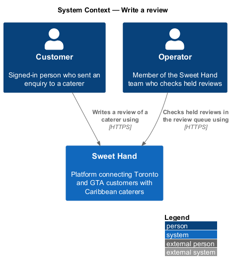
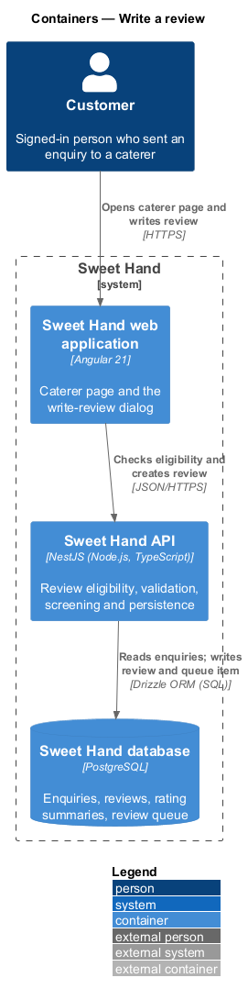
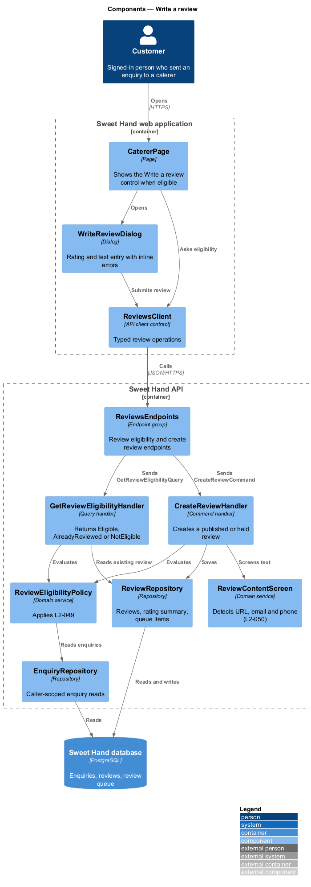
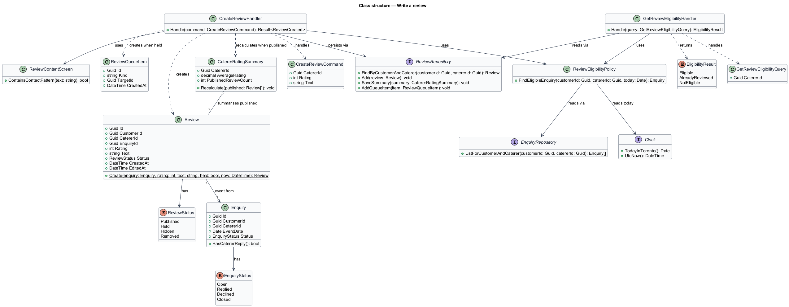
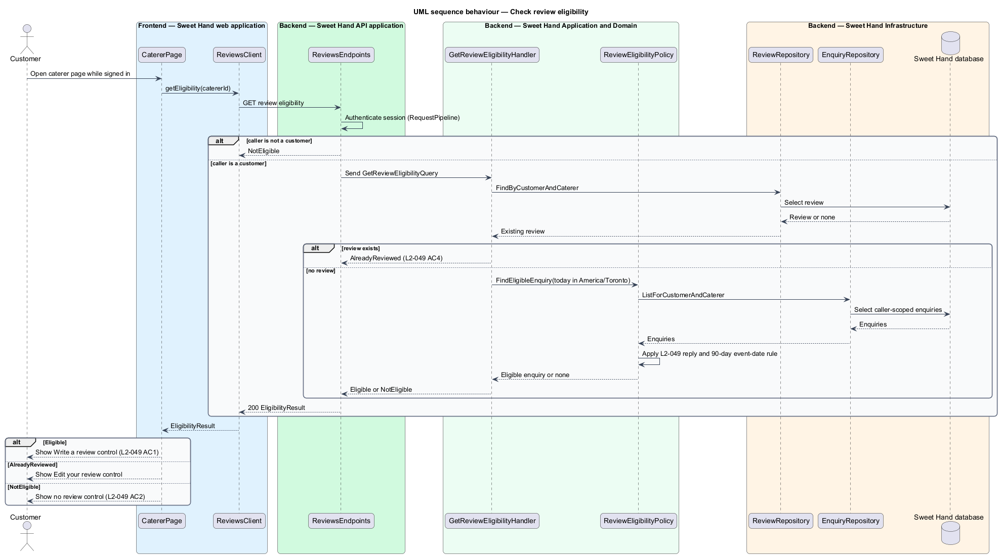
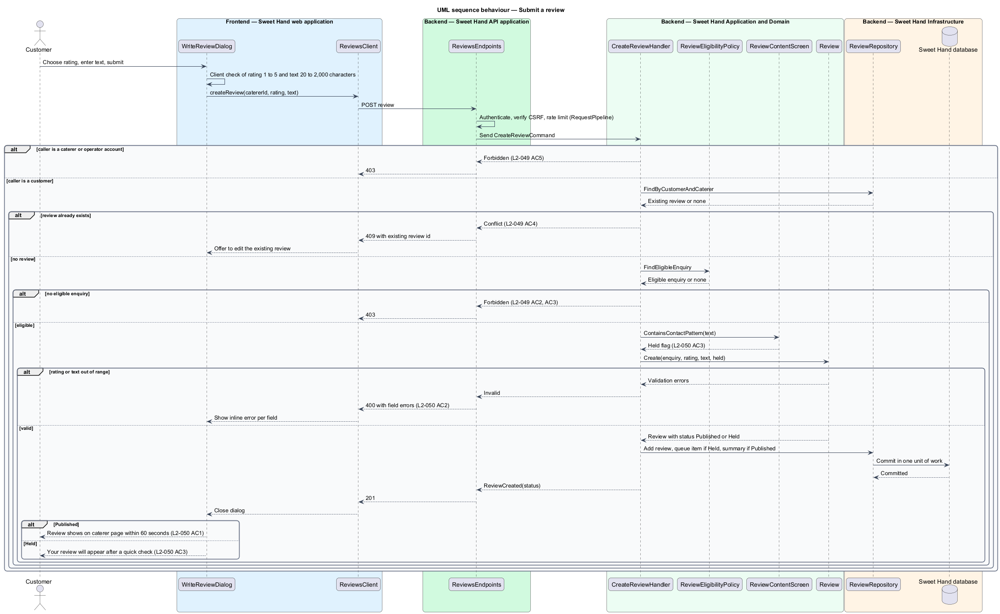

# Write a review

## Overview

Sweet Hand is a platform that connects people in Toronto and the Greater Toronto
Area (GTA) with caterers who sell Caribbean food. A customer finds a caterer,
sends an enquiry about an event, and talks with the caterer in an enquiry
thread. After the event, the customer may tell other customers how it went by
writing a review. This feature covers that step: deciding whether a customer may
review a caterer, accepting the review, and either publishing it or holding it
for an operator.

Reviews are open only to customers who have dealt with the caterer. Assumption
A-5 in `docs/specs/L1.md` limits reviews to a customer whose enquiry received a
caterer reply and whose event date has passed. This keeps reviews tied to real
contact and protects caterers from reviews by people who never engaged them.

The feature sits in the reviews subsystem. It reads enquiry data owned by the
enquiries subsystem, and it hands held reviews to the moderation subsystem
through the operator review queue (`L2-047`). Showing reviews on the caterer
page is a separate feature (`reviews/show-reviews`).

Terms used in this document:

- **review** — rating from 1 to 5 and plain text that a customer writes about one caterer
- **eligible enquiry** — enquiry from the customer to the caterer that received at least one caterer reply and whose event date is in the past by no more than 90 days
- **held review** — submitted review that is not public until an operator approves it
- **contact pattern** — URL, email address or phone number found in review text
- **rating summary** — average rating and count of published reviews for one caterer

## Description

Technology choices follow ADR 0001 (Angular 21) and ADR 0006 (NestJS on
Node.js, PostgreSQL through Drizzle ORM, S3-compatible object storage);
providers not named there remain `<TO SUPPLY>`. The components are named by
role.

Frontend — Sweet Hand web application:

- **`CatererPage`** — server-rendered caterer page. For a signed-in customer it
  asks `ReviewsClient` for the customer's review eligibility and shows the
  "Write a review" control only when the answer is eligible (`L2-049 AC1`,
  `AC2`). When the customer already has a review, it offers "Edit your review"
  instead (`L2-049 AC4`).
- **`WriteReviewDialog`** — accessible dialog opened by the "Write a review"
  control. It holds a rating input (whole stars 1 to 5) and a text area, checks
  lengths on the client for immediate feedback, and shows server errors inline
  against each field (`L2-050 AC2`). Focus moves into the dialog on open and
  returns to the control on close (`L2-067`).
- **`ReviewsClient`** — API client contract for review operations. The page and
  dialog depend on this contract, not on the concrete HTTP client.

Backend — Sweet Hand API application:

- **`ReviewsEndpoints`** — endpoint group for customer review operations:
  `GET /caterers/{catererId}/review-eligibility` and
  `POST /caterers/{catererId}/reviews`. Both require a signed-in session. The
  shared `RequestPipeline` authenticates, checks the CSRF token on the `POST`,
  and applies rate limits before the endpoint dispatches to the application
  layer. Exact route shapes are `<TO SUPPLY>`.

Backend — Sweet Hand Application and Domain:

- **`GetReviewEligibilityQuery`** / **`GetReviewEligibilityHandler`** — loads the
  caller's enquiries to the caterer and any existing review, and returns an
  `EligibilityResult` (`Eligible`, `AlreadyReviewed`, `NotEligible`).
- **`CreateReviewCommand`** / **`CreateReviewHandler`** — carries `catererId`,
  `rating` and `text`. The handler rejects caterer and operator accounts with
  HTTP 403 (`L2-049 AC5`), asks `ReviewEligibilityPolicy` for a decision,
  rejects a second review with HTTP 409 (`L2-049 AC4`), builds the `Review`, and
  saves it in one unit of work. A held review also creates a `ReviewQueueItem`
  in the same unit of work.
- **`ReviewEligibilityPolicy`** — domain service that applies `L2-049`. It
  finds an eligible enquiry: one with at least one caterer reply (status
  `Replied`, or `Closed` after a reply), an event date before today, and today
  no more than 90 days after the event date. "Today" is the current date in
  `America/Toronto`, read from `Clock`. An `Open` or `Declined` enquiry has no
  caterer reply and is never eligible (`L2-049 AC2`).
- **`Review`** — domain entity. Its factory validates a whole-number rating from
  1 to 5 and trimmed text of 20 to 2,000 characters (`L2-050 AC2`), and sets
  `status` to `Published` or `Held` from the screening result. It records
  `customerId`, `catererId`, `enquiryId` (the eligible enquiry, which supplies
  the event month shown with the review) and `createdAt`.
- **`ReviewContentScreen`** — domain service that searches review text for a
  contact pattern (`L2-050 AC3`). The exact patterns are `<TO SUPPLY>`; the
  three examples in `L2-050 AC3` (`www.example.com`, `someone@example.com`,
  `416-555-0199`) shall each be detected.
- **`CatererRatingSummary`** — read model of average rating and published review
  count for one caterer. `CreateReviewHandler` recalculates it in the same unit
  of work when the new review is `Published`. Held reviews are left out
  (`L2-051 AC5`).
- **`ReviewQueueItem`** — entry in the operator review queue (`L2-047`) that
  points at a held review. Operator approval is covered by `L2-059` in the
  moderation subsystem.

Backend — Sweet Hand Infrastructure:

- **`EnquiryRepository`** — reads the caller's enquiries to the caterer, scoped to
  the caller.
- **`ReviewRepository`** — reads and writes reviews and the rating summary. A
  unique constraint on (`customerId`, `catererId`) backs the one-review rule.
- **`Clock`** — current date and time in `America/Toronto`.

Review text is stored as given and rendered as literal text wherever it appears
(`L2-050 AC4`, `L2-080`). A published review reaches the public caterer page
within 60 seconds because public HTML is cached for 60 seconds or less
(`L2-087 AC4`).

## Requirements

The feature realizes the following level-2 (L2) requirements from
`docs/specs/L2.md`. Each refines the level-1 (L1) requirement cited beside it.
Requirement text is quoted from the specification, with *must* rendered as
*shall*.

| L2 ID | Refines (L1) | Requirement |
|-------|--------------|-------------|
| `L2-049` | `L1-014` | Assumption A-5. A customer can review a caterer only when they have an enquiry to that caterer that (a) received at least one caterer reply and (b) has an event date in the past, with today no more than 90 days after it. A customer can have at most one review per caterer. |
| `L2-050` | `L1-014` | A review is made up of a whole-number rating from 1 to 5 and plain text of 20 to 2,000 characters. A review is published as soon as it is submitted, unless it contains a URL, an email address or a phone number. In that case it is held for operator review. |

## Diagrams

### System context

A customer writes reviews through Sweet Hand. Operators see held reviews in the
review queue. No external system takes part in this feature.

### Containers

The web application calls the Sweet Hand API, which checks eligibility against
enquiries and stores the review in the Sweet Hand database.

### Components

`CatererPage` and `WriteReviewDialog` call `ReviewsClient`. In the API,
`ReviewsEndpoints` dispatches to the eligibility query and the create command,
which use `ReviewEligibilityPolicy` and `ReviewContentScreen` before persisting.

### Class structure

`CreateReviewHandler` depends on the eligibility policy and the content screen,
creates a `Review`, and creates a `ReviewQueueItem` only for a held review.

### Behaviour — check review eligibility

When a signed-in customer opens a caterer page, the page asks for eligibility
and shows "Write a review", "Edit your review" or nothing.

### Behaviour — submit a review

The handler rejects caterer accounts, ineligible customers and second reviews,
validates the content, then publishes the review or holds it for an operator.

